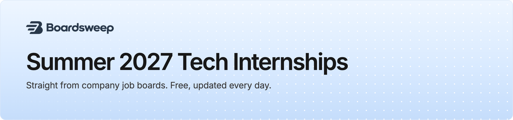

<a href="https://boardsweep.io/?utm_source=github&utm_medium=readme&utm_campaign=internships&utm_content=banner"><picture><source media="(prefers-color-scheme: dark)" srcset="assets/banner-internship-dark.png"></picture></a>

<a href="https://boardsweep.io/internships?utm_source=github&utm_medium=readme&utm_campaign=internships&utm_content=cta_email"><picture><source media="(prefers-color-scheme: dark)" srcset="assets/cta-email-dark.png"></picture></a>&nbsp;&nbsp;<a href="https://boardsweep.io/#pricing?utm_source=github&utm_medium=readme&utm_campaign=internships&utm_content=cta_instant"><picture><source media="(prefers-color-scheme: dark)" srcset="assets/cta-instant-dark.png"></picture></a>

> [!TIP]
> **This list runs a day behind.** The 85 internships we found in the last 24 hours are already in subscribers' inboxes, and appear here tomorrow. [Get a free daily email](https://boardsweep.io/internships?utm_source=github&utm_medium=readme&utm_campaign=internships&utm_content=tip_email), or [get each one the minute the company posts it](https://boardsweep.io/#pricing?utm_source=github&utm_medium=readme&utm_campaign=internships&utm_content=tip_instant) with the season pass (7 days free).

 

## Browse by field

| Field | Open now | New this week | |
| --- | ---: | ---: | --- |
| 💻 **[Software engineering](fields/software.md)** | 1,900 | 159 | [Email me these, free](https://boardsweep.io/internships/software?utm_source=github&utm_medium=readme&utm_campaign=internships&utm_content=browse_software) |
| 🤖 **[AI, ML and data](fields/aiml.md)** | 1,526 | 113 | [Email me these, free](https://boardsweep.io/internships/aiml?utm_source=github&utm_medium=readme&utm_campaign=internships&utm_content=browse_aiml) |
| 📈 **[Quant](fields/quant.md)** | 185 | 9 | [Email me these, free](https://boardsweep.io/internships/quant?utm_source=github&utm_medium=readme&utm_campaign=internships&utm_content=browse_quant) |
| 🔧 **[Hardware](fields/hardware.md)** | 894 | 133 | [Email me these, free](https://boardsweep.io/internships/hardware?utm_source=github&utm_medium=readme&utm_campaign=internships&utm_content=browse_hardware) |
| 📱 **[Product](fields/product.md)** | 312 | 36 | [Email me these, free](https://boardsweep.io/internships/product?utm_source=github&utm_medium=readme&utm_campaign=internships&utm_content=browse_product) |
| 🎨 **[Design](fields/design.md)** | 55 | 24 | [Email me these, free](https://boardsweep.io/internships/design?utm_source=github&utm_medium=readme&utm_campaign=internships&utm_content=browse_design) |
| 🛡️ **[Security](fields/security.md)** | 54 | 28 | [Email me these, free](https://boardsweep.io/internships/security?utm_source=github&utm_medium=readme&utm_campaign=internships&utm_content=browse_security) |

 

🔥 Top company &nbsp; ✨ Not on the other public lists &nbsp; ⚡ Minutes from posting to us &nbsp; 🛂 No visa sponsorship &nbsp; 🇺🇸 U.S. citizenship required &nbsp; 🎓 Advanced degree required

 

## Software engineering

This week's 159 of 1,900. <a href="fields/software.md">See all 1,900 (2 pages)</a> · <a href="https://boardsweep.io/internships/software?utm_source=github&utm_medium=readme&utm_campaign=internships&utm_content=track_software">Get only software engineering internships by email, free</a>

| Company | Role | Where and pay | Posted | &nbsp;Apply&nbsp; |
| --- | --- | --- | --- | :---: |
| &nbsp; **Invitation&nbsp;Homes** | Intern. Software Engineering | Dallas,&nbsp;TX-&nbsp;HQ - | Nov&nbsp;18 |  |
| &nbsp; **Airbnb** | Software Engineering Intern (BS/MS) 🔥 | San Francisco, CA $7,900/mo | Nov&nbsp;18 ⚡&nbsp;1m |  |
| &nbsp; **Peraton** | Summer 2027 Solution Architect Intern ✨ | - $28–&#8288;$38/hr | Nov&nbsp;18 |  |
| &nbsp; **United Wholesale Mortgage** | 2027 Technology Summer Internship Program ✨ | - | Nov&nbsp;18 |  |
| &nbsp; **Peraton** | Summer 2027 Business Analyst Intern ✨ | - $25–&#8288;$30/hr | Nov&nbsp;18 |  |
| ↳ | Summer 2027 Production Support Analyst Intern ✨ | - $25–&#8288;$30/hr | Nov&nbsp;18 |  |
| &nbsp; **GEI&nbsp;Consultants** | Web Developer Intern | Rancho Cordova, CA $23–&#8288;$27/hr | Nov&nbsp;17 |  |
| &nbsp; **Oracle** | Software Engineer New Grad Intern 🔥 | Nashville,&nbsp;TN $74,100–&#8288;$148,300/yr | Nov&nbsp;17 |  |
| &nbsp; **Raptor&nbsp;Maps** | Software Engineer Intern | Somerville,&nbsp;MA - | Nov&nbsp;17 |  |
| &nbsp; **Compunetix** | Software Engineer Co-op 🛂 | Monroeville,&nbsp;PA - | Nov&nbsp;17 |  |
| &nbsp; **Starwood Capital Group** | Agentic Engineering Intern | NYC $33.65–&#8288;$52.88/hr | Nov&nbsp;17 |  |
| ↳ | Data Intern | NYC - | Nov&nbsp;17 |  |
| &nbsp; **Constellation Energy** | IT Software Developer Intern | San&nbsp;Diego,&nbsp;CA - | Nov&nbsp;17 |  |
| &nbsp; **Lean&nbsp;Techniques** | Software Intern - Hybrid | Hybrid - | Nov&nbsp;17 ⚡&nbsp;38m |  |
| &nbsp; **Anduril** | 2027 Product Data Quality Co-op 🔥 ✨ | Santa&nbsp;Ana,&nbsp;CA $32–&#8288;$45/hr | Nov&nbsp;17 ⚡&nbsp;3m |  |
| &nbsp; **Exowatt** | Robotics &amp; Physical AI Spring Intern (Miami) | Miami,&nbsp;FL - | Nov&nbsp;17 ⚡&nbsp;13m |  |
| &nbsp; **Dark Wolf Solutions** | University of South Florida College Fair - Internship ✨ | Tampa,&nbsp;FL - | Nov&nbsp;17 ⚡&nbsp;13m |  |
| &nbsp; **Garmin** | Software Engineer Intern - Real Time Aviation Data | Chanhassen,&nbsp;MN - | Nov&nbsp;17 |  |
| **Basis Research Institute** | Electronics &amp; Sensing Engineer (Intern or Contractor) | New&nbsp;York&nbsp;Office $33–&#8288;$43/hr | Nov&nbsp;17 ⚡&nbsp;36m |  |
| &nbsp; **Walmart** | Summer 2027 Corporate Intern: Platform Stability &amp; Defect Prevention – Last Mile Delivery | Together Building AR Bentonville Home Office - | Nov&nbsp;17 |  |
| &nbsp; **Keysight Technologies** | R&amp;D Software Engineer C++/Python Internship ✨ | Gent, West Vlaanderen - | Nov&nbsp;17 |  |
| &nbsp; **Sedaro** | Compiler Intern - Simulator | Arlington,&nbsp;VA - | Nov&nbsp;17 |  |
| ↳ | Software Engineer Intern | Arlington,&nbsp;VA - | Nov&nbsp;17 |  |
| &nbsp; **ECM&nbsp;Tek** | Developer Intern - Python Development | Nashville,&nbsp;TN - | Nov&nbsp;17 |  |
| &nbsp; **IPConfigure** | Software Development for Video Surveillance Software Intern | Norfolk,&nbsp;VA - | Nov&nbsp;17 |  |
| &nbsp; **SecurityMetrics** | Software Engineer Intern | Orem,&nbsp;UT - | Nov&nbsp;17 |  |
| &nbsp; **T-Mobile** | Summer 2027 Software Engineering Intern ✨ | Overland Park, KS $27–&#8288;$50/hr | Nov&nbsp;17 |  |
| ↳ | Summer 2027 Software Engineering Intern ✨ | 2&nbsp;Locations $27–&#8288;$50/hr | Nov&nbsp;17 |  |
| ↳ | Summer 2027 Software Engineering AI Intern ✨ | Atlanta,&nbsp;GA $27–&#8288;$50/hr | Nov&nbsp;17 |  |
| ↳ | Summer 2027 Software Engineer Internship ✨ | Overland Park, KS $27–&#8288;$50/hr | Nov&nbsp;17 |  |
| &nbsp; **The&nbsp;New&nbsp;School** | Front End Developer &amp; UI/UX Designer - Student Assistant Specialist ✨ | 2&nbsp;Locations - | Nov&nbsp;17 |  |
| &nbsp; **RGA&nbsp;Reinsurance** | Summer Intern - Global Technology ✨ | United States, Creve Coeur, MO, CityPlace - | Nov&nbsp;17 |  |
| &nbsp; **Federal Ammunition** | Quality Engineering Internship - Remington Ammunition ✨ | Lonoke,&nbsp;AR - | Nov&nbsp;17 |  |
| **Clera** | Full-Stack Software Engineering Intern ✨ | New&nbsp;York $50/hr | Nov&nbsp;17 ⚡&nbsp;56m |  |
| &nbsp; **Regent** | Guidance, Navigation and Control (GNC) Intern ✨ | North Kingstown, RI - | Nov&nbsp;17 |  |
| &nbsp; **HexArmor** | Software Engineering Intern | Atlanta,&nbsp;GA - | Nov&nbsp;17 ⚡&nbsp;9m |  |
| &nbsp; **Falcomm** | AI/ML Software Engineer Graduate Intern - AI/CAD Integration 🎓 | Atlanta,&nbsp;GA - | Nov&nbsp;17 |  |
| ↳ | AI/ML Software Engineer Undergraduate Intern - AI/CAD Integration | Atlanta,&nbsp;GA - | Nov&nbsp;17 |  |
| &nbsp; **Bask&nbsp;Health** | Solutions Engineering Intern ✨ | - | Nov&nbsp;17 |  |
| &nbsp; **Thorlabs** | Summer 2027 Information Technology Internship ✨ | Jessup,&nbsp;MD - | Nov&nbsp;17 |  |
| &nbsp; **Arcadis** | Control, Automation &amp; Energy Systems Engineering Intern ✨ | Los&nbsp;Angeles,&nbsp;CA $26–&#8288;$37/hr | Nov&nbsp;17 |  |
| &nbsp; **Amazon** | Software Development Engineer Intern - Artificial General Intelligence (Summer 2027) 🔥 ✨ | Sunnyvale,&nbsp;CA - | Nov&nbsp;17 |  |
| &nbsp; **Tesla** | Internship, Integration Engineer, Factory Firmware (Winter/Spring 2027) 🔥 | Austin,&nbsp;TX - | Nov&nbsp;17 |  |
| ↳ | Internship, Supercharger SIL Test Infrastructure Software Engineer, Energy Engineering (Winter/Spring 2027) 🔥 | Palo&nbsp;Alto,&nbsp;CA - | Nov&nbsp;17 |  |
| ↳ | Internship, Data Engineer, Applications Engineering (Winter/Spring 2027) 🔥 | Fremont,&nbsp;CA - | Nov&nbsp;17 |  |
| &nbsp; **SRI&nbsp;International** | Software Engineering Co-op 🛂 | Princeton,&nbsp;NJ $20–&#8288;$27/hr | Nov&nbsp;17 |  |
| &nbsp; **Bound** | Engineering Intern | Ames,&nbsp;IA - | Nov&nbsp;16 |  |
| &nbsp; **Anduril** | 2027 Mission Operations Engineer Intern 🔥 | 2&nbsp;locations $28–&#8288;$45/hr | Nov&nbsp;16 ⚡&nbsp;3m |  |
| &nbsp; **ServiceNow** | Associate Forward Deployed Solution Engineer Intern (Bachelors Summer 2027) 🔥 | Santa&nbsp;Clara - | Nov&nbsp;16 |  |
| ↳ | Forward Deployed Solution Engineer Intern (Masters Summer 2027) 🔥 🎓 | Santa&nbsp;Clara - | Nov&nbsp;16 |  |
| &nbsp; **Forterra** | Software Engineer Intern | 5&nbsp;locations $30–&#8288;$40/hr | Nov&nbsp;16 |  |
| &nbsp; **Anduril** | 2027 Deployment Operations Intern 🔥 ✨ | Quincy,&nbsp;MA $28–&#8288;$45/hr | Nov&nbsp;16 ⚡&nbsp;4m |  |
| &nbsp; **LinkedIn** | Systems &amp; Infrastructure Engineer Intern, Masters - Summer 2027 (Mountain View, CA) 🔥 🎓 | Mountain&nbsp;View $60–&#8288;$70/hr | Nov&nbsp;16 |  |
| &nbsp; **Walter&nbsp;P&nbsp;Moore** | Engineering Intern Structures ✨ | - | Nov&nbsp;16 |  |
| &nbsp; **CesiumAstro** | Summer 2027 - Software Engineering Internship 🛂 | Austin,&nbsp;TX - | Nov&nbsp;16 |  |
| &nbsp; **Boston&nbsp;Scientific** | Supplier Engineering Intern ✨ 🛂 | Arden&nbsp;Hills,&nbsp;MN $43,368/yr | Nov&nbsp;16 |  |
| &nbsp; **Minitab** | Software Engineering Intern | State College, PA - | Nov&nbsp;16 ⚡&nbsp;7m |  |
| &nbsp; **Toyota Research Institute** | Robotics Intern, World Models, Multimodal Sensing | Cambridge,&nbsp;MA - | Nov&nbsp;16 ⚡&nbsp;7m |  |
| &nbsp; **ASML** | Internship - Integrate GUI and LLM | San&nbsp;Jose,&nbsp;CA - | Nov&nbsp;16 |  |
| &nbsp; **Bread&nbsp;Financial** | Intern - Software Engineering ✨ | 5&nbsp;Locations - | Nov&nbsp;16 |  |
| &nbsp; **Pacific&nbsp;Fusion** | Summer 2027 Vacuum Systems Engineering Internship | San&nbsp;Leandro,&nbsp;CA $30–&#8288;$48/hr | Nov&nbsp;16 ⚡&nbsp;1m |  |
| ↳ | Summer 2027 Modeling and Simulation Intern ✨ 🎓 | San&nbsp;Leandro,&nbsp;CA $30–&#8288;$48/hr | Nov&nbsp;16 ⚡&nbsp;2m |  |
| ↳ | Summer 2027 HPC/DevOps Engineering Intern | San&nbsp;Leandro,&nbsp;CA $30–&#8288;$48/hr | Nov&nbsp;16 ⚡&nbsp;2m |  |
| &nbsp; **Colliers** | Information Technology/Application Development Internship ✨ | Minneapolis,&nbsp;MN - | Nov&nbsp;16 |  |
| ↳ | Business Systems/Salesforce Internship ✨ | Minneapolis,&nbsp;MN - | Nov&nbsp;16 |  |
| **Integration Innovation** | Embedded Systems Reverse Engineer Intern ✨ 🛂 | - $25–&#8288;$48/hr | Nov&nbsp;16 |  |
| &nbsp; **Altice&nbsp;USA** | Data Analyst Intern - Modernization Program BSS/OSS Migration | Bethpage,&nbsp;NY - | Nov&nbsp;16 |  |
| ↳ | Software Developer Intern 🛂 | Bethpage,&nbsp;NY $25/hr | Nov&nbsp;16 |  |
| **I3&nbsp;Corps** | Embedded Systems Reverse Engineer Intern 🛂 | Washington,&nbsp;DC $25–&#8288;$48/hr | Nov&nbsp;16 |  |
| &nbsp; **Analog&nbsp;Devices** | Software Engineering Intern (Medical Device &amp; Healthcare Integration) ✨ | US, MA, Wilmington - | Nov&nbsp;16 |  |
| &nbsp; **Octaura** | Intern, Data Engineering | New&nbsp;York - | Nov&nbsp;16 |  |
| &nbsp; **Sherwin&nbsp;Williams** | R&amp;D PCG Summer Graduate Internship- Minneapolis, MN ✨ 🛂 🎓 | Minneapolis,&nbsp;MN - | Nov&nbsp;16 |  |
| &nbsp; **SAS** | Summer 2027 – Optimization Intern (Master&#x27;S) 🎓 | Cary,&nbsp;NC $15–&#8288;$30/hr | Nov&nbsp;16 |  |
| &nbsp; **JMP Statistical Discovery** | Jmp 2027 Summer Internship Research &amp; Development (Master&#x27;S Phd) 🎓 | Cary,&nbsp;NC $15–&#8288;$30/hr | Nov&nbsp;16 |  |
| &nbsp; **Tesla** | Internship, Software Engineer, Build &amp; Simulation Platform (Winter/Spring 2027) 🔥 | Palo&nbsp;Alto,&nbsp;CA - | Nov&nbsp;16 |  |
| &nbsp; **SRI&nbsp;International** | Embedded Software Engineering Co-op 🛂 | Princeton,&nbsp;NJ $20–&#8288;$27/hr | Nov&nbsp;16 |  |
| ↳ | Software Engineering/Full Stack Development Co-op 🛂 | Princeton,&nbsp;NJ $20–&#8288;$27/hr | Nov&nbsp;16 |  |
| &nbsp; **Viavi&nbsp;Solutions** | Software Engineering Co-op | Germantown,&nbsp;MD - | Nov&nbsp;15 |  |
| &nbsp; **Zoox** | Feature Integration Intern [Summer 2027] 🔥 ✨ | Foster&nbsp;City,&nbsp;CA - | Nov&nbsp;14 |  |
| &nbsp; **SAS** | Summer 2027 Software Developer Intern (Go Golang Experience) | Cary,&nbsp;NC $15–&#8288;$30/hr | Nov&nbsp;14 |  |
| &nbsp; **Amazon** | Data Center Infrastructure Engineer Intern, Summer 2027 - East 🔥 ✨ | Herndon,&nbsp;VA - | Nov&nbsp;14 |  |
| ↳ | Data Center Infrastructure Engineer Intern, Summer 2027 - West Coast 🔥 ✨ | Umatilla,&nbsp;OR - | Nov&nbsp;14 |  |
| &nbsp; **Idemia** | Software Engineering Internship Enrollment And Credentialing Services ✨ | - $25/hr | Nov&nbsp;13 |  |
| &nbsp; **NextEra&nbsp;Energy** | Software Engineering Intern - Technical | St&nbsp;Paul,&nbsp;MN - | Nov&nbsp;13 |  |
| &nbsp; **Conagra&nbsp;Brands** | Engineering Internship ✨ | Russellville,&nbsp;AR $20/hr | Nov&nbsp;13 |  |
| &nbsp; **KCI&nbsp;Technologies** | Transportation Engineering Intern ✨ | - | Nov&nbsp;13 |  |
| &nbsp; **Electric Power Engineers** | Software Power Systems Engineering Intern ✨ 🎓 | - | Nov&nbsp;13 |  |
| &nbsp; **Strattec** | Engineering Intern ✨ | - | Nov&nbsp;13 |  |
| &nbsp; **Idemia** | Full Stack Software Engineering Internship ✨ | - $20/hr | Nov&nbsp;13 |  |
| **Aurora&nbsp;Operations** | Embedded Software Engineer Intern — Lidar | Bozeman,&nbsp;MT $52/hr | Nov&nbsp;13 |  |
| &nbsp; **Genentech** | 2027 Summer Intern - Computational Science ✨ 🎓 | Santa&nbsp;Clara $47–&#8288;$52/hr | Nov&nbsp;13 |  |
| &nbsp; **AstraZeneca** | Site Support Intern ✨ | US - Rockville -, MD $25/hr | Nov&nbsp;13 |  |
| &nbsp; **Daimler&nbsp;Truck** | IT Developer Analyst Intern ✨ | Mount&nbsp;Holly,&nbsp;NC $21–&#8288;$29/hr | Nov&nbsp;13 |  |
| ↳ | IT Developer Analyst Intern | Mount&nbsp;Holly,&nbsp;NC - | Nov&nbsp;13 |  |
| &nbsp; **Bloom&nbsp;Energy** | Process Development Engineering Intern ✨ 🛂 | San&nbsp;Jose,&nbsp;CA $36–&#8288;$50/hr | Nov&nbsp;13 |  |
| &nbsp; **CACI** | Operations Intern (AI Tool Integration and Operational Testing - Summer 2027 ✨ | 2&nbsp;Locations $39,400–&#8288;$63,900/yr | Nov&nbsp;13 |  |
| **Pyrotek3** | Engineering Intern - Summer 2027 ✨ | Sanborn $22/hr | Nov&nbsp;13 |  |
| &nbsp; **Samsung Semiconductor** | Intern, ML Compiler (Kernel Auto-Tuning) | San&nbsp;Jose,&nbsp;CA $28–&#8288;$68/hr | Nov&nbsp;13 ⚡&nbsp;4m |  |
| &nbsp; **Sierra Nevada Corporation** | Systems Engineer Intern ✨ 🛂 | Southern Pines, NC - | Nov&nbsp;13 |  |
| &nbsp; **Valeo** | Software Engineer Intern (Year-Round) | Troy,&nbsp;MI - | Nov&nbsp;13 |  |
| &nbsp; **Reliable&nbsp;Robotics** | Supplier Engineering Intern (Summer 2027) ✨ | Mountain View, CA $105k/yr | Nov&nbsp;13 |  |
| ↳ | Flight Simulation Engineering Intern (Summer 2027) ✨ | Mountain View, CA $128k/yr | Nov&nbsp;13 |  |
| ↳ | Flight Control Law Intern (Summer 2027) ✨ | Mountain View, CA $128k/yr | Nov&nbsp;13 |  |
| ↳ | Flight Guidance Intern (Summer 2027) ✨ | Mountain View, CA $128k/yr | Nov&nbsp;13 |  |
| ↳ | Flight Navigation Intern (Summer 2027) ✨ | Mountain View, CA $128k/yr | Nov&nbsp;13 |  |
| &nbsp; **TRC&nbsp;Companies** | Substation Engineering Intern ✨ | Irvine,&nbsp;CA $20–&#8288;$28/hr | Nov&nbsp;13 |  |
| &nbsp; **Rocket&nbsp;Mortgage** | Financial Systems Intern - Summer 2027 ✨ | Detroit,&nbsp;MI - | Nov&nbsp;13 |  |
| &nbsp; **Leidos** | Chief Engineer Intern ✨ 🛂 | 6314 Remote/Teleworker $48,100–&#8288;$86,950/yr | Nov&nbsp;13 |  |
| &nbsp; **Olsson** | Engineering Internship - Building Automation Systems ✨ | Omaha,&nbsp;NE - | Nov&nbsp;13 |  |
| &nbsp; **Shield&nbsp;AI** | 2027 Summer Intern - Future Concepts - 6539 🔥 ✨ | Washington,&nbsp;D.C. $35–&#8288;$97/hr | Nov&nbsp;13 ⚡&nbsp;4m |  |
| ↳ | 2027 Summer Intern - Human Machine Teaming - 6532 🔥 ✨ | Washington,&nbsp;D.C. $48–&#8288;$67/hr | Nov&nbsp;13 ⚡&nbsp;4m |  |
| &nbsp; **Tesla** | Software Engineer Intern - Energy Engineering 🔥 | Palo&nbsp;Alto,&nbsp;CA - | Nov&nbsp;13 |  |
| &nbsp; **Samsung Semiconductor** | Intern, Compiler Engineer | San&nbsp;Jose,&nbsp;CA $28–&#8288;$68/hr | Nov&nbsp;13 ⚡&nbsp;11m |  |
| &nbsp; **AT&amp;T** | AT&amp;T Labs Internship – Advanced Degrees ✨ 🎓 | Bedminster,&nbsp;NJ $87,200–&#8288;$130,800/yr | Nov&nbsp;13 |  |
| &nbsp; **Motorola Solutions** | Operations - 2027 Summer Internship ✨ | Chicago,&nbsp;IL - | Nov&nbsp;13 |  |
| **Nexus&nbsp;Cognitive** | Data Engineering Intern | Atlanta&nbsp;HQ - | Nov&nbsp;13 |  |
| &nbsp; **Reliable&nbsp;Robotics** | Flight Software Engineer Intern (Summer 2027) | Mountain View, CA $128k/yr | Nov&nbsp;13 |  |
| &nbsp; **Camping&nbsp;World** | Software Engineering Intern | Lincolnshire,&nbsp;IL - | Nov&nbsp;13 |  |
| ↳ | Data Engineering Intern | Chicago,&nbsp;IL - | Nov&nbsp;13 |  |
| &nbsp; **Capital&nbsp;Group** | CAMPUS Global Technology Summer Associate (2027) 🛂 | Irvine - | Nov&nbsp;13 |  |
| &nbsp; **Manulife Financial** | Spring Co-op 2027 - Software Engineering Intern | Boston,&nbsp;MA - | Nov&nbsp;13 |  |
| &nbsp; **RTX** | Software Engineering Co-op (Summer/Fall) | Richardson,&nbsp;TX - | Nov&nbsp;13 |  |
| **Aurora&nbsp;Operations** | Software Engineer Intern, Vehicle Platforms | Mountain View, CA $52/hr | Nov&nbsp;13 |  |
| &nbsp; **Blizzard Entertainment** | Animation &amp; Cinematic Tools Engineering Intern - Animation &amp; Cinematic Tools Engineering | Irvine,&nbsp;CA $20–&#8288;$50/hr | Nov&nbsp;13 |  |
| &nbsp; **Martin&nbsp;Marietta** | Software Data Integration Engineer Intern | Raleigh,&nbsp;NC - | Nov&nbsp;13 |  |
| &nbsp; **Cintas** | IT OT Software Engineer Intern | Mason,&nbsp;OH - | Nov&nbsp;12 |  |
| &nbsp; **Zoox** | Firmware Engineer Intern - FW Core System Services 🔥 | 3&nbsp;locations - | Nov&nbsp;12 ⚡&nbsp;&lt;1m |  |
| &nbsp; **Muon&nbsp;Space** | Software Engineering Intern-Information Systems (Summer 2027) | San&nbsp;Jose,&nbsp;CA $40/hr | Nov&nbsp;12 ⚡&nbsp;7m |  |
| &nbsp; **Octant&nbsp;Bio** | Software Engineer - Internship | Emeryville,&nbsp;CA $1,500–&#8288;$2,000/wk | Nov&nbsp;12 |  |
| &nbsp; **Leidos** | Junior Software Engineer / Data Scientist Intern 🛂 | Tucson,&nbsp;AZ $48,100–&#8288;$86,950/yr | Nov&nbsp;12 |  |
| &nbsp; **Eversource&nbsp;Energy** | 2027 Summer:  Grid Operations Technology Intern ✨ 🛂 | Windsor,&nbsp;CT $21.20/hr | Nov&nbsp;12 |  |
| ↳ | 2027 Summer: Distribution Engineering Intern-NH ✨ 🛂 | Portsmouth,&nbsp;NH $21.20/hr | Nov&nbsp;12 |  |
| &nbsp; **Entegris** | Power Platform / Copilot Studio Intern – AI - Summer Intern ✨ 🛂 | Aurora,&nbsp;IL $20–&#8288;$30/hr | Nov&nbsp;12 |  |
| &nbsp; **North Atlantic Industries** | Intern - Embedded Software Engineer (Spring 2027) 🛂 | Bohemia,&nbsp;NY $17.50–&#8288;$27/hr | Nov&nbsp;12 |  |
| &nbsp; **GDIT** | Professional Programmer - Intern 🛂 | Raleigh,&nbsp;NC $27.20–&#8288;$36.80/hr | Nov&nbsp;12 |  |
| &nbsp; **Csusystem** | MLIC Metadata Intern ✨ | Fort&nbsp;Collins,&nbsp;CO $17/hr | Nov&nbsp;12 |  |
| &nbsp; **Walmart** | Summer 2027 Corporate Intern: APD Automation Engineer ✨ 🛂 | Together Building AR Bentonville Home Office - | Nov&nbsp;12 |  |
| ↳ | Summer 2027 Corporate Intern: eCommerce Site Experience ✨ 🛂 | Bentonville,&nbsp;AR $21–&#8288;$40/hr | Nov&nbsp;12 |  |
| ↳ | Summer 2027 Corporate Intern: eCommerce Site Experience ✨ 🛂 | Bentonville,&nbsp;AR $21–&#8288;$40/hr | Nov&nbsp;12 |  |
| &nbsp; **PTC** | Onshape Site Reliability Engineering Intern (Summer 2027) ✨ 🛂 | Boston,&nbsp;MA $32–&#8288;$36/hr | Nov&nbsp;12 |  |
| &nbsp; **Motorola Solutions** | North America (NA) Systems Engineering Operations Internship  - 2027 | Chicago, IL, More... - | Nov&nbsp;12 |  |
| **F7d8749a 72d6 407c Bf98 292ea630c73a** | 2027 Summer Intern - Solution Systems Engineer (6537, 6540, 6541) | San&nbsp;Diego,&nbsp;CA - | Nov&nbsp;12 |  |
| **Global Infrastructure** | Transportation Engineering Intern ✨ | 3&nbsp;locations $23–&#8288;$26/hr | Nov&nbsp;12 |  |
| &nbsp; **Eversource&nbsp;Energy** | 2027 Gas Systems Engineering Co-op ✨ 🛂 | 2&nbsp;Locations - | Nov&nbsp;12 |  |
| ↳ | 2027 Summer Grid Ops Technology Intern (NH) ✨ 🛂 | Manchester,&nbsp;NH $21.20/hr | Nov&nbsp;12 |  |
| &nbsp; **Shield&nbsp;AI** | 2027 Summer Intern - Systems 🔥 | San&nbsp;Diego,&nbsp;CA $38–&#8288;$55/hr | Nov&nbsp;12 ⚡&nbsp;2m |  |
| &nbsp; **Copart** | AV Engineer Intern ✨ | US Tech Infra/Ops 729 - | Nov&nbsp;12 |  |
| &nbsp; **Argonne National Laboratory** | Intern – Business Information Systems, Enterprise Software Solutions ✨ 🛂 | Lemont,&nbsp;IL $21.52–&#8288;$29.05/hr | Nov&nbsp;12 |  |
| &nbsp; **American&nbsp;Fidelity** | Salesforce Intern (Oklahoma City Office) ✨ | Oklahoma City, OK - | Nov&nbsp;12 |  |
| &nbsp; **The Aerospace Corporation** | 2027 Guidance, Navigation, and Control Graduate Intern ✨ 🛂 | El&nbsp;Segundo,&nbsp;CA $32–&#8288;$38/hr | Nov&nbsp;12 |  |
| &nbsp; **Atalanta** | Forward Deployed Engineer Intern | Washington&nbsp;D.C. $100k–&#8288;$150k/yr | Nov&nbsp;12 |  |
| ↳ | Software Engineer Intern | Washington&nbsp;D.C. $100k–&#8288;$150k/yr | Nov&nbsp;12 |  |
| &nbsp; **Zoox** | Systems &amp; Safety Engineering Intern [Summer 2027] 🔥 | Foster&nbsp;City,&nbsp;CA - | Nov&nbsp;12 |  |
| &nbsp; **Stack&nbsp;AV** | Research Intern (PhD), Autonomy 🎓 | Pittsburgh, PA or Remote - | Nov&nbsp;12 |  |
| &nbsp; **Northrop&nbsp;Grumman** | 2027 Systems Engineering Intern - Graduate Level - Plymouth MN ✨ 🛂 🎓 | United States-Minnesota-Plymouth $35.50–&#8288;$44.75/hr | Nov&nbsp;12 |  |
| &nbsp; **SharkNinja** | Spring 2027: Digital &amp; Website Technology Intern ✨ | Needham,&nbsp;MA $26–&#8288;$33/hr | Nov&nbsp;12 ⚡&nbsp;13m |  |
| &nbsp; **RTX** | Systems Engineering Intern (Summer 2027) ✨ 🛂 | Marlborough,&nbsp;MA - | Nov&nbsp;12 |  |
| &nbsp; **General Dynamics Mission Systems** | Software Asset Management Intern Administrative ✨ 🛂 | - | Nov&nbsp;12 |  |
| &nbsp; **Johns&nbsp;Hopkins&nbsp;APL** | 2027 Internship - Oceanic, Atmospheric, and Remote Sensing Sciences ✨ | Laurel,&nbsp;MD $22.60/hr | Nov&nbsp;12 |  |

 

## AI, ML and data

This week's 113 of 1,526. <a href="fields/aiml.md">See all 1,526 (2 pages)</a> · <a href="https://boardsweep.io/internships/aiml?utm_source=github&utm_medium=readme&utm_campaign=internships&utm_content=track_aiml">Get only ai, ml and data internships by email, free</a>

| Company | Role | Where and pay | Posted | &nbsp;Apply&nbsp; |
| --- | --- | --- | --- | :---: |
| &nbsp; **Boston&nbsp;Scientific** | Healthcare Solutions and Partnerships Data Analyst Intern ✨ | Utrecht,&nbsp;UT,&nbsp;NL - | Nov&nbsp;18 |  |
| &nbsp; **Robert Bosch Venture Capital** | Robot Learning Research Intern | Pittsburgh - | Nov&nbsp;18 |  |
| &nbsp; **Microsoft** | Research Intern - Frontier Tuning 🔥 | 7&nbsp;locations - | Nov&nbsp;17 |  |
| &nbsp; **Blount&nbsp;Fine&nbsp;Foods** | Manufacturing Operations Analytics Intern | Fall&nbsp;River,&nbsp;MA $19–&#8288;$20/hr | Nov&nbsp;17 |  |
| &nbsp; **CMI&nbsp;Media&nbsp;Group** | Business Insights Intern | Chicago,&nbsp;IL $17–&#8288;$18/hr | Nov&nbsp;17 |  |
| **New York City Housing Development Corporation** | Strategic Operations Graduate Intern 🎓 | NYC $20/hr | Nov&nbsp;17 |  |
| &nbsp; **Toyota Research Institute** | Future Product Innovation Research Intern, Computational Cognitive Science ✨ 🎓 | Los&nbsp;Altos,&nbsp;CA - | Nov&nbsp;17 ⚡&nbsp;4m |  |
| &nbsp; **Cloudflare** | AI &amp; Automation Intern, Communications (Winter 2027) 🔥 🛂 | In-Office $27/hr | Nov&nbsp;17 |  |
| &nbsp; **Anduril** | 2027 Machine Learning Engineer Intern 🔥 | Santa&nbsp;Ana,&nbsp;CA $42–&#8288;$60/hr | Nov&nbsp;17 ⚡&nbsp;1m |  |
| **Warp&nbsp;Sciences** | Member of Technical Staff Intern - Robotics Learning | South San Francisco - | Nov&nbsp;17 |  |
| &nbsp; **Attain&nbsp;Partners** | Summer 2027 Data Analytics Intern | Mclean,&nbsp;VA $17/hr | Nov&nbsp;17 ⚡&nbsp;15m |  |
| &nbsp; **BGE** | Business Analyst Intern - GIS | Oakbrook Terrace, IL $20/hr | Nov&nbsp;17 |  |
| &nbsp; **Toyota Research Institute** | Robotics Intern, Agentic Robotics | Cambridge,&nbsp;MA - | Nov&nbsp;17 ⚡&nbsp;6m |  |
| &nbsp; **Johns&nbsp;Hopkins&nbsp;APL** | 2027 Internship - National Security Analysis ✨ | Laurel,&nbsp;MD $22.60/hr | Nov&nbsp;17 |  |
| &nbsp; **Publicis&nbsp;Groupe** | PhD Data Science Intern 🎓 | 5&nbsp;locations $55–&#8288;$60/hr | Nov&nbsp;17 |  |
| ↳ | PhD Data Visualization Intern 🎓 | 5&nbsp;locations $55–&#8288;$60/hr | Nov&nbsp;17 |  |
| ↳ | PhD Data Visualization Intern 🎓 | 5&nbsp;locations $55–&#8288;$60/hr | Nov&nbsp;17 |  |
| &nbsp; **Bissell** | AI &amp; Automation Intern | Grand&nbsp;Rapids,&nbsp;MI - | Nov&nbsp;17 |  |
| &nbsp; **Robert Bosch Venture Capital** | AI Application Intern (8 months/40 hours per week) | Farmington&nbsp;Hills - | Nov&nbsp;17 |  |
| &nbsp; **FPWA** | Data &amp; Fiscal Policy Intern | NYC - | Nov&nbsp;17 |  |
| &nbsp; **TikTok** | Research Scientist Intern - Privacy Innovation Lab 🔥 | San&nbsp;Jose,&nbsp;CA $60/hr | Nov&nbsp;17 |  |
| &nbsp; **Birdseye Security Solutions** | Computer Vision Intern | Dallas,&nbsp;TX - | Nov&nbsp;17 |  |
| ↳ | AI Systems Intern | Dallas,&nbsp;TX - | Nov&nbsp;17 |  |
| &nbsp; **T-Mobile** | Summer 2027 AI Engineering Internship ✨ | Bellevue,&nbsp;WA $27–&#8288;$50/hr | Nov&nbsp;17 |  |
| &nbsp; **Lawrence Livermore National Laboratory** | Atmospheric, Earth &amp; Energy Undergraduate Intern - Summer 2027 ✨ | Livermore $23.26–&#8288;$31.62/hr | Nov&nbsp;17 |  |
| ↳ | Atmospheric, Earth, &amp; Energy Graduate Intern - Summer 2027 ✨ 🎓 | Livermore $6,752–&#8288;$8,201/mo | Nov&nbsp;17 |  |
| &nbsp; **Genuine Parts Company** | Technology Intern 2027 ✨ | Atlanta,&nbsp;GA - | Nov&nbsp;17 |  |
| &nbsp; **PACCAR** | 2027 Summer Internship: Data Scientist | Denton, TX, US, 76205-7864 - | Nov&nbsp;17 |  |
| **Basis Research Institute** | Research Intern, Summer 2027 🎓 | New&nbsp;York&nbsp;Office $100k/yr | Nov&nbsp;17 |  |
| &nbsp; **SAS** | Summer 2027 – IOT Analytics Intern (Master&#x27;S) 🎓 | Cary,&nbsp;NC $15–&#8288;$30/hr | Nov&nbsp;17 |  |
| ↳ | Summer 2027 – Econometrics Intern (Master&#x27;S) 🎓 | Cary,&nbsp;NC $15–&#8288;$30/hr | Nov&nbsp;17 |  |
| &nbsp; **Duetti** | Data Intern | NYC $48k–&#8288;$67,200/yr | Nov&nbsp;16 |  |
| &nbsp; **NeuroSpark** | AI Hardware Optimization Engineer Intern | Santa&nbsp;Clara,&nbsp;CA - | Nov&nbsp;16 |  |
| ↳ | AI Inference &amp; Training Framework Engineer Intern | Santa&nbsp;Clara,&nbsp;CA - | Nov&nbsp;16 |  |
| &nbsp; **Meta** | Visiting Researcher Intern - AI Mentorship Program 🔥 | 5&nbsp;locations - | Nov&nbsp;16 |  |
| ↳ | Research Scientist Intern, Perception, Displays and Graphics (PhD) 🔥 🎓 | Sunnyvale,&nbsp;CA - | Nov&nbsp;16 |  |
| &nbsp; **Sanofi** | 2027 Summer Co op Scientific Data Support Analyst Vaccines Waltham MA ✨ | Waltham,&nbsp;MA - | Nov&nbsp;16 |  |
| &nbsp; **Bloomberg** | Data Analyst Intern 🔥 ✨ | Arlington, VA - 1801 S Bell - | Nov&nbsp;16 |  |
| &nbsp; **Formlabs** | Customer Strategy &amp; Analytics MBA Intern (Summer 2027) ✨ | Somerville,&nbsp;MA $2,750/wk | Nov&nbsp;16 ⚡&nbsp;15m |  |
| &nbsp; **Bread&nbsp;Financial** | Intern - Business Intelligence ✨ | Columbus,&nbsp;OH - | Nov&nbsp;16 |  |
| &nbsp; **Toyota Research Institute** | Automated Driving Advanced Development Intern, Machine Learning Research (Cambridge) | Cambridge,&nbsp;MA - | Nov&nbsp;16 ⚡&nbsp;3m |  |
| &nbsp; **Meta** | Research Scientist Intern, Intelligent Camera Systems (PhD) 🔥 🎓 | Redmond,&nbsp;WA - | Nov&nbsp;16 |  |
| &nbsp; **bioMérieux** | Machine Learning Co-Op | Durham,&nbsp;NC $22/hr | Nov&nbsp;16 |  |
| &nbsp; **Constellation Brands** | Intern, Data and AI Enablement ✨ | 2&nbsp;Locations - | Nov&nbsp;16 |  |
| &nbsp; **Toyota Research Institute** | Research Intern, Spatial Intelligence for Robotics | Cambridge,&nbsp;MA - | Nov&nbsp;16 ⚡&nbsp;11m |  |
| &nbsp; **Robert Bosch Venture Capital** | Research Intern: Multimodal Foundation Models for Healthcare 🎓 | Pittsburgh - | Nov&nbsp;16 |  |
| ↳ | Research Intern: Multimodal Sensor Foundation Models 🎓 | Pittsburgh - | Nov&nbsp;16 |  |
| &nbsp; **Boston&nbsp;Scientific** | Product Data Analyst Intern 🛂 | Marlboro,&nbsp;MA $44,616/yr | Nov&nbsp;16 |  |
| ↳ | AI Acceleration Intern 🛂 | Marlboro,&nbsp;MA $44,616/yr | Nov&nbsp;16 |  |
| ↳ | AI Engineering Intern (Generative &amp; Agentic AI) 🛂 | Marlboro,&nbsp;MA $44,616/yr | Nov&nbsp;16 |  |
| &nbsp; **TikTok** | Client Security &amp; Data Foundation Machine Learning Engineer - Intern (TikTok BRIC) - 2027 Start (PhD) 🔥 🎓 | San&nbsp;Jose,&nbsp;CA $60/hr | Nov&nbsp;16 |  |
| &nbsp; **NVIDIA** | Applied Research Scientist Intern, Agentic Biology - Summer 2027 🔥 | US, CA, Santa Clara - | Nov&nbsp;16 |  |
| &nbsp; **Carnegie Mellon University** | AI Engineer Intern - Mission Innovation Lab (Summer 2027) 🛂 | Pittsburgh,&nbsp;PA - | Nov&nbsp;16 |  |
| &nbsp; **SAS** | Summer 2027 – Time Series Foundation Model (Tsfm) Intern | Cary,&nbsp;NC $15–&#8288;$30/hr | Nov&nbsp;16 |  |
| &nbsp; **NVIDIA** | Applied Research Scientist Intern, Agentic Biology - Summer 2027 🔥 ✨ | Santa&nbsp;Clara,&nbsp;CA - | Nov&nbsp;16 |  |
| &nbsp; **Vertiv** | Innovation/ATLAS Lab Spring 2027 Intern | Delaware,&nbsp;OH - | Nov&nbsp;16 |  |
| **Fanatics Collectibles** | Summer 2027 Internship - Manufacturing Planning &amp; Analytics Intern ✨ | Sunnyvale,&nbsp;TX - | Nov&nbsp;15 |  |
| &nbsp; **Northwell&nbsp;Health** | Emerging Technology &amp; AI Internship ✨ | New Hyde Park, Nassau - | Nov&nbsp;15 |  |
| &nbsp; **Microsoft** | Research Intern - AI Coding Agents 🔥 | Redmond,&nbsp;WA - | Nov&nbsp;13 |  |
| &nbsp; **Genentech** | 2027 Summer Intern - Translational Pharmacokinetics &amp; Pharmacodynamics (tPKPD): QSP Modeling in Cardiovascular, Renal and Metabolic Diseases ✨ 🎓 | South San Francisco $52/hr | Nov&nbsp;13 |  |
| &nbsp; **ServiceNow** | AI Identity Intern 🔥 ✨ | Kirkland $58.96/hr | Nov&nbsp;13 |  |
| &nbsp; **FieldPulse** | AI Intern | Dallas,&nbsp;TX - | Nov&nbsp;13 |  |
| &nbsp; **The Allen Institute for Artificial Intelligence** | Research Internship, AI for Neuroscience ✨ | Seattle,&nbsp;WA $94,320/yr | Nov&nbsp;13 ⚡&nbsp;1m |  |
| &nbsp; **Walmart** | Summer 2027 Corporate Intern: Last Mile Delivery Data Science Intern ✨ | Together Building AR Bentonville Home Office $21–&#8288;$40/hr | Nov&nbsp;13 |  |
| &nbsp; **Vizient** | 2027 Summer Internship - Data &amp; Digital Finance Business Partner ✨ | Chicago, IL 60607 $25/hr | Nov&nbsp;13 |  |
| &nbsp; **NREL** | Undergraduate/Graduate Internship – Biochemistry/Molecular Biology/Fermentation ✨ | Golden,&nbsp;CO - | Nov&nbsp;13 |  |
| &nbsp; **Fresenius Medical Care** | Analytics and AI Business Analyst Co-op ✨ | Lawrence,&nbsp;MA - | Nov&nbsp;13 |  |
| &nbsp; **Bristol-Myers Squibb** | Data &amp; Quantitative Sciences Statistical Programming Intern - Summer 2027 ✨ | 7&nbsp;Locations - | Nov&nbsp;13 |  |
| &nbsp; **ASML** | Internship - EUV Data Science and Analytics | Austin,&nbsp;TX - | Nov&nbsp;13 |  |
| &nbsp; **Microsoft** | Research Intern - Microsoft Research Software-Hardware Co-design 🔥 | Redmond,&nbsp;WA - | Nov&nbsp;13 |  |
| &nbsp; **Martin&nbsp;Marietta** | Intern, Data Scientist | Raleigh,&nbsp;NC - | Nov&nbsp;13 |  |
| &nbsp; **Toyota Research Institute** | Research Intern, Continual Adaptation for Robotics | Cambridge,&nbsp;MA - | Nov&nbsp;13 ⚡&nbsp;46m |  |
| &nbsp; **Flagship Pioneering** | Pioneering Medicines: Research Co-Op, Mechanism of Action – Metabolic Disease ✨ | Cambridge,&nbsp;MA $25–&#8288;$35/hr | Nov&nbsp;13 ⚡&nbsp;26m |  |
| &nbsp; **Samsung Semiconductor** | Intern, AI Systems Performance Engineer | San&nbsp;Jose,&nbsp;CA $28–&#8288;$68/hr | Nov&nbsp;13 ⚡&nbsp;4m |  |
| &nbsp; **Meta** | Research Scientist Intern, Diffractive Optics (PhD) 🔥 🎓 | Redmond,&nbsp;WA - | Nov&nbsp;13 |  |
| &nbsp; **Ramp** | Risk Strategy Intern 🔥 ✨ | New&nbsp;York,&nbsp;NY $8,000/mo | Nov&nbsp;13 ⚡&nbsp;4m |  |
| &nbsp; **Hiebing** | AI Agent Developer Intern | Madison,&nbsp;WI $15/hr | Nov&nbsp;13 |  |
| &nbsp; **Minitab** | Research &amp; Design Intern | State College, PA - | Nov&nbsp;13 ⚡&nbsp;13m |  |
| &nbsp; **Arm** | Machine Learning Engineering Intern (MS/PhD) 🔥 ✨ 🛂 🎓 | - $50–&#8288;$60/hr | Nov&nbsp;13 |  |
| &nbsp; **TikTok** | Machine Learning Scientist Intern - Local Services 🔥 | San&nbsp;Jose,&nbsp;CA $45/hr | Nov&nbsp;13 |  |
| ↳ | Machine Learning Engineer Intern 🔥 | San&nbsp;Jose,&nbsp;CA $45/hr | Nov&nbsp;13 |  |
| **E2 Consulting Engineers** | Data Analyst Intern | - | Nov&nbsp;13 |  |
| &nbsp; **Postman** | AI Engineer, Intern | San Francisco, CA - | Nov&nbsp;13 |  |
| &nbsp; **Amgen** | Grad Intern - Knowledge Graph Applications (Summer 2027) | United States - Remote $35.34–&#8288;$41.20/hr | Nov&nbsp;13 |  |
| &nbsp; **Vertex Pharmaceuticals** | Summer Intern 2027, OSD Process Data Analytics 🛂 | Boston,&nbsp;MA $23–&#8288;$32/hr | Nov&nbsp;13 |  |
| &nbsp; **Rocket&nbsp;Mortgage** | Data Analyst Intern - Summer 2027 | Detroit,&nbsp;MI - | Nov&nbsp;13 |  |
| &nbsp; **Vertex Pharmaceuticals** | Summer Intern 2027, OSD Process Data Analytics 🛂 | Boston,&nbsp;MA $23–&#8288;$32/hr | Nov&nbsp;13 |  |
| &nbsp; **Cigna** | Healthcare Analytics Summer Intern - Start Date: May 24, 2027 | Morris Plains, NJ - | Nov&nbsp;13 |  |
| &nbsp; **Camping&nbsp;World** | Data Analyst Intern | Chicago,&nbsp;IL - | Nov&nbsp;13 |  |
| &nbsp; **Verisk** | Data Science/AI Intern &#124; 2027 Summer Internship Program | Lehi,&nbsp;UT - | Nov&nbsp;13 |  |
| &nbsp; **WTW** | Early Careers: Data Analyst Internship 🛂 | New&nbsp;York,&nbsp;NY $18–&#8288;$20/hr | Nov&nbsp;13 |  |
| &nbsp; **TC&nbsp;Energy** | Intern, Intelligent Operations Technology | Spokane,&nbsp;WA - | Nov&nbsp;13 |  |
| &nbsp; **PACCAR** | Manufacturing Engineering Data Analytics Intern Summer 2027 ✨ | Columbus, MS, US, 39701 - | Nov&nbsp;13 |  |
| &nbsp; **AstraZeneca** | Summer 2027 Innovation and AI Transformation Intern ✨ | US - Boston -, MA $41.50–&#8288;$48/hr | Nov&nbsp;12 |  |
| ↳ | Global Technical Operations (GTO) Summer Internships ✨ | 2&nbsp;Locations $37–&#8288;$41.50/hr | Nov&nbsp;12 |  |
| ↳ | Summer 2027 Innovation and AI Transformation Intern ✨ | US - Boston -, MA $41.50–&#8288;$48/hr | Nov&nbsp;12 |  |
| &nbsp; **NREL** | Year-Round Graduate Internship - AI/Machine Learning Time Series Modeling | Remote&nbsp;Site - | Nov&nbsp;12 |  |
| &nbsp; **Lightmatter** | Data &amp; AI Platform, Intern - Summer 2027 | Boston,&nbsp;MA $50–&#8288;$55/hr | Nov&nbsp;12 ⚡&nbsp;2m |  |
| &nbsp; **AstraZeneca** | Summer 2027 Biostatistics Intern PhD ✨ 🎓 | US - Boston -, MA $48/hr | Nov&nbsp;12 |  |
| ↳ | Summer 2027 Biostatistics Intern PhD ✨ 🎓 | US - Boston -, MA $48/hr | Nov&nbsp;12 |  |
| &nbsp; **KION&nbsp;Group** | A.I. Engineering Intern | Grand&nbsp;Rapids,&nbsp;MI $21–&#8288;$25/hr | Nov&nbsp;12 |  |
| ↳ | A.I. Engineering Intern | Grand&nbsp;Rapids,&nbsp;MI $21–&#8288;$25/hr | Nov&nbsp;12 |  |
| &nbsp; **Highmark&nbsp;Health** | Summer 2027 Business Analysis and AI enGen Undergraduate Intern ✨ 🛂 | Pittsburgh PA, 15222, PAP, Penn Avenue Place - | Nov&nbsp;12 |  |
| &nbsp; **Fresenius Medical Care** | Agentic AI Analytics Co-op | Lawrence,&nbsp;MA - | Nov&nbsp;12 |  |
| &nbsp; **Entegris** | Commercial IT Summer Intern - Summer 2027 ✨ 🛂 | Aurora,&nbsp;IL $20–&#8288;$30/hr | Nov&nbsp;12 |  |
| &nbsp; **Amgen** | Grad Intern - Computational Chemistry (summer 2027) ✨ 🎓 | United States - Remote $35.34–&#8288;$41.20/hr | Nov&nbsp;12 |  |
| ↳ | Grad Intern – Computational Chemistry (summer 2027) ✨ 🎓 | United States - Remote $35.34–&#8288;$41.20/hr | Nov&nbsp;12 |  |
| ↳ | Grad Intern - PKDM-BA (Summer 2027) ✨ 🎓 | South San Francisco, CA $35.34–&#8288;$41.20/hr | Nov&nbsp;12 |  |
| &nbsp; **Auburn&nbsp;University** | Student Machine Learning Engineer Intern | Auburn,&nbsp;AL - | Nov&nbsp;12 |  |
| &nbsp; **Stratolaunch** | Business Intelligence &amp; Systems Analyst Intern 2027 🛂 | Mojave,&nbsp;CA $25–&#8288;$28/hr | Nov&nbsp;12 ⚡&nbsp;1m |  |
| &nbsp; **Robert Bosch Venture Capital** | AI Research Intern – Time Series Foundation Models | Sunnyvale $55–&#8288;$70/hr | Nov&nbsp;12 |  |
| &nbsp; **Arm** | Intern, Research Scientist, AI 🔥 ✨ 🛂 | - $62/hr | Nov&nbsp;12 |  |
| &nbsp; **SharkNinja** | Summer 2027: Data Science Intern (May to August) | Needham,&nbsp;MA $26–&#8288;$33/hr | Nov&nbsp;12 ⚡&nbsp;10m |  |

 

## Quant

This week's 9 of 185. <a href="fields/quant.md">See all 185</a> · <a href="https://boardsweep.io/internships/quant?utm_source=github&utm_medium=readme&utm_campaign=internships&utm_content=track_quant">Get only quant internships by email, free</a>

| Company | Role | Where and pay | Posted | &nbsp;Apply&nbsp; |
| --- | --- | --- | --- | :---: |
| **Soros Fund Management** | Quantitative Strategist Intern ✨ | New&nbsp;York $45/hr | Nov&nbsp;17 ⚡&nbsp;1m |  |
| &nbsp; **All&nbsp;Options** | Graduate Quantitative Trader Intern 🎓 | Austin,&nbsp;TX - | Nov&nbsp;17 |  |
| &nbsp; **D.&nbsp;E.&nbsp;Shaw** | Quantitative Researcher, Ph.D. Intern (New York) – Summer 2027 🔥 ✨ 🎓 | New&nbsp;York - | Nov&nbsp;16 |  |
| ↳ | Quantitative Researcher Intern (New York) – Summer 2027 🔥 ✨ | New&nbsp;York - | Nov&nbsp;16 |  |
| &nbsp; **Susquehanna** | Quantitative Trader Internship: November 2027 🔥 ✨ | - | Nov&nbsp;16 |  |
| &nbsp; **Rocket&nbsp;Mortgage** | Trade Desk Intern - Summer 2027 ✨ | Detroit,&nbsp;MI - | Nov&nbsp;13 |  |
| **Soros Fund Management** | Trading Intern - Middle and Back Office Dev | NYC $45/hr | Nov&nbsp;13 |  |
| &nbsp; **AstraZeneca** | Summer 2027 Quantitative Intern PhD ✨ 🎓 | US - Boston -, MA $48/hr | Nov&nbsp;12 |  |
| ↳ | Summer 2027 Quantitative Intern PhD ✨ 🎓 | US - Boston -, MA $48/hr | Nov&nbsp;12 |  |

 

## Hardware

This week's 133 of 894. <a href="fields/hardware.md">See all 894</a> · <a href="https://boardsweep.io/internships/hardware?utm_source=github&utm_medium=readme&utm_campaign=internships&utm_content=track_hardware">Get only hardware internships by email, free</a>

| Company | Role | Where and pay | Posted | &nbsp;Apply&nbsp; |
| --- | --- | --- | --- | :---: |
| &nbsp; **Toyota Research Institute** | Robotics Intern, Prototyping and Robotics Operations | Cambridge,&nbsp;MA - | Nov&nbsp;18 ⚡&nbsp;6m |  |
| &nbsp; **Ecliptic Enterprises** | Engineering Intern | San Luis Obispo, CA - | Nov&nbsp;18 |  |
| &nbsp; **Veolia** | EI&amp;C Co-op ✨ | Bellevue $23–&#8288;$27/hr | Nov&nbsp;18 |  |
| &nbsp; **CoffmanEngineersInc** | Electrical Engineering Intern ✨ 🛂 | Atlanta - | Nov&nbsp;17 |  |
| &nbsp; **Garmin** | Field Application Engineer Intern ✨ | Olathe,&nbsp;KS - | Nov&nbsp;17 |  |
| &nbsp; **Lightmatter** | Product &amp; Test Engineering, Intern Summer 2027 | Mountain View, CA $43–&#8288;$47/hr | Nov&nbsp;17 ⚡&nbsp;2m |  |
| &nbsp; **Deeplocal** | Engineering Intern - Summer 2027 | Pittsburgh $25–&#8288;$33/hr | Nov&nbsp;17 ⚡&nbsp;9m |  |
| &nbsp; **Rivian** | ADAS HW Systems Validation Intern - ADAS HW Systems Validation | Champaign,&nbsp;IL $25–&#8288;$40/hr | Nov&nbsp;17 |  |
| &nbsp; **Smith+Nephew** | Intern Optics and Optical Engineering R&amp;D ✨ | Andover,&nbsp;MA - | Nov&nbsp;17 |  |
| &nbsp; **Canyon AeroConnect** | Electrical Engineer Intern | Prescott,&nbsp;AZ - | Nov&nbsp;17 |  |
| ↳ | Test Engineer Intern | Prescott,&nbsp;AZ - | Nov&nbsp;17 |  |
| &nbsp; **Apple** | Cellular RF Receiver Silicon Validation Engineering Intern 🔥 ✨ | Linz - | Nov&nbsp;17 |  |
| ↳ | Cellular RF Receiver System Engineer Intern 🔥 ✨ | Linz - | Nov&nbsp;17 |  |
| &nbsp; **Lunar&nbsp;Energy** | Power Electronics Test Intern ✨ | Mountain View, CA $30–&#8288;$40/hr | Nov&nbsp;17 ⚡&nbsp;9m |  |
| &nbsp; **Texas&nbsp;Instruments** | Systems Engineering Intern - Power ✨ | Dallas,&nbsp;TX - | Nov&nbsp;17 |  |
| &nbsp; **Thorlabs** | Summer 2027 Engineering Internship ✨ | Newton,&nbsp;NJ - | Nov&nbsp;17 |  |
| ↳ | Summer 2027 TQE Internship ✨ | Jessup,&nbsp;MD - | Nov&nbsp;17 |  |
| ↳ | Summer 2027 Internship ✨ | Marlboro,&nbsp;NJ - | Nov&nbsp;17 |  |
| ↳ | Summer 2027 Internship ✨ | Ann&nbsp;Arbor,&nbsp;MI - | Nov&nbsp;17 |  |
| ↳ | Summer 2027 Internship ✨ | Sparta,&nbsp;NJ - | Nov&nbsp;17 |  |
| &nbsp; **Texas&nbsp;Instruments** | Analog IC Design (AI/ML) Engineering Intern | Dallas,&nbsp;TX - | Nov&nbsp;17 |  |
| &nbsp; **Thorlabs** | Summer 2027 Laser Systems and Technology Internship ✨ | Jessup,&nbsp;MD - | Nov&nbsp;17 |  |
| &nbsp; **Tesla** | Internship, Electrical Engineer, Energy Service Tooling (Winter/Spring 2027) 🔥 | Hayward,&nbsp;CA - | Nov&nbsp;17 |  |
| ↳ | Internship, Electrical Engineer, Project Engineering (Winter/Spring 2027) 🔥 | Palo&nbsp;Alto,&nbsp;CA - | Nov&nbsp;17 |  |
| ↳ | Internship, Grid Compliance Test Engineer, Energy Engineering (Winter/Spring 2027) 🔥 | Fremont,&nbsp;CA - | Nov&nbsp;17 |  |
| ↳ | Internship, Mechanical Design Engineer, Vehicle Power Electronics, Energy Engineering (Winter/Spring 2027) 🔥 | Palo&nbsp;Alto,&nbsp;CA - | Nov&nbsp;17 |  |
| ↳ | Internship, Thermal Controls Engineer, Vehicle Controls (Winter/Spring 2027) 🔥 | Palo&nbsp;Alto,&nbsp;CA - | Nov&nbsp;17 |  |
| &nbsp; **Microchip Technology** | Engineering Intern - ASIC Verification | San&nbsp;Jose,&nbsp;CA $19–&#8288;$30/hr | Nov&nbsp;17 |  |
| &nbsp; **SRI&nbsp;International** | Electrical Engineering Co-op 🛂 | Princeton,&nbsp;NJ $20–&#8288;$27/hr | Nov&nbsp;17 |  |
| &nbsp; **Lightmatter** | Optical Packaging Integration Internship – Summer 2027 | Mountain View, CA $53–&#8288;$57/hr | Nov&nbsp;16 ⚡&nbsp;7m |  |
| &nbsp; **Southernstatesllc** | Summer 2027 Design Engineering Intern or Co-op ✨ | Hampton,&nbsp;GA - | Nov&nbsp;16 |  |
| &nbsp; **Silicon Laboratories** | RF Validation Internship ✨ | - | Nov&nbsp;16 |  |
| &nbsp; **Southernstatesllc** | Summer 2027 Electrical Engineering Intern or Co-op ✨ | Hampton,&nbsp;GA - | Nov&nbsp;16 |  |
| &nbsp; **Impulse&nbsp;Space** | Digital Signal Processing Graduate Engineering Internship (Summer 2027) ✨ 🛂 | Redondo Beach, CA $34/hr | Nov&nbsp;16 |  |
| &nbsp; **Marvell** | System Engineer - Optical DSP Intern (PhD) - Co-Op 2027 ✨ 🎓 | 2&nbsp;Locations - | Nov&nbsp;16 |  |
| &nbsp; **Impulse&nbsp;Space** | Digital Design (FPGA/ASIC) Engineering Internship (Summer 2027) 🛂 | Redondo Beach, CA $34/hr | Nov&nbsp;16 |  |
| &nbsp; **Northrop&nbsp;Grumman** | 2027 Systems Engineer Intern - Baltimore MD ✨ 🛂 | United States-Maryland-Baltimore $20.50–&#8288;$37.25/hr | Nov&nbsp;16 |  |
| &nbsp; **General&nbsp;Dynamics** | 2027 Engineering Summer Internship: Waterfront Engineering Fast Attack Submarines ✨ | - | Nov&nbsp;16 |  |
| &nbsp; **Boston&nbsp;Scientific** | Research &amp; Development Engineering Co-op ✨ 🛂 | Maple&nbsp;Grove,&nbsp;MN $43,368/yr | Nov&nbsp;16 |  |
| &nbsp; **Ralliant** | Hardware Verification Engineer Co-op (Summer 2027) | Solon,&nbsp;OH - | Nov&nbsp;16 |  |
| ↳ | Hardware Verification Engineer Co-Op (Spring 2027) | Solon,&nbsp;OH - | Nov&nbsp;16 |  |
| &nbsp; **Nokia** | New Product Introduction (NPI) Specialist Summer Intern ✨ 🎓 | - | Nov&nbsp;16 |  |
| ↳ | New Product Introduction (NPI) Specialist Co-Op ✨ 🎓 | - | Nov&nbsp;16 |  |
| &nbsp; **Reliable&nbsp;Robotics** | Displays Engineer Intern (Summer 2027) | Mountain View, CA $128k/yr | Nov&nbsp;16 |  |
| &nbsp; **Texas&nbsp;Instruments** | Kilby Labs RF Analog Design Intern - RF Modeling ✨ | Dallas,&nbsp;TX - | Nov&nbsp;16 |  |
| &nbsp; **KLA** | Firmware Intern | Milpitas,&nbsp;CA - | Nov&nbsp;16 |  |
| &nbsp; **Southern&nbsp;States** | Electrical Engineer Intern | Hampton,&nbsp;GA - | Nov&nbsp;15 |  |
| &nbsp; **Southernstatesllc** | Summer 2027 Electrical Engineering Intern - SATD/2 ✨ | Hampton,&nbsp;GA - | Nov&nbsp;15 |  |
| ↳ | Summer 2027 Electrical Engineering Intern - SATD/1 ✨ | Hampton,&nbsp;GA - | Nov&nbsp;15 |  |
| ↳ | Summer and Fall 2027 Electrical/Mechanical Engineering Intern /Coop ✨ | Hampton,&nbsp;GA - | Nov&nbsp;15 |  |
| **Fanatics Collectibles** | Summer 2027 Internship - Manufacturing Automation &amp; Controls Intern ✨ | Sunnyvale,&nbsp;TX - | Nov&nbsp;15 |  |
| &nbsp; **Eight&nbsp;Sleep** | Field Service Engineer (Contract or Intern) ✨ | San&nbsp;Francisco $25–&#8288;$30/hr | Nov&nbsp;15 |  |
| ↳ | Short-Term Firmware Intern | San&nbsp;Francisco $30–&#8288;$35/hr | Nov&nbsp;14 ⚡&nbsp;22m |  |
| &nbsp; **Tesla** | Electrical Engineer Intern - High Speed Hardware Design 🔥 | Palo&nbsp;Alto,&nbsp;CA - | Nov&nbsp;14 |  |
| &nbsp; **Bloom&nbsp;Energy** | Engineering Intern ✨ | San&nbsp;Jose,&nbsp;CA - | Nov&nbsp;14 |  |
| &nbsp; **ASML** | Internship - Engineer (Defectivity, Materials &amp; Contamination Analysis) ✨ | Wilton,&nbsp;CT $18–&#8288;$48/hr | Nov&nbsp;14 |  |
| &nbsp; **Rambus** | Mixed Signal Emir Intern | - | Nov&nbsp;13 |  |
| ↳ | Mixed Signal Design Intern | - $32.20–&#8288;$59.80/hr | Nov&nbsp;13 |  |
| &nbsp; **Bloom&nbsp;Energy** | Electrical Engineering Intern ✨ 🛂 | Fremont,&nbsp;CA $36–&#8288;$50/hr | Nov&nbsp;13 |  |
| &nbsp; **Gannett&nbsp;Fleming** | Intern Electrical Engineering ✨ | - $21–&#8288;$28/hr | Nov&nbsp;13 |  |
| &nbsp; **Hargroveepc** | Electrical Engineer Intern ✨ | Mobile,&nbsp;AL - | Nov&nbsp;13 |  |
| &nbsp; **Valeo** | Quality Engineer Co-Op (Spring 2027) ✨ | Hamilton,&nbsp;OH - | Nov&nbsp;13 |  |
| &nbsp; **IMEG** | Electrical Engineering Intern &#124; Independence, OH ✨ | Cleveland,&nbsp;OH - | Nov&nbsp;13 |  |
| &nbsp; **Entegris** | Automation and Controls Interns ✨ 🛂 | Colorado Springs, CO $20–&#8288;$30/hr | Nov&nbsp;13 |  |
| ↳ | Product Engineering Intern ✨ 🛂 | Chaska,&nbsp;MN $20–&#8288;$30/hr | Nov&nbsp;13 |  |
| &nbsp; **Bloom&nbsp;Energy** | Electrical Engineering Intern (Masters) ✨ 🛂 🎓 | San&nbsp;Jose,&nbsp;CA $45–&#8288;$50/hr | Nov&nbsp;13 |  |
| ↳ | Microgrid Commissioning Support Intern (MSEE) ✨ 🛂 🎓 | San&nbsp;Jose,&nbsp;CA $45.75–&#8288;$50/hr | Nov&nbsp;13 |  |
| ↳ | Energy Transition Solutions Intern ✨ 🛂 | San&nbsp;Jose,&nbsp;CA $36–&#8288;$39/hr | Nov&nbsp;13 |  |
| ↳ | Automation Engineering Intern ✨ 🛂 | Fremont,&nbsp;CA $36–&#8288;$50/hr | Nov&nbsp;13 |  |
| &nbsp; **RTX** | Composite Engineering Intern (Summer 2027)(Onsite) ✨ | Middletown,&nbsp;CT - | Nov&nbsp;13 |  |
| &nbsp; **Moog** | Intern, Engineering ✨ | Torrance,&nbsp;CA $28.79–&#8288;$34.29/hr | Nov&nbsp;13 |  |
| &nbsp; **Lightmatter** | Hardware Test Engineering, Intern (Summer 2027) | Mountain View, CA $43–&#8288;$47/hr | Nov&nbsp;13 ⚡&nbsp;47m |  |
| &nbsp; **Samsung Semiconductor** | Intern, SSD Firmware Development | San&nbsp;Jose,&nbsp;CA $28–&#8288;$68/hr | Nov&nbsp;13 ⚡&nbsp;5m |  |
| &nbsp; **Microsoft** | Electrical Engineering INTERN (PhD) 🔥 ✨ 🎓 | Redmond,&nbsp;WA - | Nov&nbsp;13 |  |
| &nbsp; **Moog** | Intern, Electrical Engineering ✨ | Buffalo,&nbsp;NY $25.50–&#8288;$31/hr | Nov&nbsp;13 |  |
| &nbsp; **Reliable&nbsp;Robotics** | Flight Test Integration Engineer Intern (Summer 2027) ✨ | Mountain View, CA $105k/yr | Nov&nbsp;13 |  |
| ↳ | Electrical Systems Integration Intern (Summer 2027) ✨ | Mountain View, CA $105k/yr | Nov&nbsp;13 |  |
| ↳ | System Integration &amp; Test Intern (Summer 2027) ✨ | Mountain View, CA $105k/yr | Nov&nbsp;13 |  |
| ↳ | Reliability Engineering Intern (Summer 2027) ✨ | Mountain View, CA $105k/yr | Nov&nbsp;13 |  |
| &nbsp; **Meta** | Research Scientist Intern, Materials Architecture &amp; Device Integration (PhD) 🔥 🎓 | Redmond,&nbsp;WA - | Nov&nbsp;13 |  |
| &nbsp; **Lightmatter** | Physical Design, Intern (Summer 2027) | Boston,&nbsp;MA $50–&#8288;$55/hr | Nov&nbsp;13 ⚡&nbsp;14m |  |
| &nbsp; **Micron&nbsp;Technology** | Intern - Enterprise SSD Architecture 🔥 | Boise, ID - Main Site - | Nov&nbsp;13 |  |
| &nbsp; **Leidos** | Radar Engineering Intern ✨ 🛂 | Huntsville,&nbsp;AL $57,850–&#8288;$104,575/yr | Nov&nbsp;13 |  |
| &nbsp; **Keysight Technologies** | Design Validation Intern ✨ | Penang - | Nov&nbsp;13 |  |
| &nbsp; **Hays Electrical Services** | Electrical Apprentice ✨ | Houston,&nbsp;TX $18–&#8288;$37/hr | Nov&nbsp;13 |  |
| ↳ | Electrical Apprentice ✨ | Dallas,&nbsp;TX $18–&#8288;$37/hr | Nov&nbsp;13 |  |
| ↳ | Electrical Apprentice Prefab ✨ | San&nbsp;Marcos,&nbsp;TX $18–&#8288;$48/hr | Nov&nbsp;13 |  |
| ↳ | Electrical Apprentice ✨ | Austin,&nbsp;TX $18–&#8288;$37/hr | Nov&nbsp;13 |  |
| ↳ | Electrical Apprentice ✨ | San&nbsp;Antonio,&nbsp;TX $18–&#8288;$37/hr | Nov&nbsp;13 |  |
| &nbsp; **Lightmatter** | Quality &amp; Reliability, Intern Summer 2027 | Mountain View, CA $43–&#8288;$47/hr | Nov&nbsp;13 ⚡&nbsp;1m |  |
| &nbsp; **Eversource&nbsp;Energy** | 2027 Summer: Distribution Engineering Intern (Hooksett, NH-Hybrid Schedule) ✨ 🛂 | Hooksett,&nbsp;NH $21.20/hr | Nov&nbsp;13 |  |
| &nbsp; **Bloom&nbsp;Energy** | NPI Engineering Development Intern ✨ 🛂 | San&nbsp;Jose,&nbsp;CA $36–&#8288;$50/hr | Nov&nbsp;13 |  |
| &nbsp; **Reliable&nbsp;Robotics** | Hardware Test Engineering Intern (Summer 2027) | Mountain View, CA $105k/yr | Nov&nbsp;13 |  |
| **Cooper&nbsp;Companies** | Packaging Engineering Co-Op ✨ | Victor,&nbsp;NY $24–&#8288;$25/hr | Nov&nbsp;13 |  |
| &nbsp; **UL&nbsp;Solutions** | RF Wireless Testing Internship (PM Shift) ✨ | Fremont,&nbsp;CA $21/hr | Nov&nbsp;13 |  |
| &nbsp; **Reliable&nbsp;Robotics** | FPGA Engineering Intern (Summer 2027) | Mountain View, CA $128k/yr | Nov&nbsp;13 |  |
| ↳ | Avionics Intern (Summer 2027) | Mountain View, CA $105k/yr | Nov&nbsp;13 |  |
| &nbsp; **Texas&nbsp;Instruments** | Product Engineering Failure Analysis Intern 🛂 | Dallas,&nbsp;TX - | Nov&nbsp;13 |  |
| ↳ | Analog Design Eng Intern (GaN Device) | Santa&nbsp;Clara,&nbsp;CA - | Nov&nbsp;13 |  |
| ↳ | Analog Design Eng Intern - High-speed/RF/mm-wave | Dallas,&nbsp;TX - | Nov&nbsp;13 |  |
| ↳ | Analog Design Eng Intern - Power | Dallas,&nbsp;TX - | Nov&nbsp;13 |  |
| ↳ | Test Engineering intern - PhD 🛂 🎓 | - | Nov&nbsp;13 |  |
| ↳ | Analog Design Eng Intern - High-Speed/RF | Santa&nbsp;Clara,&nbsp;CA - | Nov&nbsp;13 |  |
| &nbsp; **Qualcomm** | FY27 Intern - Radio Interface Design Engineer Intern – 5G/6G Systems - 6 months, Italy 🔥 ✨ | 2&nbsp;locations - | Nov&nbsp;13 |  |
| &nbsp; **Shield&nbsp;AI** | 2027 June Co-op - Hardware Test - #6426 🔥 | Dallas,&nbsp;TX $42–&#8288;$67/hr | Nov&nbsp;12 |  |
| &nbsp; **Sonos** | Compliance Engineering Intern ✨ 🛂 | Boston,&nbsp;MA - | Nov&nbsp;12 |  |
| &nbsp; **Stanley Black &amp; Decker** | Engineering Intern, Prototyping - Summer 2027 ✨ 🛂 | Towson,&nbsp;MD $38,600–&#8288;$62,200/yr | Nov&nbsp;12 |  |
| &nbsp; **Entegris** | Research and Development Intern - Summer 2027 ✨ 🛂 | San Luis Obispo, CA $20–&#8288;$30/hr | Nov&nbsp;12 |  |
| ↳ | Research &amp; Development Intern - Summer 2027 ✨ 🛂 | San Luis Obispo, CA $20–&#8288;$30/hr | Nov&nbsp;12 |  |
| ↳ | CMP Pad R&amp;D Summer Intern - Summer 2027 ✨ 🛂 | Hillsboro,&nbsp;OR $20–&#8288;$30/hr | Nov&nbsp;12 |  |
| &nbsp; **Vital&nbsp;Lyfe** | Electrical Engineering Internship - Summer 2027 ✨ | Los Angeles - Greater Area $30–&#8288;$33/hr | Nov&nbsp;12 |  |
| &nbsp; **Schweitzer Engineering Laboratories** | Electrical Engineering Intern - Automation ✨ | Idaho&nbsp;-&nbsp;Boise $24.25–&#8288;$33/hr | Nov&nbsp;12 |  |
| &nbsp; **RTX** | Digital Hardware Design Engineer Co-op (Summer/Fall 2027)(Onsite) 🛂 | Cedar&nbsp;Rapids,&nbsp;IA - | Nov&nbsp;12 |  |
| &nbsp; **Johnson&nbsp;Controls** | Computer Science/CAD Intern ✨ | Waynesboro-Pennsylvania-United States of Ame $22–&#8288;$25.50/hr | Nov&nbsp;12 |  |
| &nbsp; **Hargroveepc** | Electrical Engineering Co-Op ✨ | New Johnsonville, TN - | Nov&nbsp;12 |  |
| &nbsp; **Vishay Intertechnology** | R&amp;D Engineering Intern | Yankton,&nbsp;SD - | Nov&nbsp;12 |  |
| &nbsp; **Northrop&nbsp;Grumman** | 2027 Aeronautical Engineering Intern - Sunnyvale CA ✨ 🛂 | United States-California-Sunnyvale $21.50–&#8288;$39/hr | Nov&nbsp;12 |  |
| &nbsp; **Entegris** | Research Associate Intern - Summer 2027 ✨ 🛂 | Aurora,&nbsp;IL $20–&#8288;$30/hr | Nov&nbsp;12 |  |
| ↳ | Equipment Engineering Intern ✨ 🛂 | Colorado Springs, CO $20–&#8288;$30/hr | Nov&nbsp;12 |  |
| ↳ | Materials Solutions Engineering Intern - Summer 2027 ✨ 🛂 | Aurora,&nbsp;IL $20–&#8288;$30/hr | Nov&nbsp;12 |  |
| ↳ | Product Design R&amp;D Intern - Summer 2027 ✨ 🛂 | Colorado Springs, CO $20–&#8288;$30/hr | Nov&nbsp;12 |  |
| ↳ | Quality Intern - Summer 2027 ✨ 🛂 | San Luis Obispo, CA $20–&#8288;$30/hr | Nov&nbsp;12 |  |
| ↳ | Product Development Engineering Intern ✨ 🛂 | Chaska,&nbsp;MN $20–&#8288;$30/hr | Nov&nbsp;12 |  |
| &nbsp; **ABB** | Electrical Engineering Co-op- Summer 2027 ✨ | USA,&nbsp;NC,&nbsp;Mebane $20–&#8288;$34/hr | Nov&nbsp;12 |  |
| &nbsp; **Xcimer&nbsp;Energy** | Summer 2027 Internship - Experimental Lasers (Graduate) ✨ 🎓 | Denver,&nbsp;CO $25–&#8288;$35/hr | Nov&nbsp;12 |  |
| &nbsp; **Northrop&nbsp;Grumman** | SkillBridge Internship Program is seeking our exceptional enlisted-military talent to join us as a Systems Engineer - 2 ✨ 🛂 | United States-Alabama-Huntsville $79,300–&#8288;$118,900/yr | Nov&nbsp;12 |  |
| &nbsp; **Xcimer&nbsp;Energy** | Summer 2027 Internship - Experimental Lasers (Undergraduate) ✨ | Denver,&nbsp;CO $25–&#8288;$35/hr | Nov&nbsp;12 |  |
| &nbsp; **RTX** | Cryogenic Engineering Intern (Summer 2027) ✨ 🛂 | Tucson,&nbsp;AZ - | Nov&nbsp;12 |  |
| &nbsp; **Toyota Research Institute** | Robotics Intern, Prototyping and Research Operations | Cambridge,&nbsp;MA - | Nov&nbsp;12 ⚡&nbsp;48m |  |
| &nbsp; **The Aerospace Corporation** | 2027 Lidar Graduate Intern ✨ 🛂 🎓 | El&nbsp;Segundo,&nbsp;CA $32–&#8288;$38/hr | Nov&nbsp;12 |  |
| &nbsp; **Keysight Technologies** | RF Engineer Intern - Quantum ✨ | Santa&nbsp;Rosa,&nbsp;CA $39.53/hr | Nov&nbsp;12 |  |
| &nbsp; **Northrop&nbsp;Grumman** | 2027 Wafer Processing Engineering Internship - Saint Charles MO ✨ 🛂 | United States-Missouri-Saint Charles - | Nov&nbsp;12 |  |
| &nbsp; **Micron&nbsp;Technology** | Physical Failure Analysis Technician - 6 Month Intern 2027 🔥 ✨ | Boise,&nbsp;ID&nbsp;-&nbsp;ID1 - | Nov&nbsp;12 |  |

 

## Product

This week's 36 of 312. <a href="fields/product.md">See all 312</a> · <a href="https://boardsweep.io/internships/product?utm_source=github&utm_medium=readme&utm_campaign=internships&utm_content=track_product">Get only product internships by email, free</a>

| Company | Role | Where and pay | Posted | &nbsp;Apply&nbsp; |
| --- | --- | --- | --- | :---: |
| &nbsp; **Smarty** | Product Management Intern | Orem,&nbsp;UT - | Nov&nbsp;18 |  |
| &nbsp; **Tesla** | Internship, Robotics Technical Program Manager, Optimus Hardware (Summer 2027) 🔥 | Palo&nbsp;Alto,&nbsp;CA - | Nov&nbsp;18 |  |
| &nbsp; **APEX&nbsp;Analytix** | Product Management Intern - DevOps | Greensboro,&nbsp;NC - | Nov&nbsp;17 |  |
| &nbsp; **Hudson River Trading** | Internship Program Manager 🔥 | New&nbsp;York,&nbsp;NY - | Nov&nbsp;17 |  |
| **F7d8749a 72d6 407c Bf98 292ea630c73a** | Program Manager, Intern Experience | Seattle,&nbsp;WA - | Nov&nbsp;17 ⚡&nbsp;3m |  |
| &nbsp; **T-Mobile** | Summer 2027 Assoc Program Manager Internship ✨ | Overland Park, KS $27–&#8288;$50/hr | Nov&nbsp;17 |  |
| &nbsp; **Uber** | 2027 Product Management Intern, US 🔥 | San Francisco, CA $56.80/hr | Nov&nbsp;17 |  |
| ↳ | 2027 Product Management Intern, US 🔥 ✨ | San Francisco, CA $56.80/hr | Nov&nbsp;17 |  |
| &nbsp; **Bound** | Product Management Intern | Ames,&nbsp;IA - | Nov&nbsp;16 |  |
| &nbsp; **Sanofi** | 2027 Summer Intern Project Management Function Swiftwater PA ✨ | Swiftwater,&nbsp;PA - | Nov&nbsp;16 |  |
| &nbsp; **ServiceNow** | Inbound Product Manager (Masters Summer 2027) 🔥 🎓 | San&nbsp;Diego,&nbsp;CA - | Nov&nbsp;16 |  |
| &nbsp; **Duetti** | 2027 Summer Internship (MBA) - Product | New&nbsp;York,&nbsp;NY $109k–&#8288;$111,360/yr | Nov&nbsp;16 |  |
| **Invitation Charter** | 2027 Summer Intern: Mobile Product ✨ | - | Nov&nbsp;16 |  |
| &nbsp; **Addepar** | Technical Product Management Intern - ADX 🛂 | New&nbsp;York,&nbsp;NY $39/hr | Nov&nbsp;16 ⚡&nbsp;2m |  |
| &nbsp; **Navy&nbsp;Federal** | Intern - Year Round (Strategy &amp; Innovation) ✨ 🎓 | Pensacola,&nbsp;FL - | Nov&nbsp;16 |  |
| &nbsp; **GM&nbsp;Financial** | Intern - Product Owner 🛂 | Arlington,&nbsp;TX - | Nov&nbsp;16 |  |
| &nbsp; **Tesla** | Internship, Program Manager, Lifecycle Communications (Winter/Spring 2027) 🔥 | Fremont,&nbsp;CA - | Nov&nbsp;16 |  |
| **Fanatics Collectibles** | Summer 2027 Internship - Product Management Intern | Seattle,&nbsp;WA $27/hr | Nov&nbsp;15 |  |
| ↳ | Summer 2027 Internship - Product Intern | Coppell,&nbsp;TX - | Nov&nbsp;15 |  |
| ↳ | Summer 2027 Internship - Product Intern | New&nbsp;York,&nbsp;NY $27/hr | Nov&nbsp;15 |  |
| &nbsp; **Philips** | Intern – Upstream Product Management (MBA / PhD) – Bedford, MA – Summer 2027 🎓 | Bedford,&nbsp;MA $33–&#8288;$41/hr | Nov&nbsp;15 |  |
| &nbsp; **SAS** | Summer 2027 IOT Product Strategy Intern | Cary,&nbsp;NC $15–&#8288;$30/hr | Nov&nbsp;14 |  |
| &nbsp; **Koch&nbsp;Industries** | Product Management Intern - Aerospace &amp; Defense Solutions | Georgetown,&nbsp;TX - | Nov&nbsp;13 |  |
| &nbsp; **FieldPulse** | Product Intern | Dallas,&nbsp;TX - | Nov&nbsp;13 |  |
| &nbsp; **ServiceNow** | Sr Outbound Product Manager Intern (MBA Summer 2027) 🔥 | San&nbsp;Diego - | Nov&nbsp;13 |  |
| &nbsp; **Addepar** | Summer 2027 Internship - Product Analyst (Navigator) 🛂 | New&nbsp;York,&nbsp;NY $31/hr | Nov&nbsp;13 ⚡&nbsp;7m |  |
| &nbsp; **ServiceNow** | Sr Inbound Product Manager Intern (MBA Summer 2027) 🔥 🎓 | San&nbsp;Diego - | Nov&nbsp;13 |  |
| ↳ | Sr Outbound Product Manager Intern (MBA Summer 2027) 🔥 ✨ 🎓 | San&nbsp;Diego - | Nov&nbsp;13 |  |
| &nbsp; **Camping&nbsp;World** | New Product Development Product Management Intern ✨ | Lincolnshire,&nbsp;IL - | Nov&nbsp;13 |  |
| &nbsp; **Trane Technologies** | Product Management Engineering Co-op | Grand&nbsp;Rapids,&nbsp;MI - | Nov&nbsp;13 |  |
| &nbsp; **Entegris** | Associate Product Manager Intern 🛂 | Chaska,&nbsp;MN $20–&#8288;$30/hr | Nov&nbsp;13 |  |
| &nbsp; **Charles&nbsp;Schwab** | 2027 Corporate Development &amp; Products Intern ✨ | - $30.80/hr | Nov&nbsp;12 |  |
| &nbsp; **Philips** | Intern – Project Management – Plymouth, MN – Summer 2027 ✨ | Plymouth,&nbsp;MN $26–&#8288;$29/hr | Nov&nbsp;12 |  |
| &nbsp; **Highmark&nbsp;Health** | Summer 2027 BluePrint &amp; Estimation Architect enGen Undergraduate Intern ✨ 🛂 | 51&nbsp;Locations - | Nov&nbsp;12 |  |
| &nbsp; **ServiceNow** | Sr Inbound Product Manager Intern (MBA Summer 2028) 🔥 | San&nbsp;Diego - | Nov&nbsp;12 |  |
| ↳ | Sr Outbound Product Manager Intern (MBA Summer 2028) 🔥 | San&nbsp;Diego - | Nov&nbsp;12 |  |

 

## Design

This week's 24 of 55. <a href="fields/design.md">See all 55</a> · <a href="https://boardsweep.io/internships/design?utm_source=github&utm_medium=readme&utm_campaign=internships&utm_content=track_design">Get only design internships by email, free</a>

| Company | Role | Where and pay | Posted | &nbsp;Apply&nbsp; |
| --- | --- | --- | --- | :---: |
| &nbsp; **Shure** | Industrial Design Intern ✨ 🛂 | - $23–&#8288;$43/hr | Nov&nbsp;17 |  |
| &nbsp; **Garmin** | Product Designer Intern ✨ | Olathe,&nbsp;KS - | Nov&nbsp;17 |  |
| &nbsp; **Punchcut** | Design Engineer Intern | SF - | Nov&nbsp;17 |  |
| &nbsp; **Zoox** | UX Designer Intern [Summer 2027] 🔥 | Foster&nbsp;City,&nbsp;CA - | Nov&nbsp;17 ⚡&nbsp;16m |  |
| &nbsp; **Vertiv** | UX Design Intern (Winter/Spring 2027) ✨ | Westerville,&nbsp;OH - | Nov&nbsp;17 |  |
| &nbsp; **L.L.Bean** | Merchandising Graphic Design Intern (Summer 2027) ✨ | Freeport,&nbsp;ME - | Nov&nbsp;16 |  |
| &nbsp; **Zoox** | Service Designer Intern [Summer 2027] 🔥 | Foster&nbsp;City,&nbsp;CA - | Nov&nbsp;16 |  |
| &nbsp; **SharkNinja** | Summer 2027: HW UX/UI Design Intern (May through August) ✨ | Needham,&nbsp;MA $26–&#8288;$35/hr | Nov&nbsp;16 ⚡&nbsp;16m |  |
| &nbsp; **Samsara** | Product Design (Mechanical Engineering) Co-Op 🔥 | San Francisco - SF9 $35–&#8288;$58/hr | Nov&nbsp;15 ⚡&nbsp;3m |  |
| **Fanatics Collectibles** | Summer 2027 Internship - Creative &amp; Illustration Intern ✨ | Seattle,&nbsp;WA $27/hr | Nov&nbsp;15 |  |
| &nbsp; **Nike** | NIKE, Inc. Apparel Design Internship ✨ | Beaverton,&nbsp;OR - | Nov&nbsp;13 |  |
| ↳ | NIKE, Inc. Product Graphics Design Internship ✨ | Beaverton,&nbsp;OR - | Nov&nbsp;13 |  |
| ↳ | NIKE, Inc. Footwear Design Internship ✨ | Beaverton,&nbsp;OR - | Nov&nbsp;13 |  |
| &nbsp; **Camping&nbsp;World** | Conversational Design Intern ✨ | Chicago,&nbsp;IL - | Nov&nbsp;13 |  |
| &nbsp; **IFF** | Intern, Beverage Design ✨ | Tastepoint South, PA - | Nov&nbsp;13 |  |
| &nbsp; **Rocket&nbsp;Mortgage** | Digital Strategy &amp; Creator Intern - Summer 2027 ✨ | Detroit,&nbsp;MI - | Nov&nbsp;13 |  |
| ↳ | Graphic Design Intern - 3 Consecutive Terms (Winter, Summer and Fall 2027) ✨ | Detroit,&nbsp;MI - | Nov&nbsp;13 |  |
| ↳ | Instructional Design Intern - Summer 2027 ✨ | Detroit,&nbsp;MI - | Nov&nbsp;13 |  |
| &nbsp; **Pacvue** | Graphic Design Intern ✨ | US&nbsp;Remote $20/hr | Nov&nbsp;13 ⚡&nbsp;8m |  |
| &nbsp; **Zoox** | Industrial Design Intern [Summer 2027] 🔥 ✨ | Foster&nbsp;City,&nbsp;CA - | Nov&nbsp;13 |  |
| **Global Infrastructure** | Intern Engineering Designer, Water ✨ | 3&nbsp;locations - | Nov&nbsp;12 |  |
| ↳ | Intern Engineering Designer, Water ✨ | 3&nbsp;locations - | Nov&nbsp;12 |  |
| ↳ | Intern Engineering Designer, Water ✨ | 3&nbsp;locations - | Nov&nbsp;12 |  |
| &nbsp; **Meta** | UX Research Scientist Intern, Contextual AI (PhD) 🔥 ✨ 🎓 | Redmond,&nbsp;WA - | Nov&nbsp;12 |  |

 

## Security

This week's 28 of 54. <a href="fields/security.md">See all 54</a> · <a href="https://boardsweep.io/internships/security?utm_source=github&utm_medium=readme&utm_campaign=internships&utm_content=track_security">Get only security internships by email, free</a>

| Company | Role | Where and pay | Posted | &nbsp;Apply&nbsp; |
| --- | --- | --- | --- | :---: |
| &nbsp; **Peraton** | IT Cybersecurity Intern Fort Huachuca, Az ✨ | - $24/hr | Nov&nbsp;18 |  |
| ↳ | Summer 2027 Cybersecurity Engineering Intern ✨ | - $24/hr | Nov&nbsp;18 |  |
| &nbsp; **Microsoft** | Research Intern - Firmware Security 🔥 | Redmond,&nbsp;WA - | Nov&nbsp;17 |  |
| &nbsp; **Illumio** | Security and Compliance Analyst Intern ✨ 🛂 | Sunnyvale, California - HQ $37/hr | Nov&nbsp;17 ⚡&nbsp;28m |  |
| &nbsp; **Socket** | Research Intern ✨ 🎓 | - | Nov&nbsp;17 ⚡&nbsp;4m |  |
| &nbsp; **State of Wisconsin Investment Board** | Information Security Intern ✨ | Madison Wisconsin - | Nov&nbsp;16 |  |
| &nbsp; **ServiceNow** | Security Engineer Intern 🔥 ✨ | Kirkland $58.96/hr | Nov&nbsp;13 |  |
| &nbsp; **UHY** | 2027 TRC Fall Internship ✨ | 3&nbsp;Locations - | Nov&nbsp;13 |  |
| &nbsp; **Carnegie Mellon University** | Cybersecurity Engineer Intern (Spring 2027) ✨ | Pittsburgh,&nbsp;PA - | Nov&nbsp;13 |  |
| ↳ | Cybersecurity Engineer Intern (Spring 2027) ✨ | Pittsburgh,&nbsp;PA - | Nov&nbsp;13 |  |
| &nbsp; **Tapestry** | Summer IT, Digital &amp; Data Analytics Internship 🛂 | New York, New York $20/hr | Nov&nbsp;13 |  |
| &nbsp; **Camping&nbsp;World** | AI Security Intern ✨ | Chicago,&nbsp;IL - | Nov&nbsp;13 |  |
| &nbsp; **CrowdStrike** | Insider Risk Engineering Intern - Summer 2027 🔥 ✨ | 3&nbsp;Locations $22–&#8288;$30/hr | Nov&nbsp;13 |  |
| &nbsp; **ServiceNow** | Information Security Analyst Intern 🔥 ✨ | San&nbsp;Diego $45.79/hr | Nov&nbsp;13 |  |
| ↳ | Security Engineering &amp; Automation Intern 🔥 ✨ | Kirkland $58.96/hr | Nov&nbsp;13 |  |
| ↳ | AI Security Engineer Intern 🔥 ✨ | San&nbsp;Diego $62.89/hr | Nov&nbsp;13 |  |
| &nbsp; **Rocket&nbsp;Mortgage** | Technology Risk Assurance Intern - Summer 2027 ✨ | Detroit,&nbsp;MI - | Nov&nbsp;13 |  |
| &nbsp; **Trace3** | Security Intern ✨ | Irvine,&nbsp;CA $18–&#8288;$28/hr | Nov&nbsp;13 ⚡&nbsp;10m |  |
| &nbsp; **RegScale** | Cyber Security Intern ✨ | Remote - | Nov&nbsp;13 |  |
| &nbsp; **State&nbsp;Street** | Cyber Security Operations Center Analyst, Full-time Internship (Jan - June 2027) ✨ | Quincy,&nbsp;MA - | Nov&nbsp;13 |  |
| &nbsp; **Horizon3&nbsp;AI** | Research Intern, Adversarial Intelligence | Chicago,&nbsp;IL $40–&#8288;$50/hr | Nov&nbsp;13 |  |
| &nbsp; **Carnegie Mellon University** | Cyber AI Engineering Intern (Spring 2027) 🛂 | Pittsburgh,&nbsp;PA - | Nov&nbsp;13 |  |
| ↳ | Cyber AI Engineering Intern (Spring 2027) 🛂 | Pittsburgh,&nbsp;PA - | Nov&nbsp;13 |  |
| &nbsp; **Bloomberg** | Engineering Intern 🔥 ✨ | Arlington, VA - 1801 S Bell - | Nov&nbsp;13 |  |
| &nbsp; **Muon&nbsp;Space** | Security Engineering Intern (Summer 2027) ✨ | Mountain View, CA $40/hr | Nov&nbsp;12 ⚡&nbsp;7m |  |
| &nbsp; **ServiceNow** | Product Security Intern 🔥 ✨ | San&nbsp;Diego $62.89/hr | Nov&nbsp;12 |  |
| &nbsp; **Mass General Brigham** | Security Co-op ✨ | Boston-MA $17.71–&#8288;$24.28/hr | Nov&nbsp;12 |  |
| &nbsp; **American Electric Power** | Cybersecurity Intern - Summer 2027 ✨ 🛂 | Columbus,&nbsp;OH - | Nov&nbsp;12 |  |

---

**Missing a role, or a link that's wrong?** [Tell us](../../issues/new/choose): every report helps us read more company boards.

**Ask your AI assistant for roles:** add Boardsweep to Claude, ChatGPT or Claude Code with [our free connector](https://github.com/Boardsweep/mcp).

Also see: [New grad roles](https://github.com/Boardsweep/new-grad-2027) · [Every internship, filterable, on boardsweep.io](https://boardsweep.io/internships?utm_source=github&utm_medium=readme&utm_campaign=internships&utm_content=footer)

⚡ is measured from the time the company published the posting, where its job board gives one. Updated Nov 19, 2026 at 13:40 UTC. Not affiliated with any company listed.

