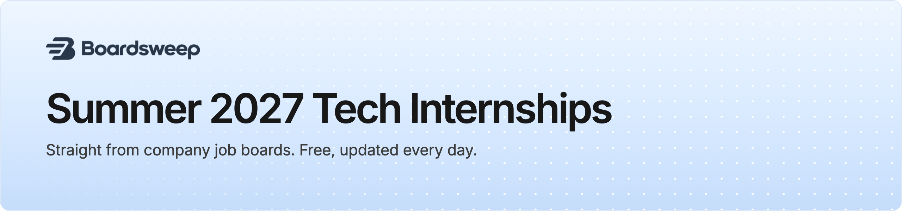

<a href="https://boardsweep.io/?utm_source=github&utm_medium=readme&utm_campaign=internships&utm_content=banner"><picture><source media="(prefers-color-scheme: dark)" srcset="assets/banner-internship-dark.png"></picture></a>

<a href="https://boardsweep.io/internships?utm_source=github&utm_medium=readme&utm_campaign=internships&utm_content=cta_email"><picture><source media="(prefers-color-scheme: dark)" srcset="assets/cta-email-dark.png"></picture></a>&nbsp;&nbsp;<a href="https://boardsweep.io/#pricing?utm_source=github&utm_medium=readme&utm_campaign=internships&utm_content=cta_instant"><picture><source media="(prefers-color-scheme: dark)" srcset="assets/cta-instant-dark.png"></picture></a>

> [!TIP]
> **This list runs a day behind.** The 177 internships we found in the last 24 hours are already in subscribers' inboxes, and appear here tomorrow. [Get a free daily email](https://boardsweep.io/internships?utm_source=github&utm_medium=readme&utm_campaign=internships&utm_content=tip_email), or [get each one the minute the company posts it](https://boardsweep.io/#pricing?utm_source=github&utm_medium=readme&utm_campaign=internships&utm_content=tip_instant) with the season pass (7 days free).

 

## Browse by field

| Field | Open now | New this week | |
| --- | ---: | ---: | --- |
| 💻 **[Software engineering](fields/software.md)** | 1,864 | 219 | [Email me these, free](https://boardsweep.io/internships/software?utm_source=github&utm_medium=readme&utm_campaign=internships&utm_content=browse_software) |
| 🤖 **[AI, ML and data](fields/aiml.md)** | 1,511 | 172 | [Email me these, free](https://boardsweep.io/internships/aiml?utm_source=github&utm_medium=readme&utm_campaign=internships&utm_content=browse_aiml) |
| 📈 **[Quant](fields/quant.md)** | 174 | 12 | [Email me these, free](https://boardsweep.io/internships/quant?utm_source=github&utm_medium=readme&utm_campaign=internships&utm_content=browse_quant) |
| 🔧 **[Hardware](fields/hardware.md)** | 896 | 148 | [Email me these, free](https://boardsweep.io/internships/hardware?utm_source=github&utm_medium=readme&utm_campaign=internships&utm_content=browse_hardware) |
| 📱 **[Product](fields/product.md)** | 281 | 41 | [Email me these, free](https://boardsweep.io/internships/product?utm_source=github&utm_medium=readme&utm_campaign=internships&utm_content=browse_product) |
| 🎨 **[Design](fields/design.md)** | 54 | 21 | [Email me these, free](https://boardsweep.io/internships/design?utm_source=github&utm_medium=readme&utm_campaign=internships&utm_content=browse_design) |
| 🛡️ **[Security](fields/security.md)** | 56 | 33 | [Email me these, free](https://boardsweep.io/internships/security?utm_source=github&utm_medium=readme&utm_campaign=internships&utm_content=browse_security) |

 

🔥 Top company &nbsp; ✨ Not on the other public lists &nbsp; ⚡ Minutes from posting to us &nbsp; 🛂 No visa sponsorship &nbsp; 🇺🇸 U.S. citizenship required &nbsp; 🎓 Advanced degree required

 

## Software engineering

This week's 219 of 1,864. <a href="fields/software.md">See all 1,864 (2 pages)</a> · <a href="https://boardsweep.io/internships/software?utm_source=github&utm_medium=readme&utm_campaign=internships&utm_content=track_software">Get only software engineering internships by email, free</a>

| Company | Role | Where and pay | Posted | &nbsp;Apply&nbsp; |
| --- | --- | --- | --- | :---: |
| &nbsp; **RTX** | Systems Engineer 2027 Summer Intern (Onsite) ✨ 🛂 | Richardson,&nbsp;TX - | Nov&nbsp;4 |  |
| ↳ | Platform Intern (Summer 2027) ✨ 🛂 | Richardson,&nbsp;TX - | Nov&nbsp;4 |  |
| &nbsp; **University Corporation for Atmospheric Research** | 2027 SIParCS Undergraduate Student Internships ✨ 🛂 | Boulder,&nbsp;CO $23.41/hr | Nov&nbsp;4 |  |
| &nbsp; **Caterpillar** | Oil and Gas Project Application Engineering Intern ✨ | San&nbsp;Diego,&nbsp;CA $26–&#8288;$43/hr | Nov&nbsp;4 |  |
| &nbsp; **RTX** | Intern: Summer 2027 - Control/Diagnostic Software (Onsite) 🛂 | Jupiter,&nbsp;FL - | Nov&nbsp;4 |  |
| &nbsp; **Northrop&nbsp;Grumman** | 2027 S/W Embedded Engineering Intern – Sykesville MD 🛂 | United States-Maryland-Sykesville $20.50–&#8288;$37.25/hr | Nov&nbsp;4 |  |
| &nbsp; **Etched** | IA Research Engineer (Kernels) Intern 🔥 | San&nbsp;Jose - | Nov&nbsp;4 |  |
| &nbsp; **Electronic&nbsp;Arts** | Anticheat Engineer Intern 🛂 | Austin,&nbsp;TX - | Nov&nbsp;3 |  |
| &nbsp; **SCS&nbsp;Engineers** | Engineering Intern Summer 2027 ✨ | - $21–&#8288;$26/hr | Nov&nbsp;3 |  |
| &nbsp; **SRI&nbsp;International** | Radar Research Interns ✨ 🛂 | - $20–&#8288;$40/hr | Nov&nbsp;3 |  |
| &nbsp; **Amgen** | Grad Intern – Target Safety Risk Weighting and Evaluation Strategies (Summer 2027) ✨ | United States - Remote $35.34–&#8288;$41.20/hr | Nov&nbsp;3 |  |
| &nbsp; **Riverside Research** | Computational Electromagnetic Intern ✨ 🛂 | - | Nov&nbsp;3 |  |
| &nbsp; **Engramme** | Full-Stack Software Engineer (Co-op / extended internship) | San&nbsp;Francisco - | Nov&nbsp;3 |  |
| ↳ | Back-End Software Engineer (Co-op / extended internship) | San&nbsp;Francisco - | Nov&nbsp;3 |  |
| &nbsp; **Trimble** | Telecom Intern ✨ | US - CO, Westminster $22.69–&#8288;$28.32/hr | Nov&nbsp;3 |  |
| &nbsp; **RTX** | Systems Engineering Intern (Summer 2027) ✨ 🛂 | Marlborough,&nbsp;MA - | Nov&nbsp;3 |  |
| &nbsp; **University Corporation for Atmospheric Research** | 2027 SIParCS Graduate Student Internships ✨ 🛂 | Boulder,&nbsp;CO $28.32/hr | Nov&nbsp;3 |  |
| &nbsp; **Hewlett Packard Enterprise** | Global Workplace Internship Program ✨ | Spring,&nbsp;TX - | Nov&nbsp;3 |  |
| &nbsp; **Regent** | Commercial Business Development, Data Intern | North Kingstown, RI - | Nov&nbsp;3 ⚡&nbsp;42m |  |
| &nbsp; **Westlake** | Process Control Engineer Intern (Summer 2027) ✨ 🛂 | US - Calvert City, KY - | Nov&nbsp;3 |  |
| &nbsp; **Commonwealth Fusion Systems** | Intern - R&amp;D Multiphysics Simulation Intern  - Spring or Summer 2027 ✨ | Somerville,&nbsp;MA $25–&#8288;$38/hr | Nov&nbsp;3 ⚡&nbsp;26m |  |
| **Toshiba Global Commerce Solutions - External** | AI Software Engineering Intern 🛂 | Frisco,&nbsp;TX - | Nov&nbsp;3 ⚡&nbsp;32m |  |
| &nbsp; **Microsoft** | Software Engineer, Teamwork Experiences Internship Opportunities 🔥 | Redmond,&nbsp;WA - | Nov&nbsp;3 |  |
| &nbsp; **Commonwealth Fusion Systems** | Intern - Software Engineer - Summer 2027 | Devens,&nbsp;MA $25–&#8288;$38/hr | Nov&nbsp;3 |  |
| &nbsp; **JM&nbsp;Family** | Process Intelligence Intern, Distribution ✨ | Florida - Deerfield Beach - | Nov&nbsp;3 |  |
| &nbsp; **Daikin&nbsp;Applied** | Systems Engineering and Modular Architecture Intern ✨ | Plymouth, MN 55441 - | Nov&nbsp;3 |  |
| **Nex** | Summer 2027 &#124; Software Engineer Intern (Sports &amp; Fitness) | San&nbsp;Jose,&nbsp;CA - | Nov&nbsp;3 |  |
| &nbsp; **Stvinc** | Transportation Engineering Intern - Summer 2027 ✨ 🛂 | Frisco,&nbsp;TX $47,959–&#8288;$54,498/yr | Nov&nbsp;3 |  |
| &nbsp; **CoorsTek** | Process Engineering Intern ✨ | Hillsboro,&nbsp;OR - | Nov&nbsp;3 |  |
| &nbsp; **Biogen** | Intern, Information Technology | Cambridge,&nbsp;MA $28/hr | Nov&nbsp;3 |  |
| &nbsp; **RTX** | Structures Engineer Intern (Summer 2027)(Onsite) ✨ 🛂 | Middletown,&nbsp;CT - | Nov&nbsp;3 |  |
| &nbsp; **AECOM** | Engineering Intern ✨ | New&nbsp;York - | Nov&nbsp;3 |  |
| &nbsp; **IMEG** | Sustainability &amp; Energy Engineering Intern ✨ | 4&nbsp;Locations - | Nov&nbsp;3 |  |
| &nbsp; **RTX** | Systems Engineering Intern, BMC2 (Onsite) ✨ 🛂 | St Petersburg, FL - | Nov&nbsp;3 |  |
| &nbsp; **Johns&nbsp;Manville** | Engineering Intern (Corporate Project Engineering Team) ✨ | Littleton CO JMTC $41,600–&#8288;$52,600/yr | Nov&nbsp;3 |  |
| &nbsp; **ACLU** | Spring 2027 Undergraduate Intern, Product &amp; Technology Department ✨ | Remote/Hybrid- New York $20/hr | Nov&nbsp;3 |  |
| &nbsp; **T-Mobile** | T-Ads Software Engineer Intern | Philadelphia,&nbsp;PA $27–&#8288;$50/hr | Nov&nbsp;3 |  |
| &nbsp; **JM&nbsp;Family** | AI Center of Excellence (COE) Delivery Team Intern | Florida - Deerfield Beach - | Nov&nbsp;3 |  |
| &nbsp; **T-Mobile** | Software Engineering Intern | Atlanta,&nbsp;GA $27–&#8288;$50/hr | Nov&nbsp;3 |  |
| &nbsp; **Sun&nbsp;Life** | Business Operations Software Engineer 2027 Co-op | 5&nbsp;Locations $22/hr | Nov&nbsp;3 |  |
| &nbsp; **Apacheip** | AI Implementation Intern | Houston Headquarters - | Nov&nbsp;3 |  |
| &nbsp; **Sun&nbsp;Life** | Business Operations Software Engineer 2027 Co-op | 5&nbsp;Locations $22/hr | Nov&nbsp;3 |  |
| &nbsp; **Ciena** | Stagiaire en développement logiciel - Software developer Intern/Co-op | 2&nbsp;Locations $25.50–&#8288;$35/hr | Nov&nbsp;3 |  |
| &nbsp; **Moderna** | 2027 Co-Op, mRNA Design Engineering 🛂 | Cambridge,&nbsp;MA $20–&#8288;$60/hr | Nov&nbsp;3 |  |
| &nbsp; **TruStage** | IT - Innovation &amp; AI Technology Internship (Hybrid) | Madison,&nbsp;WI - | Nov&nbsp;3 |  |
| &nbsp; **Sun&nbsp;Life** | Business Operations Software Engineer - 2027 Co-op | 5&nbsp;Locations $22/hr | Nov&nbsp;3 |  |
| ↳ | Business Operations Software Engineer - 2027 Co-op | 5&nbsp;Locations $22/hr | Nov&nbsp;3 |  |
| &nbsp; **Bose** | Software/DSP Research Engineer Co-op | US, MA - Framingham $40–&#8288;$51.25/hr | Nov&nbsp;3 |  |
| &nbsp; **Arch Capital Group** | Originations Portal IT Intern | Greensboro,&nbsp;NC - | Nov&nbsp;3 |  |
| &nbsp; **Hewlett Packard Enterprise** | Software Engineering Intern, Product &amp; Developer Productivity - HP IQ | San Francisco, CA $40–&#8288;$50/hr | Nov&nbsp;3 |  |
| ↳ | Software Engineering Intern, AIML Platform - HP IQ | San Francisco, CA $40–&#8288;$50/hr | Nov&nbsp;3 |  |
| ↳ | Software Engineering Intern, Product &amp; Developer Productivity - HP IQ | San Francisco, CA $40–&#8288;$50/hr | Nov&nbsp;3 |  |
| &nbsp; **Staples** | Software Engineer Intern (SDS e-Commerce Team) | Framingham,&nbsp;MA - | Nov&nbsp;3 |  |
| &nbsp; **Hewlett Packard Enterprise** | Software Engineering Intern, AIML Platform - HP IQ | San Francisco, CA $40–&#8288;$50/hr | Nov&nbsp;3 |  |
| &nbsp; **Highmark&nbsp;Health** | Summer 2027 AI Services and Platforms Software Engineer Graduate Intern 🛂 | 51&nbsp;Locations - | Nov&nbsp;3 |  |
| &nbsp; **Northrop&nbsp;Grumman** | 2027 Ground Software Engineer Intern - Redondo Beach CA 🛂 | United States-California-Redondo Beach $21.50–&#8288;$33.50/hr | Nov&nbsp;3 |  |
| ↳ | 2027 Flight Software Engineer Intern - Redondo Beach CA 🛂 | United States-California-Manhattan Beach $21.50–&#8288;$33.50/hr | Nov&nbsp;3 |  |
| &nbsp; **Dell&nbsp;Technologies** | CSG Software Engineering Undergraduate Intern | TX $29.60–&#8288;$31.80/hr | Nov&nbsp;3 |  |
| &nbsp; **American&nbsp;Express** | Campus Undergraduate Summer Internship Program - 2027 Software Engineer, Enterprise Technology Services- Sunnyvale, CA | Sunnyvale,&nbsp;CA - | Nov&nbsp;3 |  |
| &nbsp; **Sonos** | Data Engineering Intern (Seattle) 🛂 | Seattle,&nbsp;WA - | Nov&nbsp;3 |  |
| &nbsp; **PACCAR** | 2027 Summer Internship: Software Developer | Denton, TX, US, 76205-7864 - | Nov&nbsp;3 |  |
| ↳ | 2027 Summer Internship: Design Engineer- Autonomous Vehicle Platform ✨ | Denton, TX, US, 76205-7864 - | Nov&nbsp;3 |  |
| &nbsp; **Dell&nbsp;Technologies** | Dell Technologies Services Undergraduate Engineering   Intern | 2&nbsp;locations $27.10–&#8288;$31.80/hr | Nov&nbsp;3 |  |
| &nbsp; **Costco** | CDS Intern - Innovation | Issaquah,&nbsp;WA $21–&#8288;$32.90/hr | Nov&nbsp;2 |  |
| ↳ | Costco Data Systems Intern - IT Product Owner | Issaquah,&nbsp;WA $21–&#8288;$32.90/hr | Nov&nbsp;2 |  |
| &nbsp; **Rocket&nbsp;Lab** | Ground Systems Engineering Intern Summer 2027 | Middle&nbsp;River,&nbsp;MD $25/hr | Nov&nbsp;2 ⚡&nbsp;3m |  |
| &nbsp; **Wellmark** | Software Engineer Internship – AI Platform Team | Des&nbsp;Moines - | Nov&nbsp;2 |  |
| &nbsp; **Parsons** | Software Engineer Intern (Fall 2026) ✨ 🛂 | - $22.93–&#8288;$40.14/hr | Nov&nbsp;2 |  |
| &nbsp; **Keysight Technologies** | DevSecOps, Intern ✨ 🛂 | Colorado Springs, CO $31.11/hr | Nov&nbsp;2 |  |
| &nbsp; **Constellation Brands** | Intern, Full Stack Engineer | Rochester,&nbsp;NY $19–&#8288;$32/hr | Nov&nbsp;2 |  |
| &nbsp; **Astro&nbsp;Mechanica** | GNC Engineering Intern ✨ | San&nbsp;Francisco $40–&#8288;$55/hr | Nov&nbsp;2 ⚡&nbsp;57m |  |
| ↳ | Airframe/Structures Engineering Intern ✨ | San&nbsp;Francisco $40–&#8288;$55/hr | Nov&nbsp;2 ⚡&nbsp;57m |  |
| &nbsp; **Trane Technologies** | Engineering Intern ✨ | Greenville,&nbsp;SC $25.92/hr | Nov&nbsp;2 |  |
| &nbsp; **Westernalliancebank** | Summer 2027 Internship - Columbus, OH - Business Escrow Services - Technology ✨ | Columbus,&nbsp;OH - | Nov&nbsp;2 |  |
| &nbsp; **KLA** | Software Engineer (AI/ML) Intern | 2&nbsp;Locations $22.10–&#8288;$42.50/hr | Nov&nbsp;2 |  |
| ↳ | Software Engineer (AI/ML) Intern | 2&nbsp;Locations $22.10–&#8288;$42.50/hr | Nov&nbsp;2 |  |
| &nbsp; **RTX** | Externals Design Engineer Intern (Summer 2027) (Onsite) ✨ | East Hartford, CT - | Nov&nbsp;2 |  |
| &nbsp; **Systems Technology Research** | 5G SA O-RAN Test Bed Co-Op (Engineering Co-Op) ✨ 🛂 | Woburn,&nbsp;MA $25.20–&#8288;$54/hr | Nov&nbsp;2 |  |
| &nbsp; **KEEN&nbsp;Footwear** | Junior Material Developer Intern ✨ 🛂 | Portland,&nbsp;OR $22/hr | Nov&nbsp;2 |  |
| &nbsp; **Consor** | Water &amp; Wastewater Treatment Engineering Intern ✨ | - | Nov&nbsp;2 |  |
| &nbsp; **Cincinnati Children’s Hospital and Medical Center** | Student II - Software Engineering Developer (B) | Remote - | Nov&nbsp;2 |  |
| ↳ | Student II - Software Engineering Developer (A) | Remote - | Nov&nbsp;2 |  |
| &nbsp; **Federal Reserve System** | 2027 Summer Internship Program - IT Asset Management Intern ✨ 🛂 | Atlanta,&nbsp;GA - | Nov&nbsp;2 |  |
| &nbsp; **RTX** | VA Tech Student Intern Fellowship ✨ 🛂 | Cedar&nbsp;Rapids,&nbsp;IA - | Nov&nbsp;2 |  |
| &nbsp; **ABB** | Physical AI Robotics Simulation Intern- Fall 2026 | Milpitas,&nbsp;CA $20–&#8288;$34/hr | Nov&nbsp;2 |  |
| &nbsp; **KEEN&nbsp;Footwear** | Analytics Engineer Intern 🛂 | Portland,&nbsp;OR $22/hr | Nov&nbsp;2 |  |
| &nbsp; **Cincinnati Children’s Hospital and Medical Center** | Student II - Data Management Engineer | Remote - | Nov&nbsp;2 |  |
| &nbsp; **Sierra Nevada Corporation** | DevOps Engineer Intern (Summer 2027) ✨ 🛂 | Southern Pines, NC - | Nov&nbsp;2 |  |
| &nbsp; **Microsoft** | Software Engineer: Internship Opportunities 🔥 | Aliso&nbsp;Viejo,&nbsp;CA - | Nov&nbsp;2 |  |
| **Toshiba Global Commerce Solutions - External** | Software Engineering Intern 🛂 | Durham,&nbsp;NC - | Nov&nbsp;2 ⚡&nbsp;38m |  |
| ↳ | Agentic Software Engineering Intern 🛂 | Durham,&nbsp;NC - | Nov&nbsp;2 ⚡&nbsp;39m |  |
| ↳ | AI Automation &amp; Revenue Ops Intern 🛂 | Durham,&nbsp;NC - | Nov&nbsp;2 ⚡&nbsp;40m |  |
| &nbsp; **Argonne National Laboratory** | Givens Associates ✨ 🎓 | Lemont,&nbsp;IL $30.36–&#8288;$45.54/hr | Nov&nbsp;2 |  |
| &nbsp; **Imanagecom** | Sign up for iManage U 2027 Internship Program Alerts ✨ | Chicago,&nbsp;IL - | Nov&nbsp;2 |  |
| &nbsp; **JMP Statistical Discovery** | Jmp 2027 Summer Internship Devops R&amp;D ✨ | - $15–&#8288;$30/hr | Nov&nbsp;2 |  |
| &nbsp; **Eaton** | Engineering Intern- Summer 2027 ✨ 🛂 | Middlesex,&nbsp;NC $22.15/hr | Nov&nbsp;2 |  |
| &nbsp; **ParetoHealth** | Software Engineering Summer Intern 🛂 | Philadelphia,&nbsp;PA - | Nov&nbsp;2 ⚡&nbsp;35m |  |
| &nbsp; **Roku** | SW Engineer Intern, AI Engineering | San&nbsp;Jose,&nbsp;CA - | Nov&nbsp;2 ⚡&nbsp;29m |  |
| &nbsp; **Microsoft** | Explore Program Engineering Internship Opportunities: First-Year Students, Redmond 🔥 | Redmond,&nbsp;WA $25.96–&#8288;$47.77/hr | Nov&nbsp;2 |  |
| &nbsp; **NVIDIA** | AI Compiler and Kernel Intern – Summer 2027 🔥 | US,&nbsp;TX,&nbsp;Austin - | Nov&nbsp;2 |  |
| &nbsp; **Resideo** | Mobile Software Engineer Intern - Summer 2027 | Austin,&nbsp;TX - | Nov&nbsp;2 |  |
| &nbsp; **Merck** | Future Talent Program Co-op - Patient Data Learning 🎓 | Cambridge,&nbsp;MA $39,908–&#8288;$111,111/yr | Nov&nbsp;2 |  |
| **F7d8749a 72d6 407c Bf98 292ea630c73a** | Summer 2027 Intern - Embedded Firmware - 5810 | Dallas,&nbsp;TX - | Nov&nbsp;2 |  |
| &nbsp; **NVIDIA** | Math Libraries Intern, cuEST - Summer 2027 🔥 | US, CA, Santa Clara - | Nov&nbsp;2 |  |
| &nbsp; **RTX** | PW1100G-JM Program Fleet Intern (Summer 2027) 🛂 | East Hartford, CT - | Nov&nbsp;2 |  |
| &nbsp; **Astro&nbsp;Mechanica** | Software Engineering Intern | San&nbsp;Francisco $40–&#8288;$55/hr | Nov&nbsp;2 |  |
| &nbsp; **Motorola Solutions** | Software Engineer Cybersecurity Services - 2027 Summer Internship 🛂 | Virginia Remote Work, More... - | Nov&nbsp;2 |  |
| &nbsp; **Northrop&nbsp;Grumman** | 2027 Engineering Intern (Software/Mission Assurance/Quality) - Chandler AZ 🛂 | United States-Arizona-Chandler $18.50–&#8288;$33.50/hr | Nov&nbsp;2 |  |
| &nbsp; **Leidos** | Software Engineering Intern 🛂 | Arlington,&nbsp;VA $48,100–&#8288;$86,950/yr | Nov&nbsp;2 |  |
| &nbsp; **PACCAR** | 2027 Summer Internship: Truck Systems &amp; Software Support ✨ | Denton, TX, US, 76205-7864 - | Nov&nbsp;2 |  |
| &nbsp; **Staples** | Software Engineer Intern, Marketplace Platform | Framingham,&nbsp;MA - | Nov&nbsp;2 |  |
| &nbsp; **LabCorp** | Co-op - Full-Stack Life Sciences Engineer 🛂 | Durham,&nbsp;NC - | Nov&nbsp;2 |  |
| &nbsp; **Applied&nbsp;Materials** | Summer 2027 Software Engineer Intern- Bachelor&#x27;s/Master&#x27;s (Santa Clara, CA) | Santa&nbsp;Clara,&nbsp;CA - | Nov&nbsp;2 |  |
| &nbsp; **Northrop&nbsp;Grumman** | Engineering Software and Analysis Intern 🛂 | United States-California-Sunnyvale $21.50–&#8288;$39/hr | Nov&nbsp;2 |  |
| &nbsp; **Sierra Nevada Corporation** | Software Engineer Intern (Summer 2027) 🛂 | Southern Pines, NC - | Nov&nbsp;2 |  |
| &nbsp; **Zebra** | 2027 Summer Internship (US) - Software/AI Engineer (Handheld Mobile Computers) 🛂 | Holtsville,&nbsp;NY $33–&#8288;$40.50/hr | Nov&nbsp;2 |  |
| &nbsp; **Corning** | Process Engineering Intern - Summer 2027 ✨ 🛂 | Durham, NC, US, 27712 $1,635–&#8288;$3,185/wk | Nov&nbsp;2 |  |
| &nbsp; **KnowBe4** | Software Engineer Summer Internship ✨ | Clearwater,&nbsp;FL - | Nov&nbsp;1 ⚡&nbsp;34m |  |
| &nbsp; **Federal Reserve System** | Undergraduate Intern – Technology Focus ✨ | Minneapolis,&nbsp;MN $23/hr | Nov&nbsp;1 |  |
| &nbsp; **TRG** | Full Stack Application Developer Intern | Dallas,&nbsp;TX - | Nov&nbsp;1 |  |
| &nbsp; **Fireworkhq** | Data Engineer Intern | San&nbsp;Mateo,&nbsp;CA - | Oct&nbsp;31 |  |
| &nbsp; **Philips** | Intern - Systems Engineer – New Kensington, PA – Summer 2027 ✨ | New Kensington, PA $26–&#8288;$36/hr | Oct&nbsp;30 |  |
| &nbsp; **Hyster-Yale** | Summer 2027 Engineering Intern ✨ | 3&nbsp;Locations - | Oct&nbsp;30 |  |
| &nbsp; **The Aerospace Corporation** | 2027 Formal Methods Researcher Graduate Intern ✨ 🛂 🎓 | 7&nbsp;Locations $32–&#8288;$38/hr | Oct&nbsp;30 |  |
| &nbsp; **Elucid** | Software Engineer Intern | Boston,&nbsp;MA $35–&#8288;$40/hr | Oct&nbsp;30 |  |
| &nbsp; **Amazon** | Software Development Engineer Intern 🔥 | Cupertino,&nbsp;CA - | Oct&nbsp;30 |  |
| **Obsidian Entertainment** | Gameplay Engineer Intern | Irvine,&nbsp;CA $22–&#8288;$30/hr | Oct&nbsp;30 |  |
| &nbsp; **ASML** | Internship- Product Engineer Computational Model | San&nbsp;Jose,&nbsp;CA - | Oct&nbsp;30 |  |
| &nbsp; **Stand&nbsp;Together** | KIP Spring 2027 - Development Intern - Grassroot Institute of Hawaii ✨ | Honolulu,&nbsp;HI - | Oct&nbsp;30 ⚡&nbsp;26m |  |
| &nbsp; **Toyota Research Institute** | Multi-scale Physics Battery Modeling Intern ✨ | Los&nbsp;Altos,&nbsp;CA - | Oct&nbsp;30 ⚡&nbsp;56m |  |
| &nbsp; **Carnegie Mellon University** | Enabling Mission Capability at Scale Intern - Summer 2027 ✨ 🛂 | Pittsburgh,&nbsp;PA - | Oct&nbsp;30 |  |
| &nbsp; **Nintendo Technology Development** | Intern - Software Engineer, Performance Tools (NTD) 🛂 | Redmond,&nbsp;WA $45/hr | Oct&nbsp;30 |  |
| &nbsp; **Nintendo** | Intern - Software Engineer, Performance Tools (NTD) ✨ | Redmond,&nbsp;WA $45/hr | Oct&nbsp;30 ⚡&nbsp;16m |  |
| &nbsp; **Becton&nbsp;Dickinson** | Molding Reliability Engineering Intern ✨ | - Columbus (molding Center), NE - | Oct&nbsp;30 |  |
| &nbsp; **Garda Capital Partners** | Infrastructure Engineer Intern ✨ | Wayzata,&nbsp;MN $40/hr | Oct&nbsp;30 ⚡&nbsp;33m |  |
| &nbsp; **Nintendo Technology Development** | Intern - Software Engineer, Graphics (NTD) 🛂 | Redmond,&nbsp;WA $45/hr | Oct&nbsp;30 |  |
| &nbsp; **Nintendo** | Intern - Software Engineer, Graphics (NTD) ✨ | Redmond,&nbsp;WA $45/hr | Oct&nbsp;30 ⚡&nbsp;48m |  |
| &nbsp; **The New York Times** | Backend Engineering Intern, Wirecutter | New&nbsp;York,&nbsp;NY $40/hr | Oct&nbsp;30 ⚡&nbsp;58m |  |
| &nbsp; **Robert Bosch Venture Capital** | Quality Engineering Intern / Co-op - Spring 2027 ✨ | Florence - | Oct&nbsp;30 |  |
| &nbsp; **RTX** | Systems Engineer Intern (Summer 2027)  - Tac Comm - Onsite ✨ 🛂 | Cedar&nbsp;Rapids,&nbsp;IA - | Oct&nbsp;30 |  |
| **Brain** | AI Product Engineer Intern (Summer 2027) | San Francisco Bay Area - | Oct&nbsp;30 |  |
| ↳ | AI Security Engineer Intern (Summer 2027) ✨ | San Francisco Bay Area - | Oct&nbsp;30 |  |
| &nbsp; **Keysight Technologies** | Solutions Engineering, Intern ✨ 🛂 | Santa&nbsp;Clara,&nbsp;CA $46.03/hr | Oct&nbsp;30 |  |
| &nbsp; **Ferrovial** | Webber - Field Engineer Intern II - Infrastructure Management ✨ | Murfreesboro,&nbsp;TN - | Oct&nbsp;30 |  |
| **Brain** | AI Platform Engineer Intern (Summer 2027) | San Francisco Bay Area - | Oct&nbsp;30 |  |
| &nbsp; **Metropolitan Transportation Authority** | Technology Support, Emerging Talent Intern (Spring) ✨ | Brooklyn,&nbsp;NY $19/hr | Oct&nbsp;30 |  |
| &nbsp; **Schweitzer Engineering Laboratories** | Automation Engineering Intern ✨ 🛂 | Idaho&nbsp;-&nbsp;Moscow $24.25–&#8288;$33/hr | Oct&nbsp;30 |  |
| &nbsp; **CarMax** | Process Engineer Intern ✨ | Corporate - Richmond $23–&#8288;$35/hr | Oct&nbsp;30 |  |
| &nbsp; **Obsidian** | Gameplay Engineer - 2027 Summer Internship ✨ | Irvine,&nbsp;CA $22–&#8288;$30/hr | Oct&nbsp;30 |  |
| &nbsp; **Schweitzer Engineering Laboratories** | Process Engineering Intern ✨ 🛂 | Idaho&nbsp;-&nbsp;Moscow $24.25–&#8288;$33/hr | Oct&nbsp;30 |  |
| &nbsp; **AstraZeneca** | Manufacturing Solutions &amp; Innovation Intern ✨ | US - Gaithersburg -, MD $37–&#8288;$39/hr | Oct&nbsp;30 |  |
| &nbsp; **Carnegie Mellon University** | Cyber Range Development Intern ✨ 🛂 | Pittsburgh,&nbsp;PA - | Oct&nbsp;30 |  |
| ↳ | Cyber Range Development Intern ✨ 🛂 | Pittsburgh,&nbsp;PA - | Oct&nbsp;30 |  |
| ↳ | Agentic Development Intern ✨ 🛂 | Pittsburgh,&nbsp;PA - | Oct&nbsp;30 |  |
| ↳ | Full-Stack Software Development Intern ✨ 🛂 | Pittsburgh,&nbsp;PA - | Oct&nbsp;30 |  |
| &nbsp; **Elucid** | Software Engineering Intern: Spring 2027 ✨ | Boston,&nbsp;MA $35–&#8288;$40/hr | Oct&nbsp;30 |  |
| &nbsp; **RESPEC** | Student Engineering Intern – Water Resources ✨ | Denver $22–&#8288;$26/hr | Oct&nbsp;30 |  |
| &nbsp; **Sierra Nevada Corporation** | Specialty Engineering Intern (Summer 2027) ✨ | Dayton,&nbsp;OH - | Oct&nbsp;30 |  |
| ↳ | Quality Engineer Intern (Summer 2027) ✨ | Dayton,&nbsp;OH - | Oct&nbsp;30 |  |
| &nbsp; **AtriCure** | IT Co-op- ERP Data Migration ✨ | Mason,&nbsp;OH - | Oct&nbsp;30 ⚡&nbsp;15m |  |
| &nbsp; **Emcorgroup** | J. C. Higgins Corp. Project Engineer Internship ✨ | - | Oct&nbsp;30 |  |
| &nbsp; **Chevron** | 2026-2027 Facilities Engineering Intern (Previous Intern) ✨ 🛂 | 13&nbsp;Locations - | Oct&nbsp;30 |  |
| &nbsp; **GE&nbsp;Vernova** | Software Engineering Intern 🛂 | - | Oct&nbsp;30 |  |
| ↳ | Software Engineering Intern 🛂 | - | Oct&nbsp;30 |  |
| &nbsp; **Dedrone** | 2027 US Software Engineering Internship (Dedrone) | 2&nbsp;locations $45/hr | Oct&nbsp;30 ⚡&nbsp;19m |  |
| &nbsp; **Costco** | CDS Intern - Software Engineer - IT Retail Media | Issaquah,&nbsp;WA $21–&#8288;$32.90/hr | Oct&nbsp;30 |  |
| ↳ | Software Engineer Intern - International Depot | Issaquah,&nbsp;WA $21–&#8288;$32.90/hr | Oct&nbsp;30 |  |
| ↳ | CDS Intern - Powerapps Developer - ECM Digital Workflow | Issaquah,&nbsp;WA $21–&#8288;$32.90/hr | Oct&nbsp;30 |  |
| &nbsp; **Itron** | Intern - Systems Engineer (Spring 2027) | United States of America, South Carolina, We - | Oct&nbsp;30 |  |
| ↳ | Intern - Systems Engineer (Spring 2027) | United States of America, South Carolina, We - | Oct&nbsp;30 |  |
| &nbsp; **Nokia** | Software Engineer Co-op | - | Oct&nbsp;30 |  |
| &nbsp; **Hewlett Packard Enterprise** | Software Engineering Intern | Sunnyvale,&nbsp;CA - | Oct&nbsp;30 |  |
| &nbsp; **OLG** | Front End Developer Student | 2&nbsp;Locations $18.50–&#8288;$28.50/hr | Oct&nbsp;30 |  |
| &nbsp; **AGCO** | Design Engineering Intern - Summer 2027 ✨ | Beloit,&nbsp;KS - | Oct&nbsp;30 |  |
| &nbsp; **Carnegie Mellon University** | Full-Stack Software Development Intern ✨ 🛂 | Pittsburgh,&nbsp;PA - | Oct&nbsp;30 |  |
| &nbsp; **WEX&nbsp;Health** | Software Engineer Intern | Illinois - Remote Office $27–&#8288;$35/hr | Oct&nbsp;30 |  |
| &nbsp; **Amazon** | Software Development Engineer Intern, Machine Learning/Automated Reasoning- Summer 2027 🔥 | Seattle,&nbsp;WA - | Oct&nbsp;30 |  |
| &nbsp; **Bristol-Myers Squibb** | Quality Control Strategy and Science Spring Co-op | New Brunswick - NJ $24–&#8288;$45/hr | Oct&nbsp;30 |  |
| &nbsp; **Barclays** | Chief Client Office - Client Data &amp; Engineering Group Summer Internship Program 2027 New York City 🛂 | New York, 745 7th Avenue $110k/yr | Oct&nbsp;30 |  |
| &nbsp; **Stantec** | Metallurgy &amp; Process Engineering Intern - Energy &amp; Resources (Summer 2027) ✨ | Reno,&nbsp;NV - | Oct&nbsp;30 |  |
| &nbsp; **Amazon** | Critical Project Engineer Intern 🔥 ✨ | SGP - | Oct&nbsp;30 |  |
| &nbsp; **Robert Bosch Venture Capital** | IT Systems Engineering Intern (19 hours per week) ✨ | Roseville $24–&#8288;$27/hr | Oct&nbsp;29 |  |
| **E2 Consulting Engineers** | Substation Design Engineer Intern –Part Time ✨ | - $22–&#8288;$32/hr | Oct&nbsp;29 |  |
| &nbsp; **Northrop&nbsp;Grumman** | 2027 Systems Engineering Intern - Boulder CO ✨ 🛂 | United States-Colorado-Boulder $21.50–&#8288;$39/hr | Oct&nbsp;29 |  |
| &nbsp; **GlobalFoundries** | Digital Design Backend Engineering Intern, 3D and AI Flows | Santa&nbsp;Clara,&nbsp;CA $20–&#8288;$40/hr | Oct&nbsp;29 |  |
| &nbsp; **Valeris** | Intern, IT | Remote,&nbsp;KY - | Oct&nbsp;29 |  |
| &nbsp; **Overland&nbsp;AI** | Software Engineering Intern | Seattle,&nbsp;WA $28/hr | Oct&nbsp;29 |  |
| &nbsp; **Waggoner Financial** | Software Engineer Intern | Lansing,&nbsp;MI - | Oct&nbsp;29 |  |
| &nbsp; **Zoox** | Contract Student Worker - Software Engineer 🔥 | 2&nbsp;locations - | Oct&nbsp;29 ⚡&nbsp;41m |  |
| &nbsp; **RTX** | Reliability Engineering Intern (Summer 2027) ✨ 🛂 | Tucson,&nbsp;AZ - | Oct&nbsp;29 |  |
| &nbsp; **Golden&nbsp;Analytics** | Software Engineer Intern | Bellevue,&nbsp;WA - | Oct&nbsp;29 |  |
| &nbsp; **Samsung Semiconductor** | Intern, Systems Software Engineering | San&nbsp;Jose,&nbsp;CA $28–&#8288;$68/hr | Oct&nbsp;29 |  |
| &nbsp; **Mackenzie Investments** | Summer Intern 2027 Asset Management Operations Technology) ✨ | - $49k–&#8288;$51k/yr | Oct&nbsp;29 |  |
| &nbsp; **Eversource&nbsp;Energy** | Engineering Intern: Distribution System Modeling and Automation (MA/CT/NH, Hybrid Schedule) ✨ 🛂 | Westwood,&nbsp;MA $21.20/hr | Oct&nbsp;29 |  |
| &nbsp; **Vestmark Internship Program** | Cloud Engineer Co-op ✨ | Wakefield,&nbsp;MA $19–&#8288;$22/hr | Oct&nbsp;29 ⚡&nbsp;56m |  |
| &nbsp; **CareSource** | 2027 Summer Internship Program -  Enterprise Architecture ✨ | Remote $41,200–&#8288;$66k/yr | Oct&nbsp;29 |  |
| &nbsp; **Toyota Research Institute** | Human Interactive Driving Intern, Platform Research Systems Integration | Los&nbsp;Altos,&nbsp;CA - | Oct&nbsp;29 ⚡&nbsp;21m |  |
| &nbsp; **KLA** | Image Processing Intern | Milpitas,&nbsp;CA $49–&#8288;$58/hr | Oct&nbsp;29 |  |
| ↳ | Image Processing Intern | Milpitas,&nbsp;CA $49–&#8288;$58/hr | Oct&nbsp;29 |  |
| &nbsp; **Nintendo Technology Development** | Intern - Software Engineer, Connectivity (NTD) 🛂 | Redmond,&nbsp;WA $45/hr | Oct&nbsp;29 |  |
| &nbsp; **Nintendo** | Intern - Software Engineer, Connectivity (NTD) ✨ | Redmond,&nbsp;WA $45/hr | Oct&nbsp;29 ⚡&nbsp;44m |  |
| &nbsp; **Rocket&nbsp;Lab** | Quality Engineering Intern Spring 2027 | Long&nbsp;Beach,&nbsp;CA $28/hr | Oct&nbsp;29 ⚡&nbsp;3m |  |
| **Interco** | Paid Internship -- Software Development -- React 🛂 | St.&nbsp;Louis $15/hr | Oct&nbsp;29 |  |
| &nbsp; **Mass General Brigham** | CIS Student Intern ✨ | 20 Shattuck Street  Boston $17.71–&#8288;$24.28/hr | Oct&nbsp;29 |  |
| &nbsp; **Philips** | Intern - Advanced Manufacturing Engineer - Plymouth, MN - Summer 2027 ✨ | Plymouth,&nbsp;MN $25–&#8288;$28/hr | Oct&nbsp;29 |  |
| &nbsp; **KLA** | Software Intern | Milpitas,&nbsp;CA - | Oct&nbsp;29 |  |
| ↳ | Software Intern | Milpitas,&nbsp;CA - | Oct&nbsp;29 |  |
| &nbsp; **AeroVironment** | GNC / Autonomy Engineering Intern ✨ | Simi&nbsp;Valley,&nbsp;CA - | Oct&nbsp;29 |  |
| &nbsp; **Disneycareers** | Enterprise Technology And Data Software Engineering Intern Summer 2027 | - | Oct&nbsp;29 |  |
| ↳ | Walt Disney Animation Studios Full Stack Web Development Intern Summer 2027 | - | Oct&nbsp;29 |  |
| &nbsp; **Ameresco** | Project Engineering Intern ✨ | United States - New York - Albany - | Oct&nbsp;29 |  |
| ↳ | Project Commissioning Engineer Intern ✨ | United States - New York - Remote - | Oct&nbsp;29 |  |
| &nbsp; **Base&nbsp;Power** | Power Systems Engineering Intern ✨ | Austin,&nbsp;TX - | Oct&nbsp;29 |  |
| &nbsp; **Northrop&nbsp;Grumman** | 2027 Software Test Engineering Intern- Roy UT ✨ 🛂 | United States-Utah-Roy $23–&#8288;$29/hr | Oct&nbsp;29 |  |
| **Papedawson** | Engineer Intern ✨ | Sarasota,&nbsp;FL - | Oct&nbsp;29 |  |
| &nbsp; **Two Six Technologies** | Systems Software Engineering Intern | Arlington,&nbsp;VA $25–&#8288;$40/hr | Oct&nbsp;29 ⚡&nbsp;37m |  |
| &nbsp; **GDIT** | GDIT Summer Internship Program – Summer 2027 Summer Enterprise IT Internship ✨ 🛂 | Bossier&nbsp;City,&nbsp;LA $49,300–&#8288;$66,700/yr | Oct&nbsp;29 |  |
| &nbsp; **Tesla** | Data Engineer Intern - Energy 🔥 | Palo&nbsp;Alto,&nbsp;CA - | Oct&nbsp;29 |  |
| &nbsp; **KLA** | Software Engineer Intern | Milpitas,&nbsp;CA - | Oct&nbsp;29 |  |

 

## AI, ML and data

This week's 172 of 1,511. <a href="fields/aiml.md">See all 1,511 (2 pages)</a> · <a href="https://boardsweep.io/internships/aiml?utm_source=github&utm_medium=readme&utm_campaign=internships&utm_content=track_aiml">Get only ai, ml and data internships by email, free</a>

| Company | Role | Where and pay | Posted | &nbsp;Apply&nbsp; |
| --- | --- | --- | --- | :---: |
| &nbsp; **Erie&nbsp;Insurance** | Claims Systems &amp; AI Intern 2 | Erie,&nbsp;PA $19.57/hr | Nov&nbsp;3 |  |
| &nbsp; **ByteDance** | Research Scientist Intern - Video and Edge - Multimedia Lab 🔥 | San&nbsp;Diego,&nbsp;CA $57/hr | Nov&nbsp;3 |  |
| **Samsung Research America Internship** | 2027 Summer Intern, Generative AI based Imaging and Video R&amp;D | 6105 Tennyson Pkwy, Suite 300, Plano TX 7502 $44–&#8288;$59/hr | Nov&nbsp;3 ⚡&nbsp;34m |  |
| &nbsp; **Meta** | Research Scientist Intern, GenAI Safety (PhD) 🔥 🎓 | 2&nbsp;locations - | Nov&nbsp;3 |  |
| &nbsp; **AstraZeneca** | Epidemiology Intern ✨ 🎓 | US - Boston -, MA $41–&#8288;$48/hr | Nov&nbsp;3 |  |
| ↳ | Epidemiology Intern ✨ 🎓 | US - Boston -, MA $41–&#8288;$48/hr | Nov&nbsp;3 |  |
| &nbsp; **RoboForce** | Machine Learning Engineer Intern, AI &amp; Robotics | Milpitas,&nbsp;CA $5,000–&#8288;$6,500/mo | Nov&nbsp;3 |  |
| &nbsp; **Engramme** | Machine Learning Engineer (Co-op / extended internship) | San&nbsp;Francisco - | Nov&nbsp;3 |  |
| &nbsp; **Johns&nbsp;Hopkins&nbsp;APL** | 2027 Internship - AI and Autonomous Systems Engineer ✨ 🛂 | Laurel,&nbsp;MD $22.60/hr | Nov&nbsp;3 |  |
| &nbsp; **Saronic** | Enterprise Technology Intern - AI and Automation (Summer 2027) 🔥 | Austin,&nbsp;TX - | Nov&nbsp;3 |  |
| &nbsp; **USAFacts** | AI Product Intern | Bellevue,&nbsp;WA $33/hr | Nov&nbsp;3 ⚡&nbsp;42m |  |
| &nbsp; **Eulerity** | Finance Data Analyst Intern | NYC - | Nov&nbsp;3 ⚡&nbsp;&lt;1m |  |
| &nbsp; **Highmark&nbsp;Health** | Summer 2027 Responsible AI Undergraduate Intern ✨ 🛂 | 51&nbsp;Locations - | Nov&nbsp;3 |  |
| &nbsp; **ASML** | Internship- Business Systems AI ✨ | San&nbsp;Diego,&nbsp;CA - | Nov&nbsp;3 |  |
| &nbsp; **Meta** | Research Scientist Intern, Ads Quality (PhD) 🔥 🎓 | Menlo&nbsp;Park,&nbsp;CA - | Nov&nbsp;3 |  |
| &nbsp; **Sanofi** | 2027 Summer Intern EGDS Morristown NJ ✨ | 2&nbsp;Locations $60/hr | Nov&nbsp;3 |  |
| &nbsp; **Meta** | Research Scientist Intern, Humanoid Control &amp; Dexterous Manipulation (PhD) 🔥 ✨ 🎓 | Redmond,&nbsp;WA - | Nov&nbsp;3 |  |
| **Hive Financial Systems** | HFA Internship 2027 | Atlanta,&nbsp;GA - | Nov&nbsp;3 ⚡&nbsp;55m |  |
| &nbsp; **Trimble** | AI Developer Intern | 2&nbsp;Locations $21.39–&#8288;$32.12/hr | Nov&nbsp;3 |  |
| ↳ | AI Developer Intern | 2&nbsp;Locations $22.69–&#8288;$34.04/hr | Nov&nbsp;3 |  |
| **Samsung Research America Internship** | 2027 Spring/Summer Intern, Agentic AI Solutions | Mountain View, CA $36–&#8288;$63/hr | Nov&nbsp;3 ⚡&nbsp;29m |  |
| &nbsp; **First Citizens Bank** | 2027 Summer Intern - Applied AI (Raleigh, NC) | Raleigh,&nbsp;NC - | Nov&nbsp;3 |  |
| &nbsp; **Vizient** | 2027 Summer Internship - Strategy Analytics Project ✨ | Chicago, IL 60607 $25/hr | Nov&nbsp;3 |  |
| &nbsp; **American Cancer Society** | Research Intern, Cancer Risk Prediction ✨ | GA&nbsp;Atlanta - | Nov&nbsp;3 |  |
| &nbsp; **The New York Times** | Advertising Business Data Analyst Intern | New&nbsp;York,&nbsp;NY $20/hr | Nov&nbsp;3 ⚡&nbsp;50m |  |
| &nbsp; **Hearst** | Editorial AI Development Intern | SF $21.87/hr | Nov&nbsp;3 |  |
| &nbsp; **SpartanNash** | Business Development &amp; Analytics Intern - Summer 2027 ✨ 🛂 | Norfolk,&nbsp;VA $20/hr | Nov&nbsp;3 |  |
| &nbsp; **Toyota Research Institute** | Bridging Atomistic Modeling to Real Electrochemical Systems Modeling Intern ✨ 🎓 | Los&nbsp;Altos,&nbsp;CA $45–&#8288;$65/hr | Nov&nbsp;3 ⚡&nbsp;34m |  |
| &nbsp; **Meta** | Research Scientist Intern, FM Quality ML (PhD) 🔥 🎓 | Menlo&nbsp;Park,&nbsp;CA - | Nov&nbsp;3 |  |
| &nbsp; **TikTok** | Machine Learning Engineer - Intern (TikTok BRIC) - 2027 Start (PhD) 🔥 🎓 | San&nbsp;Jose,&nbsp;CA $60/hr | Nov&nbsp;3 |  |
| &nbsp; **GenMD** | Member of Technical Staff Intern, Applied AI | Palo&nbsp;Alto $45–&#8288;$60/hr | Nov&nbsp;3 ⚡&nbsp;45m |  |
| &nbsp; **Itron** | Intern - Data Analytics and Automation, Finance | United States of America, Washington, Libert $15.87–&#8288;$44.23/hr | Nov&nbsp;3 |  |
| &nbsp; **Sherwin&nbsp;Williams** | 2027 R&amp;D Data Visualization Intern- Cleveland 🛂 | Brecksville,&nbsp;OH - | Nov&nbsp;3 |  |
| &nbsp; **Highmark&nbsp;Health** | Summer 2027 Healthcare Analytics Data Science Graduate Intern 🛂 | 51&nbsp;Locations - | Nov&nbsp;3 |  |
| &nbsp; **JM&nbsp;Family** | AI &amp; Decision Science Intern | Florida - Deerfield Beach - | Nov&nbsp;3 |  |
| &nbsp; **CareSource** | 2027 Summer Internship Program - Data Science Intern | Remote $41,200–&#8288;$66k/yr | Nov&nbsp;3 |  |
| &nbsp; **Vizient** | 2027 Summer Internship - Digital Collaboration &amp; Data Insights | Chicago, IL 60607 $25/hr | Nov&nbsp;3 |  |
| &nbsp; **Mosaic** | Artificial Intelligence Co-Op/Intern - Summer 2027 | US&nbsp;-&nbsp;Tampa,&nbsp;FL - | Nov&nbsp;3 |  |
| &nbsp; **RGA Reinsurance Company** | Data Analyst Intern | Chesterfield,&nbsp;MO - | Nov&nbsp;3 |  |
| &nbsp; **Itron** | Data Analytics and Automation Intern - Finance | Liberty&nbsp;Lake,&nbsp;WA $15.87–&#8288;$44.23/hr | Nov&nbsp;3 |  |
| &nbsp; **OnePot** | Research Intern, Machine Learning | South&nbsp;SF - | Nov&nbsp;3 ⚡&nbsp;&lt;1m |  |
| &nbsp; **Dell&nbsp;Technologies** | Dell Technologies Services Undergraduate Analytics Intern | 2&nbsp;locations $20.70–&#8288;$30.75/hr | Nov&nbsp;3 |  |
| &nbsp; **Koch&nbsp;Industries** | Project Controls Analyst Co-op | Wichita,&nbsp;KS - | Nov&nbsp;2 |  |
| &nbsp; **Microsoft** | Research Intern - Speech Processing 🔥 🎓 | Redmond,&nbsp;WA - | Nov&nbsp;2 |  |
| &nbsp; **Meta** | Research Scientist Intern, Robotic Control Policy (PhD) 🔥 🎓 | Redmond,&nbsp;WA - | Nov&nbsp;2 |  |
| &nbsp; **PNNL** | NSIP Undergraduate Intern – Artificial Intelligence &amp; Data Analytics - SWE Conference 🛂 | Richland,&nbsp;WA $17.13/hr | Nov&nbsp;2 |  |
| ↳ | NSIP Masters Intern - Artificial Intelligence &amp; Data Analytics - SWE Conference 🛂 🎓 | Richland,&nbsp;WA $20.87/hr | Nov&nbsp;2 |  |
| ↳ | NSIP PhD Intern - Artificial Intelligence &amp; Data Analytics - SWE 🛂 🎓 | Richland,&nbsp;WA $24.04/hr | Nov&nbsp;2 |  |
| &nbsp; **7-Eleven** | Development Analyst Intern | - | Nov&nbsp;2 |  |
| &nbsp; **Merck** | 2027 Future Talent Program - Translational Genome Analytics - Co-op ✨ | 5&nbsp;Locations $39,908–&#8288;$111,111/yr | Nov&nbsp;2 |  |
| &nbsp; **Samsung Semiconductor** | Intern, AI Application Engineer | Folsom,&nbsp;CA $28–&#8288;$68/hr | Nov&nbsp;2 ⚡&nbsp;38m |  |
| &nbsp; **Microsoft** | Research Intern - Coding Agents &amp; Post-Training Optimization 🔥 🎓 | Redmond,&nbsp;WA - | Nov&nbsp;2 |  |
| &nbsp; **Tria&nbsp;Federal** | Summer Internship Program - Growth Operations 🛂 | Arlington,&nbsp;VA - | Nov&nbsp;2 |  |
| &nbsp; **Meta** | Research Scientist Intern PhD, PAR Safety Evals and Red Teaming 🔥 🎓 | 2&nbsp;locations - | Nov&nbsp;2 |  |
| &nbsp; **Flagship Pioneering** | Flagship Pioneering ML Internship | Cambridge,&nbsp;MA $7,000–&#8288;$9,000/mo | Nov&nbsp;2 |  |
| &nbsp; **Microsoft** | Research Intern - Foundational Models &amp; Agent 🔥 | Redmond,&nbsp;WA - | Nov&nbsp;2 |  |
| &nbsp; **Meta** | Research Scientist Intern, Interactive Physics Simulation for Robotics (PhD) 🔥 🎓 | Redmond,&nbsp;WA - | Nov&nbsp;2 |  |
| &nbsp; **Intuitive Surgical** | AI/ML Engineer Intern | Sunnyvale - | Nov&nbsp;2 |  |
| &nbsp; **Cincinnati Children’s Hospital and Medical Center** | Student II - Business Operations &amp; Analytics ✨ | Remote - | Nov&nbsp;2 |  |
| &nbsp; **GDIT** | Intern - Technical Writer / Data Analytics Analyst 🛂 | Bossier&nbsp;City,&nbsp;LA $18.22–&#8288;$24.15/hr | Nov&nbsp;2 |  |
| &nbsp; **Cincinnati Children’s Hospital and Medical Center** | Student II - BA Enterprise Business Intelligence (A) ✨ | Remote - | Nov&nbsp;2 |  |
| ↳ | Student II - BA Enterprise Business Intelligence (B) | Remote - | Nov&nbsp;2 |  |
| &nbsp; **Intuitive Surgical** | Data Science Intern ✨ | Sunnyvale - | Nov&nbsp;2 |  |
| **Toshiba Global Commerce Solutions - External** | Data Science &amp; Business Analytics Intern 🛂 | Durham,&nbsp;NC - | Nov&nbsp;2 ⚡&nbsp;37m |  |
| &nbsp; **KEEN&nbsp;Footwear** | Merchandising &amp; Product Data Analytics Intern 🛂 | Portland,&nbsp;OR $22/hr | Nov&nbsp;2 |  |
| &nbsp; **Lawrence Livermore National Laboratory** | Livermore Center for Quantum Science (LCQS) Graduate Internship - Summer 2027 ✨ 🎓 | Livermore $6,752–&#8288;$8,201/mo | Nov&nbsp;2 |  |
| &nbsp; **State&nbsp;Street** | State Street Investment Management - Index Strategy Analyst - 2027 Summer Internship ✨ | Quincy,&nbsp;MA $41,600–&#8288;$65k/yr | Nov&nbsp;2 |  |
| ↳ | State Street Investment Management -Americas Strategy and Insights Analyst - 2027 Summer Internship ✨ | Boston,&nbsp;MA $41,600–&#8288;$65k/yr | Nov&nbsp;2 |  |
| &nbsp; **Trace3** | Workplace AI Intern ✨ | Detroit,&nbsp;MI $18–&#8288;$26/hr | Nov&nbsp;2 |  |
| &nbsp; **NOV** | Marketing and Data Analyst Intern | Houston,&nbsp;TX - | Nov&nbsp;2 |  |
| &nbsp; **Entrust** | AI Developer Intern | United States - Shakopee, MN $23/hr | Nov&nbsp;2 |  |
| &nbsp; **Federal Reserve System** | 2027 Summer Internship Program - Supervision &amp; Regulation (Analytics, Innovation and Modeling) ✨ 🛂 | Atlanta,&nbsp;GA - | Nov&nbsp;2 |  |
| &nbsp; **Lila&nbsp;Sciences** | Co-op, Agentic and Generative Protein Design ✨ | 2&nbsp;locations - | Nov&nbsp;2 ⚡&nbsp;13m |  |
| &nbsp; **ParetoHealth** | Cost Containment Summer Intern ✨ 🛂 | Philadelphia,&nbsp;PA - | Nov&nbsp;2 |  |
| ↳ | Analytics Summer Intern | Philadelphia,&nbsp;PA - | Nov&nbsp;2 ⚡&nbsp;11m |  |
| &nbsp; **Nebius** | ML Solution Architect Intern | Remote&nbsp;in $100k/yr | Nov&nbsp;2 ⚡&nbsp;&lt;1m |  |
| &nbsp; **GE&nbsp;Aerospace** | Artificial Intelligence Intern ✨ | Remote - | Nov&nbsp;2 |  |
| &nbsp; **BNP&nbsp;Paribas** | 2028 - Summer Analyst Internship - Global Markets, Equity Research | New York City, NY $110k/yr | Nov&nbsp;2 |  |
| &nbsp; **Signet&nbsp;Jewelers** | Data Analytics Intern | Akron,&nbsp;OH - | Nov&nbsp;2 |  |
| ↳ | Data Analytics Intern | Akron,&nbsp;OH - | Nov&nbsp;2 |  |
| &nbsp; **NVIDIA** | Technical Product Marketing MBA Intern, AI Infrastructure - Summer 2027 🔥 ✨ 🎓 | Santa&nbsp;Clara,&nbsp;CA - | Nov&nbsp;2 |  |
| &nbsp; **Resideo** | Data Science Intern - Summer 2027 | 2&nbsp;locations - | Nov&nbsp;2 |  |
| &nbsp; **Zebra Technologies** | Data Scientist Intern 🛂 | 2&nbsp;locations $34–&#8288;$44.50/hr | Nov&nbsp;2 |  |
| &nbsp; **LabCorp** | Co-op - Agentic AI Developer 🛂 | Durham,&nbsp;NC - | Nov&nbsp;2 |  |
| &nbsp; **Zebra** | 2027 Summer Internship (US) - AI 🛂 | Lincolnshire,&nbsp;IL $36–&#8288;$44.50/hr | Nov&nbsp;2 |  |
| &nbsp; **PACCAR** | 2027 Summer Internship: AI-Driven Vehicle Definition | Denton, TX, US, 76205-7864 - | Nov&nbsp;2 |  |
| ↳ | 2027 Summer Internship: Sales Administration Data Analyst - Greenhouse Gas | Denton, TX, US, 76205-7864 - | Nov&nbsp;2 |  |
| **Fa Euwp Saasfaprod1** | Intern - Data Science AI-I (PhD level) 🛂 🎓 | Rochester,&nbsp;MN - | Nov&nbsp;2 |  |
| &nbsp; **NVIDIA** | Product Marketing MBA Intern, AI Infrastructure — Summer 2027 🔥 ✨ 🎓 | Santa&nbsp;Clara,&nbsp;CA - | Nov&nbsp;2 |  |
| &nbsp; **Booz Allen Hamilton** | University - 2027 Summer Games Data Scientist Intern - Royal Oak, MI 🛂 | Detroit,&nbsp;MI $61,900–&#8288;$141k/yr | Nov&nbsp;2 |  |
| &nbsp; **Corning** | Science &amp; Technology - Materials Modeling Intern - Summer 2027 ✨ 🛂 🎓 | Corning, NY, US, 14831 $1,635–&#8288;$3,185/wk | Nov&nbsp;2 |  |
| &nbsp; **JM&nbsp;Family** | AI Intern | Deerfield Beach, FL - | Nov&nbsp;2 |  |
| &nbsp; **Sierra Nevada Corporation** | Data Science Intern (Summer 2027) | Sparks,&nbsp;NV - | Nov&nbsp;2 |  |
| &nbsp; **CoStar&nbsp;Group** | Data Science Intern – Richmond, VA (Summer 2027) | US-VA&nbsp;Richmond $30/hr | Nov&nbsp;2 |  |
| &nbsp; **GE&nbsp;Aerospace** | Artificial Intelligence Intern ✨ | Remote - | Nov&nbsp;2 |  |
| &nbsp; **American&nbsp;Express** | Campus Graduate Masters Summer Internship Program - 2027 AI Engineer, Enterprise Technology Services- Phoenix, AZ | Phoenix,&nbsp;AZ - | Nov&nbsp;2 |  |
| ↳ | Campus Undergraduate Summer Internship Program - 2027 AI Engineer, Enterprise Technology Services- Phoenix, AZ | Phoenix,&nbsp;AZ - | Nov&nbsp;2 |  |
| &nbsp; **Sierra** | Research Intern 🔥 | San Francisco, CA - | Oct&nbsp;31 ⚡&nbsp;4m |  |
| &nbsp; **Umiami** | Data Science &amp; AI Intern | Miami,&nbsp;FL - | Oct&nbsp;30 |  |
| ↳ | Data Science &amp; AI Intern ✨ | Miami,&nbsp;FL - | Oct&nbsp;30 |  |
| ↳ | Data Science &amp; AI Intern | Miami,&nbsp;FL - | Oct&nbsp;30 |  |
| ↳ | Data Science &amp; AI Intern | Miami,&nbsp;FL - | Oct&nbsp;30 |  |
| &nbsp; **Meta** | Research Scientist Intern, Video RecSys (PhD) 🔥 🎓 | Menlo&nbsp;Park,&nbsp;CA - | Oct&nbsp;30 |  |
| &nbsp; **Andreessen Horowitz** | Research Intern - Frontier | NYC $4,500/wk | Oct&nbsp;30 |  |
| &nbsp; **Microsoft** | Research Intern - Office of Applied Research 🔥 🎓 | 2&nbsp;locations - | Oct&nbsp;30 |  |
| &nbsp; **Divergent** | Summer 2027 Business Intelligence Intern | Torrance,&nbsp;CA $39–&#8288;$45/hr | Oct&nbsp;30 |  |
| &nbsp; **Strada Education Foundation** | Strada Education Foundation Internship: Clear Outcomes and Data Science Intern | Washington,&nbsp;DC $22.75/hr | Oct&nbsp;30 |  |
| &nbsp; **Sanofi** | 2027 Summer Intern Translational Models Research Cambridge MA ✨ | Cambridge,&nbsp;MA $29–&#8288;$35/hr | Oct&nbsp;30 |  |
| &nbsp; **General&nbsp;Motors** | 2027 Summer Intern – Research and Development – Vehicle Aerodynamics and Machine Learning ✨ 🛂 | Warren,&nbsp;MI - | Oct&nbsp;30 |  |
| &nbsp; **Waymo** | 2027 Summer Intern, PhD, Research Scientist Intern 🔥 🎓 | Mountain View, CA $85/hr | Oct&nbsp;30 ⚡&nbsp;2m |  |
| **Pyrotek3** | Intern - Sales Applications &amp; AI Analyst ✨ | Spokane $22/hr | Oct&nbsp;30 |  |
| &nbsp; **Lila&nbsp;Sciences** | Co-Op, AI-Driven Equation Discovery 🎓 | 2&nbsp;locations - | Oct&nbsp;30 ⚡&nbsp;38m |  |
| &nbsp; **FedEx** | Intern - Data Science 🛂 | Memphis,&nbsp;TN $25/hr | Oct&nbsp;30 |  |
| ↳ | Intern - Data Science 🛂 | Collierville,&nbsp;TN $25/hr | Oct&nbsp;30 |  |
| &nbsp; **Toyota Research Institute** | Accelerated Science Intern, Representation Learning for Molecules and Materials | Los&nbsp;Altos,&nbsp;CA - | Oct&nbsp;30 |  |
| &nbsp; **Meta** | Research Scientist Intern, MSL - Agentic Post-Training (PhD) 🔥 🎓 | Menlo&nbsp;Park,&nbsp;CA - | Oct&nbsp;30 |  |
| **Brain** | Machine Learning Engineer, Applied AI Intern (Summer 2027) | San Francisco Bay Area - | Oct&nbsp;30 |  |
| &nbsp; **Toyota Research Institute** | Machine Learning/Agentic AI Intern | Cambridge,&nbsp;MA - | Oct&nbsp;30 ⚡&nbsp;32m |  |
| &nbsp; **Snowflake** | Product Marketing- Agentic Analytics Intern (Spring 2027) 🔥 | Menlo&nbsp;Park,&nbsp;CA - | Oct&nbsp;30 |  |
| &nbsp; **First Citizens Bank** | 2027 Summer Intern - AI Innovation (Raleigh, NC) | Raleigh,&nbsp;NC - | Oct&nbsp;30 |  |
| &nbsp; **Stripe** | PhD Machine Learning Engineer, Intern 🔥 🎓 | San Francisco, New York City, Seattle - | Oct&nbsp;30 ⚡&nbsp;3m |  |
| ↳ | Master&#x27;s Machine Learning Engineer, Intern 🔥 🎓 | San Francisco, New York City, Seattle - | Oct&nbsp;30 ⚡&nbsp;3m |  |
| &nbsp; **Carnegie Mellon University** | Learning Engineering Intern ✨ 🛂 | Pittsburgh,&nbsp;PA - | Oct&nbsp;30 |  |
| ↳ | Learning Engineering Intern ✨ 🛂 | Pittsburgh,&nbsp;PA - | Oct&nbsp;30 |  |
| &nbsp; **General&nbsp;Motors** | 2027 Summer Intern - Research and Development - Aftertreatment Catalysis ✨ 🛂 | Warren,&nbsp;MI - | Oct&nbsp;30 |  |
| ↳ | 2027 Summer Intern - Research and Development - EPSR Lab ✨ 🛂 🎓 | Warren,&nbsp;MI - | Oct&nbsp;30 |  |
| &nbsp; **Dow&nbsp;Jones** | Summer 2027 Internship Program – Customer and Market Research Intern ✨ | NYC - 1211 Ave of the Americas $28/hr | Oct&nbsp;30 |  |
| &nbsp; **FC&nbsp;Cincinnati** | Data Analyst Intern | Cincinnati,&nbsp;OH - | Oct&nbsp;30 ⚡&nbsp;35m |  |
| &nbsp; **Meta** | Research Scientist Intern, Photorealistic Telepresence (PhD) 🔥 🎓 | 2&nbsp;locations - | Oct&nbsp;30 |  |
| &nbsp; **Astera&nbsp;Labs** | SG&amp;A AI Implementation Intern ✨ | San&nbsp;Jose,&nbsp;CA $45–&#8288;$57/hr | Oct&nbsp;30 ⚡&nbsp;44m |  |
| &nbsp; **Lila&nbsp;Sciences** | Co-Op, Bayesian Methods for Complex Decision Making | 2&nbsp;locations - | Oct&nbsp;30 ⚡&nbsp;26m |  |
| &nbsp; **Commonwealth of Massachusetts** | HR Business Intelligence Co-op | Boston,&nbsp;MA - | Oct&nbsp;30 |  |
| &nbsp; **Waymo** | 2027 Summer Intern, MS/PhD, Weather Perception 🔥 🎓 | San Francisco, CA $70/hr | Oct&nbsp;30 ⚡&nbsp;4m |  |
| &nbsp; **Costco** | Costco Digital Services Intern - Infosec AI/ML | Issaquah,&nbsp;WA $21–&#8288;$32.90/hr | Oct&nbsp;30 |  |
| &nbsp; **Northrop&nbsp;Grumman** | 2027 Intern Product Support – Data Scientist 🛂 | United States-California-San Diego $21.50–&#8288;$39/hr | Oct&nbsp;30 |  |
| &nbsp; **Hyster-Yale** | Summer 2027 Business Analytics Intern | Hy US Greenville, NC - | Oct&nbsp;30 |  |
| &nbsp; **Molina&nbsp;Healthcare** | Customer Experience &amp; Analytics Internship (Remote) – Summer 2027 (Undergraduate) | - | Oct&nbsp;30 |  |
| &nbsp; **VSP&nbsp;Vision** | Internship, AI – Agentic &amp; Machine Learning Development | Remote $30.50–&#8288;$36.50/hr | Oct&nbsp;30 |  |
| &nbsp; **Molina&nbsp;Healthcare** | Data Analytics Internship (Remote) – Summer 2027 (Undergraduate) ✨ | - | Oct&nbsp;30 |  |
| ↳ | Reporting &amp; Analytics Internship (Remote) – Summer 2027 (Undergraduate) ✨ | - | Oct&nbsp;30 |  |
| ↳ | Healthcare Quality &amp; Analytics Internship (Wisconsin Health Plan) – Summer 2027 (Undergraduate) | WI - | Oct&nbsp;30 |  |
| &nbsp; **Salesforce** | AI Labs Summer Internship, Emerging Talent 🔥 | California - San Francisco $53–&#8288;$57/hr | Oct&nbsp;30 |  |
| &nbsp; **Nissan** | Procurement Transformation Intern 🎓 | Franklin,&nbsp;TN - | Oct&nbsp;30 |  |
| &nbsp; **Carnegie Mellon University** | Agentic Development Intern ✨ 🛂 | Pittsburgh,&nbsp;PA - | Oct&nbsp;30 |  |
| &nbsp; **General&nbsp;Motors** | 2027 Summer Intern – Research and Development – Vehicle Health Management 🛂 | Warren,&nbsp;MI - | Oct&nbsp;30 |  |
| &nbsp; **Centene** | Portfolio Data Analyst Intern (Undergraduate - Summer 2027) ✨ | Remote-MO $18–&#8288;$26/hr | Oct&nbsp;29 |  |
| &nbsp; **Palona&nbsp;AI** | PhD Research Intern - Robotics &amp; Physical AI 🎓 | Los&nbsp;Altos,&nbsp;CA - | Oct&nbsp;29 |  |
| &nbsp; **Acushnet** | Sports Biomechanics Research Assistant Internship ✨ | Oceanside,&nbsp;CA $30–&#8288;$32/hr | Oct&nbsp;29 |  |
| &nbsp; **Microsoft** | Applied Science PhD Intern 🔥 🎓 | Redmond,&nbsp;WA - | Oct&nbsp;29 |  |
| ↳ | Applied Scientist Intern 🔥 | Redmond,&nbsp;WA - | Oct&nbsp;29 |  |
| &nbsp; **FreshCut&nbsp;Paper** | Business Insights &amp; Analytics Co-op Intern | Concord,&nbsp;NH - | Oct&nbsp;29 |  |
| &nbsp; **CareSource** | 2027 Summer Internship Program - Quality and Performance Outcomes ✨ | Remote $41,200–&#8288;$66k/yr | Oct&nbsp;29 |  |
| &nbsp; **Toyota Research Institute** | Human Interactive Driving Research Intern, World Models 🎓 | Los&nbsp;Altos,&nbsp;CA - | Oct&nbsp;29 ⚡&nbsp;28m |  |
| ↳ | Human Interactive Driving Research Intern, Decision-Making for Driving at the Limits | Los&nbsp;Altos,&nbsp;CA - | Oct&nbsp;29 ⚡&nbsp;38m |  |
| **Path&nbsp;Robotics** | Machine Learning &amp; Robotics Internship 2027 | Columbus,&nbsp;OH - | Oct&nbsp;29 |  |
| &nbsp; **Toyota Research Institute** | Human Interactive Driving Research Intern, Perception for Driving at the Limits | Los&nbsp;Altos,&nbsp;CA - | Oct&nbsp;29 ⚡&nbsp;52m |  |
| &nbsp; **OneMain&nbsp;Financial** | Intern - Capital Markets ✨ | New&nbsp;York,&nbsp;NY - | Oct&nbsp;29 |  |
| &nbsp; **Meta** | Research Scientist Intern, Integrity (Trust and Safety) AI (PhD) 🔥 🎓 | 2&nbsp;locations - | Oct&nbsp;29 |  |
| &nbsp; **ByteDance** | Research Scientist - Intern (Video and Edge, Multimedia Lab) - 2027 Start (PhD) 🔥 🎓 | San&nbsp;Jose $60/hr | Oct&nbsp;29 |  |
| &nbsp; **Meta** | Research Scientist Intern, AI Infra (PhD) 🔥 🎓 | Menlo&nbsp;Park,&nbsp;CA - | Oct&nbsp;29 |  |
| &nbsp; **Toyota Research Institute** | Human Interactive Driving Research Intern - Learning-Based Control for Safe Autonomous Driving | Los&nbsp;Altos,&nbsp;CA - | Oct&nbsp;29 ⚡&nbsp;22m |  |
| &nbsp; **Meta** | Research Scientist Intern, Integrity AI (PhD) 🔥 ✨ 🎓 | 2&nbsp;locations - | Oct&nbsp;29 |  |
| ↳ | Research Scientist Intern, Scam and Trust (PhD) 🔥 🎓 | Menlo&nbsp;Park,&nbsp;CA - | Oct&nbsp;29 |  |
| &nbsp; **Walmart** | R-2690844 (USA) Corporate Intern:  Market Strategy Data Science Intern | Always AR Bentonville Home Office $21–&#8288;$40/hr | Oct&nbsp;29 |  |
| &nbsp; **CareSource** | 2027 Summer Internship Program - AI Healthcare Operations ✨ | Remote $41,200–&#8288;$66k/yr | Oct&nbsp;29 |  |
| &nbsp; **Arch Capital Group** | Data Analytics Intern | Greensboro,&nbsp;NC $26–&#8288;$28/hr | Oct&nbsp;29 |  |
| &nbsp; **Amgen** | Grad Intern – Bioanalytical Research Associate (Summer 2027) ✨ | Thousand Oaks, CA $35.34–&#8288;$41.20/hr | Oct&nbsp;29 |  |
| &nbsp; **Charles River Analytics** | Scientist Intern 🎓 | Cambridge,&nbsp;MA $20–&#8288;$30/hr | Oct&nbsp;29 |  |
| &nbsp; **AXA** | Underwriting Data &amp; Analytics Intern | NYC $25/hr | Oct&nbsp;29 |  |
| &nbsp; **First Citizens Bank** | 2027 Summer Intern - AI Adoption (Raleigh, NC) ✨ | Raleigh,&nbsp;NC $18.70–&#8288;$28.60/hr | Oct&nbsp;29 |  |
| &nbsp; **Syngenta&nbsp;Group** | Data Scientist Intern | Raleigh $20–&#8288;$45/hr | Oct&nbsp;29 |  |
| &nbsp; **FOX** | Data Ops Analyst (Apprentice - 1 Year contract) ✨ | IND&nbsp;-&nbsp;Remote - | Oct&nbsp;29 |  |

 

## Quant

This week's 12 of 174. <a href="fields/quant.md">See all 174</a> · <a href="https://boardsweep.io/internships/quant?utm_source=github&utm_medium=readme&utm_campaign=internships&utm_content=track_quant">Get only quant internships by email, free</a>

| Company | Role | Where and pay | Posted | &nbsp;Apply&nbsp; |
| --- | --- | --- | --- | :---: |
| &nbsp; **Galaxy&nbsp;Digital** | 2027 Sales and Trading Internships - NYC ✨ | New&nbsp;York $55/hr | Nov&nbsp;3 |  |
| &nbsp; **Royal Bank of Canada** | 2028 Capital Markets, Global Markets Sales &amp; Trading Analyst ✨ | New&nbsp;York,&nbsp;NY - | Nov&nbsp;3 |  |
| ↳ | 2028 Capital Markets, Global Markets Sales &amp; Trading Analyst ✨ | New&nbsp;York,&nbsp;NY - | Nov&nbsp;3 |  |
| &nbsp; **Man&nbsp;Group** | Systematic Quant Intern - PhD 🎓 | Massachusetts $55–&#8288;$65/hr | Nov&nbsp;3 ⚡&nbsp;34m |  |
| &nbsp; **Arrowstreet Capital** | Software Engineer Intern, Summer 2027 🔥 | Boston $1,200–&#8288;$3,200/wk | Nov&nbsp;3 |  |
| &nbsp; **Mizuho&nbsp;Securities** | Summer 2027 Treasury Internship ✨ | New&nbsp;York,&nbsp;NY - | Nov&nbsp;2 |  |
| &nbsp; **Lawrence Livermore National Laboratory** | Livermore Center for Quantum Science (LCQS) Undergraduate Internship - Summer 2027 ✨ | Livermore $23.26–&#8288;$31.60/hr | Nov&nbsp;2 |  |
| &nbsp; **BNP&nbsp;Paribas** | 2028 - Summer Analyst Internship - Global Markets, Sales &amp; Trading | New York City, NY $110k/yr | Nov&nbsp;2 |  |
| &nbsp; **First Citizens Bank** | 2027 Summer Intern - Quantitative Modeling (Raleigh, NC) | Raleigh,&nbsp;NC - | Oct&nbsp;30 |  |
| &nbsp; **Fidelity Investments** | Quantitative Research Intern- Equity Quantitative Research Team | Boston,&nbsp;MA - | Oct&nbsp;29 |  |
| ↳ | Quantitative Research Intern- Fixed Income Team | 2&nbsp;Locations - | Oct&nbsp;29 |  |
| &nbsp; **SCM** | Quantitative Research Analyst Intern | Radnor,&nbsp;PA - | Oct&nbsp;29 ⚡&nbsp;&lt;1m |  |

 

## Hardware

This week's 148 of 896. <a href="fields/hardware.md">See all 896</a> · <a href="https://boardsweep.io/internships/hardware?utm_source=github&utm_medium=readme&utm_campaign=internships&utm_content=track_hardware">Get only hardware internships by email, free</a>

| Company | Role | Where and pay | Posted | &nbsp;Apply&nbsp; |
| --- | --- | --- | --- | :---: |
| &nbsp; **Intuitive Surgical** | Product Development Engineering Intern ✨ | Durham - | Nov&nbsp;3 |  |
| &nbsp; **Eversource&nbsp;Energy** | 2027 Telecommunications Engineering Intern ✨ 🛂 | Manchester,&nbsp;NH $21.20/hr | Nov&nbsp;3 |  |
| &nbsp; **PNNL** | Undergraduate Tech Intern - Electrical Engineering (Winter 2026-2027) 🛂 | Richland,&nbsp;WA $17.13/hr | Nov&nbsp;3 |  |
| &nbsp; **Meta** | ASIC Engineering Intern, Formal Verification 🔥 | Sunnyvale,&nbsp;CA - | Nov&nbsp;3 |  |
| &nbsp; **General Dynamics Mission Systems** | Electrical Engineering Intern (FPGA) ✨ 🛂 | - | Nov&nbsp;3 |  |
| &nbsp; **Wabtec** | Firmware Engineering Co-Op 🛂 | Waltham $25–&#8288;$28/hr | Nov&nbsp;3 |  |
| &nbsp; **Northrop&nbsp;Grumman** | 2026 Part-Time Systems Engineering Intern - Chandler AZ ✨ 🛂 | United States-Arizona-Chandler $17.75–&#8288;$32.75/hr | Nov&nbsp;3 |  |
| &nbsp; **Micron&nbsp;Technology** | Intern - Advanced Packaging TD 🔥 ✨ | Boise, ID - Main Site - | Nov&nbsp;3 |  |
| &nbsp; **Bose** | Electrical Engineering Co-op — FPGA and Audio Research Platforms | US, MA - Framingham $22–&#8288;$31.75/hr | Nov&nbsp;3 |  |
| &nbsp; **Northrop&nbsp;Grumman** | 2027 Electrical Engineering Intern - Colorado Springs ✨ 🛂 | United States-Colorado-Colorado Springs $24.25–&#8288;$30.50/hr | Nov&nbsp;3 |  |
| &nbsp; **ASML** | Internship - Material Science, SD Foundation ✨ | San&nbsp;Diego,&nbsp;CA - | Nov&nbsp;3 |  |
| &nbsp; **Johns&nbsp;Hopkins&nbsp;APL** | 2027 Internship - Maritime Electrical Engineering Intern ✨ | Laurel,&nbsp;MD $22.60/hr | Nov&nbsp;3 |  |
| &nbsp; **LHB** | Engineering Technician College Intern (Electrical) ✨ 🛂 | - $22.61–&#8288;$24.99/hr | Nov&nbsp;3 |  |
| &nbsp; **SharkNinja** | Spring 2027: Electrical Design Engineering Co-op, Advanced Development (January to June) ✨ | Needham,&nbsp;MA $30–&#8288;$40/hr | Nov&nbsp;3 ⚡&nbsp;26m |  |
| &nbsp; **Parsons** | I&amp;C Engineering Intern ✨ | - $22.93–&#8288;$40.14/hr | Nov&nbsp;3 |  |
| &nbsp; **Boston&nbsp;Scientific** | Process Development Co-op - Summer/Fall 2027 ✨ 🛂 | Arden&nbsp;Hills,&nbsp;MN $43,368/yr | Nov&nbsp;3 |  |
| &nbsp; **Northrop&nbsp;Grumman** | 2027 Electrical Engineer Intern - Field Engineering - Baltimore MD ✨ 🛂 | United States-Maryland-Baltimore $20.50–&#8288;$37.25/hr | Nov&nbsp;3 |  |
| &nbsp; **Garmin** | Design Certification Engineer Intern ✨ | Olathe,&nbsp;KS - | Nov&nbsp;3 |  |
| &nbsp; **Verdantas** | Electrical Engineer Intern ✨ | 2&nbsp;Locations $20–&#8288;$22/hr | Nov&nbsp;3 |  |
| &nbsp; **Intel** | Foundry Construction Intern – Undergraduate 🔥 ✨ | 2&nbsp;Locations - | Nov&nbsp;3 |  |
| &nbsp; **ASML** | Co-op - Test and Measurement Facility Engineer (Internship) ✨ | Wilton,&nbsp;CT $18–&#8288;$48/hr | Nov&nbsp;3 |  |
| ↳ | CoOp - Electrical Engineer (Internship) | Wilton,&nbsp;CT $18–&#8288;$48/hr | Nov&nbsp;3 |  |
| &nbsp; **HNTB** | Co-op Engineer: Electrical and Traction Power - Spring 2027 ✨ 🛂 | Chelmsford,&nbsp;MA $25.28–&#8288;$37.92/hr | Nov&nbsp;3 |  |
| ↳ | Co-op Engineer: Electrical and Traction Power - Spring 2027 ✨ 🛂 | Chelmsford,&nbsp;MA $25.28–&#8288;$37.92/hr | Nov&nbsp;3 |  |
| &nbsp; **Figure** | Integration &amp; Test - Mechanical Engineering Intern [Winter 2027] ✨ | San&nbsp;Jose,&nbsp;CA $40–&#8288;$45/hr | Nov&nbsp;3 ⚡&nbsp;2m |  |
| &nbsp; **Micron&nbsp;Technology** | Intern - System Engineer, HBM 🔥 | Boise, ID - Main Site - | Nov&nbsp;3 |  |
| &nbsp; **ASML** | Coop - Mechatronics Engineer (Internship) ✨ | Wilton,&nbsp;CT $18–&#8288;$48/hr | Nov&nbsp;3 |  |
| &nbsp; **RTX** | Systems Engineering Intern, St. Petersburg, FL (Onsite) ✨ 🛂 | St Petersburg, FL - | Nov&nbsp;3 |  |
| &nbsp; **Zurn Elkay Water Solutions** | Electrical &amp; Electronics Engineering Intern | Downers Grove, IL $20–&#8288;$25/hr | Nov&nbsp;3 |  |
| &nbsp; **RTX** | ECAD Librarian (Remote) 🛂 | Remote,&nbsp;AZ - | Nov&nbsp;3 |  |
| &nbsp; **Marvell** | Hardware Signal Integrity Intern, MS - Summer 2027 🎓 | Santa&nbsp;Clara,&nbsp;CA - | Nov&nbsp;3 |  |
| ↳ | Hardware Signal Integrity Intern, MS - Summer 2027 🎓 | Santa&nbsp;Clara,&nbsp;CA - | Nov&nbsp;3 |  |
| &nbsp; **PACCAR** | 2027 Summer Internship: Design Engineer- Powertrain &amp; Aftertreatment ✨ | Denton, TX, US, 76205-7864 - | Nov&nbsp;3 |  |
| &nbsp; **onsemi** | Summer 2027 - Device Characterization Intern | San&nbsp;Jose,&nbsp;CA $33.35/hr | Nov&nbsp;3 |  |
| &nbsp; **PACCAR** | 2027 Summer Internship: Design Engineer - Powertrain - Aftertreatment Development (SG 15) ✨ | Denton, TX, US, 76205-7864 - | Nov&nbsp;3 |  |
| ↳ | 2027 Summer Internship: Design Engineer- Cab &amp; Sleepers Structures and Interiors ✨ | Denton, TX, US, 76205-7864 - | Nov&nbsp;3 |  |
| ↳ | 2027 Summer Internship: Design Engineer- Chassis Development ✨ | Denton, TX, US, 76205-7864 - | Nov&nbsp;3 |  |
| &nbsp; **Dell&nbsp;Technologies** | CSG Hardware Engineering Intern | Austin,&nbsp;TX $29.60–&#8288;$31.80/hr | Nov&nbsp;3 |  |
| &nbsp; **ASML** | Internship - Electrical Engineer ✨ | Wilton,&nbsp;CT - | Nov&nbsp;2 |  |
| ↳ | Internship - Droplet Generation Research ✨ | San&nbsp;Diego,&nbsp;CA - | Nov&nbsp;2 |  |
| &nbsp; **GlobalFoundries** | CVD Apprentice Maintenance Technician (Nights) ✨ | Malta,&nbsp;NY $36,200–&#8288;$59,200/yr | Nov&nbsp;2 |  |
| ↳ | ETCH Associate Maintenance Technician Apprenticeship (Days) ✨ | Malta,&nbsp;NY $36,200–&#8288;$59,200/yr | Nov&nbsp;2 |  |
| &nbsp; **Gorbel** | Mechanical Engineering Co-Op ✨ | USA, New York, Victor $20/hr | Nov&nbsp;2 |  |
| &nbsp; **Micron&nbsp;Technology** | Intern - HVM Area Manufacturing Engineer (AME) 🔥 ✨ | Boise, ID - Main Site - | Nov&nbsp;2 |  |
| &nbsp; **Astro&nbsp;Mechanica** | Electrical/Avionics Engineering Intern ✨ | San&nbsp;Francisco $40–&#8288;$55/hr | Nov&nbsp;2 ⚡&nbsp;57m |  |
| &nbsp; **Rambus** | Intern Digital Design ✨ | - | Nov&nbsp;2 |  |
| &nbsp; **Micron&nbsp;Technology** | Intern - YE-Electrical Failure Analysis Engineer 🔥 ✨ | Boise,&nbsp;ID&nbsp;-&nbsp;ID1 - | Nov&nbsp;2 |  |
| ↳ | Intern- YE Physical Failure Analysis Engineer 🔥 ✨ | Boise,&nbsp;ID&nbsp;-&nbsp;ID1 - | Nov&nbsp;2 |  |
| &nbsp; **Valeo** | VPS Intern (Year-Round) ✨ | Reno,&nbsp;NV - | Nov&nbsp;2 |  |
| &nbsp; **Northrop&nbsp;Grumman** | 2027 Electrical Design and Technology Internship - Baltimore MD ✨ 🛂 | United States-Maryland-Baltimore $25.50–&#8288;$31/hr | Nov&nbsp;2 |  |
| &nbsp; **Emcorgroup** | Bas Intern (Sacramento Branch) ✨ | - $26–&#8288;$29/hr | Nov&nbsp;2 |  |
| &nbsp; **Johnson&nbsp;Controls** | HVAC Control Systems Engineering Intern ✨ | Glendale-Wisconsin $22–&#8288;$25.50/hr | Nov&nbsp;2 |  |
| &nbsp; **Atkinsréalis** | Electrical Engineering Student (Summer 2027) ✨ | 5&nbsp;Locations $61,900–&#8288;$80k/yr | Nov&nbsp;2 |  |
| &nbsp; **Renesas Electronics** | Product Engineering Intern | Morrisville,&nbsp;NC - | Nov&nbsp;2 |  |
| &nbsp; **Trane Technologies** | Controls Contracting Co-op ✨ | Grand&nbsp;Rapids,&nbsp;MI $25.50/hr | Nov&nbsp;2 |  |
| &nbsp; **Symbotic** | Intern- Manufacturing Engineer ✨ | USA Wilmington, MA - ITC $29–&#8288;$37.95/hr | Nov&nbsp;2 |  |
| &nbsp; **KLA** | Mechatronics Summer Intern ✨ | Ann&nbsp;Arbor,&nbsp;MI $27–&#8288;$38.50/hr | Nov&nbsp;2 |  |
| &nbsp; **RTX** | Optical Engineer Intern (Summer 2027) ✨ 🛂 | Mckinney,&nbsp;TX - | Nov&nbsp;2 |  |
| &nbsp; **Eaton** | Power Electronics Engineering Intern ✨ | Menomonee Falls, WI $37.50/hr | Nov&nbsp;2 |  |
| &nbsp; **Lila&nbsp;Sciences** | Co-Op, Targeted Non-Viral Delivery ✨ | Cambridge,&nbsp;MA - | Nov&nbsp;2 ⚡&nbsp;28m |  |
| &nbsp; **Metalenz** | Meta-Optics Intern Summer 2027 🎓 | Boston,&nbsp;MA $5,500–&#8288;$8,500/mo | Nov&nbsp;2 ⚡&nbsp;44m |  |
| &nbsp; **Fermilab** | LBNF/DUNE internship in South Dakota ✨ | Lead,&nbsp;SD $20/hr | Nov&nbsp;2 |  |
| &nbsp; **Trane Technologies** | Applied Compression Aero Intern ✨ | La&nbsp;Crosse,&nbsp;WI $25.50/hr | Nov&nbsp;2 |  |
| &nbsp; **Resideo** | Firmware Engineering Intern - Summer 2027 | Aurora,&nbsp;IL - | Nov&nbsp;2 |  |
| ↳ | Embedded Firmware Engineering Intern - Summer 2027 | Melville,&nbsp;NY - | Nov&nbsp;2 |  |
| &nbsp; **GlobalFoundries** | PDK Design Engineering Intern, Silicon Photonics (Summer 2027) | Malta,&nbsp;NY $20–&#8288;$40/hr | Nov&nbsp;2 |  |
| &nbsp; **Resideo** | Firmware Engineering Intern - Summer 2027 | Golden Valley, MN - | Nov&nbsp;2 |  |
| &nbsp; **NXP Semiconductors** | Hardware/Software System and Application Engineer Intern | Chandler,&nbsp;AZ - | Nov&nbsp;2 |  |
| &nbsp; **GlobalFoundries** | Design Verification Engineer Intern (Summer 2027) | Richardson,&nbsp;TX $20–&#8288;$40/hr | Nov&nbsp;2 |  |
| &nbsp; **Shield&nbsp;AI** | Summer 2027 Intern - Embedded Firmware - 5810 🔥 | Dallas,&nbsp;TX $37–&#8288;$97/hr | Nov&nbsp;2 |  |
| &nbsp; **WSP** | Electrical Engineering Intern - Summer 2027 ✨ | San&nbsp;Diego,&nbsp;CA $23.90–&#8288;$31.11/hr | Nov&nbsp;2 |  |
| &nbsp; **PACCAR** | 2027 Summer Internship: Design Engineer- Future Chassis ✨ | Denton, TX, US, 76205-7864 - | Nov&nbsp;2 |  |
| ↳ | 2027 Summer Internship: Electrical Engineer ✨ | Denton, TX, US, 76205-7864 - | Nov&nbsp;2 |  |
| ↳ | 2027 Summer Internship: Vehicle Performance Test Engineer ✨ | Denton, TX, US, 76205-7864 - | Nov&nbsp;2 |  |
| &nbsp; **Applied&nbsp;Materials** | 2027 Summer Electrical Engineer Intern- Master&#x27;s (Santa Clara, CA) 🎓 | Santa&nbsp;Clara,&nbsp;CA - | Nov&nbsp;2 |  |
| &nbsp; **Corning** | Controls Engineering Intern - Summer 2027 ✨ 🛂 | Durham, NC, US, 27712 $1,635–&#8288;$3,185/wk | Nov&nbsp;2 |  |
| &nbsp; **Texas&nbsp;Instruments** | Layout Design Intern-Dallas,TX 🛂 | Dallas,&nbsp;TX - | Nov&nbsp;2 |  |
| &nbsp; **PricewaterhouseCoopers** | Silicon Valley - Audit - Intern - Summer 2028 - Destination CPA ✨ | Silicon Valley, CA - | Nov&nbsp;2 |  |
| ↳ | Silicon Valley - Audit - Intern - Winter 2028 - Destination CPA ✨ | Silicon Valley, CA - | Nov&nbsp;2 |  |
| &nbsp; **Corning** | Science &amp; Technology Intern - Optical Modeling - Summer 2027 ✨ 🛂 🎓 | Corning, NY, US, 14831 $1,635–&#8288;$3,185/wk | Nov&nbsp;2 |  |
| ↳ | Intern, Haptic Metrology &amp; Stylus Tablet Development - Summer 2027 🛂 | Corning, NY, US, 14831 $1,635–&#8288;$3,185/wk | Nov&nbsp;2 |  |
| **Fa Euwp Saasfaprod1** | Undergraduate Engineering Intern - Microfabrication ✨ | Rochester,&nbsp;MN - | Nov&nbsp;2 |  |
| ↳ | Undergraduate Engineering Intern - Additive Manufacturing ✨ | Rochester,&nbsp;MN - | Nov&nbsp;2 |  |
| &nbsp; **Corning** | Co-Op - Microscopy &amp; Surface Analysis ✨ 🎓 | Corning, NY, US, 14831 $1,635–&#8288;$3,185/wk | Nov&nbsp;2 |  |
| &nbsp; **Vertiv** | Engineering Internship - Lab Focus (Summer 2027) ✨ | Columbus,&nbsp;OH - | Nov&nbsp;2 |  |
| &nbsp; **Valmont** | Embedded Systems Engineer Intern | Valley,&nbsp;NE - | Nov&nbsp;2 |  |
| &nbsp; **Applied&nbsp;Materials** | 2027 Spring Process Engineer Co-op (Billerica, MA) ✨ | Billerica,&nbsp;MA $31–&#8288;$41/hr | Oct&nbsp;31 |  |
| ↳ | 2027 Summer Process Engineer Intern - BS or MS (Gloucester, MA) ✨ | Gloucester,&nbsp;MA $31–&#8288;$41/hr | Oct&nbsp;31 |  |
| ↳ | 2027 Spring Manufacturing Engineer Co-op (Billerica, MA) ✨ | Billerica,&nbsp;MA $31–&#8288;$41/hr | Oct&nbsp;31 |  |
| &nbsp; **Micron&nbsp;Technology** | Intern - Process Integration – Advanced Packaging 🔥 ✨ | Boise, ID - Main Site - | Oct&nbsp;31 |  |
| &nbsp; **Applied&nbsp;Materials** | 2027 Spring Electrical Engineer Co-op (Billerica, MA) ✨ | Billerica,&nbsp;MA $31–&#8288;$41/hr | Oct&nbsp;31 |  |
| &nbsp; **Micron&nbsp;Technology** | Equipment Engineer Intern - VMEC 🔥 ✨ | Manassas, VA -  Fab 6 $37.91–&#8288;$52.10/hr | Oct&nbsp;31 |  |
| &nbsp; **Trane Technologies** | Energy Engineering Co-op ✨ 🛂 | Grand&nbsp;Rapids,&nbsp;MI $24/hr | Oct&nbsp;31 |  |
| &nbsp; **Genentech** | 2027 Summer Intern - Systems &amp; Hardware Development | Tucson $25–&#8288;$52/hr | Oct&nbsp;31 |  |
| &nbsp; **Signify** | Electrical Engineering Intern, Cooper Lighting Solutions - February to May 2027 | Peachtree&nbsp;City $23–&#8288;$31/hr | Oct&nbsp;31 |  |
| &nbsp; **Emcorgroup** | Low Voltage Integration Technician Apprentice ✨ | - | Oct&nbsp;30 |  |
| &nbsp; **Intel** | TD Memory Quality and Reliability PhD Intern 🔥 🎓 | 3&nbsp;Locations $120,898–&#8288;$120,902/yr | Oct&nbsp;30 |  |
| &nbsp; **Applied&nbsp;Materials** | Summer 2027 Electrical Radio Frequency Engineer Intern- Master&#x27;s/PhD (Santa Clara, CA) ✨ 🎓 | Santa&nbsp;Clara,&nbsp;CA - | Oct&nbsp;30 |  |
| &nbsp; **Commonwealth Fusion Systems** | Intern - Electrical/Electromechanical Engineer - Spring 2027 ✨ | Devens,&nbsp;MA $25–&#8288;$38/hr | Oct&nbsp;30 ⚡&nbsp;53m |  |
| &nbsp; **General&nbsp;Motors** | 2027 Summer Intern – Research and Development - Power Electronics &amp; Energy Conversion Systems ✨ 🛂 | 2&nbsp;Locations - | Oct&nbsp;30 |  |
| &nbsp; **Keysight Technologies** | Quality Engineer Intern | Roseville,&nbsp;CA $28.72/hr | Oct&nbsp;30 |  |
| &nbsp; **Commonwealth Fusion Systems** | Intern - Mechanical and Magnet Engineer - Spring or Summer 2027 ✨ | Devens,&nbsp;MA $25–&#8288;$38/hr | Oct&nbsp;30 ⚡&nbsp;24m |  |
| &nbsp; **ASML** | Internship – EUV CSCM UIR ✨ | Hillsboro,&nbsp;OR - | Oct&nbsp;30 |  |
| &nbsp; **Base&nbsp;Power** | Manufacturing Test Engineering Intern ✨ | Austin,&nbsp;TX - | Oct&nbsp;30 ⚡&nbsp;38m |  |
| &nbsp; **Samsung Semiconductor** | Intern, SRAM Design Engineer | San&nbsp;Jose,&nbsp;CA $28–&#8288;$68/hr | Oct&nbsp;30 ⚡&nbsp;19m |  |
| &nbsp; **Commonwealth Fusion Systems** | Intern - Fusion Fuel Systems - Spring or Summer 2027 ✨ | Devens,&nbsp;MA $25–&#8288;$38/hr | Oct&nbsp;30 ⚡&nbsp;19m |  |
| ↳ | Intern - R&amp;D Test Engineer - Spring or Summer 2027 ✨ | Somerville,&nbsp;MA $25–&#8288;$38/hr | Oct&nbsp;30 |  |
| &nbsp; **Sierra Nevada Corporation** | Firmware Engineering Intern 🛂 | Folsom,&nbsp;CA $23.54–&#8288;$32.37/hr | Oct&nbsp;30 |  |
| &nbsp; **NXP Semiconductors** | Internship - Design of a compact solder joint resistance sensor ✨ | 2&nbsp;Locations - | Oct&nbsp;30 |  |
| &nbsp; **Johns&nbsp;Hopkins&nbsp;APL** | 2027 Internship - Robotics Engineer – Maritime Systems 🛂 | Laurel,&nbsp;MD $22.60/hr | Oct&nbsp;30 |  |
| &nbsp; **Johnson &amp; Johnson** | R&amp;D Co-Op ✨ | Irving,&nbsp;TX - | Oct&nbsp;30 |  |
| &nbsp; **Applied&nbsp;Materials** | 2027 Spring Process Engineer Co-op - Doctorate (Gloucester, MA) ✨ 🎓 | Gloucester,&nbsp;MA - | Oct&nbsp;30 |  |
| &nbsp; **Stratolaunch** | Manufacturing (Electrical) Engineering Intern Summer 2027 ✨ | Mojave,&nbsp;CA $38/hr | Oct&nbsp;30 |  |
| &nbsp; **ASML** | Internship - Mechatronics Engineer ✨ | Wilton,&nbsp;CT $18–&#8288;$48/hr | Oct&nbsp;30 |  |
| &nbsp; **Loft&nbsp;Orbital** | Summer 2027 Internship - Thermal &amp; Manufacturing Engineering ✨ | Golden,&nbsp;CO $30/hr | Oct&nbsp;30 |  |
| &nbsp; **WSP** | Electrical Engineering Intern -  Summer 2027 ✨ | Milwaukee,&nbsp;WI $23.03–&#8288;$29.96/hr | Oct&nbsp;30 |  |
| &nbsp; **Corning** | Research &amp; Development Intern - Thin Films Material Science - Summer 2027 ✨ 🛂 | Corning, NY, US, 14831 $1,635–&#8288;$3,185/wk | Oct&nbsp;30 |  |
| &nbsp; **Nokia** | Silicon Photonics Packaging Engineer Co-op | - | Oct&nbsp;30 |  |
| &nbsp; **GlobalFoundries** | Device Engineering Intern, Silicon Photonics (Summer 2027) | Malta,&nbsp;NY $20–&#8288;$40/hr | Oct&nbsp;30 |  |
| **Berkshire Hathaway Energy** | Intern (Electrical Engineering) ✨ | Lusby,&nbsp;MD - | Oct&nbsp;30 |  |
| &nbsp; **Base&nbsp;Power** | Deployments Engineering Intern (Product Launch) ✨ | Austin,&nbsp;TX - | Oct&nbsp;29 |  |
| **SmartFlower&nbsp;Solar** | Embedded Systems Engineering Intern | Woburn,&nbsp;MA - | Oct&nbsp;29 |  |
| &nbsp; **Keysight Technologies** | R&amp;D Power Electronics Electrical Engineering Intern ✨ 🛂 | Loveland,&nbsp;CO $30.34–&#8288;$32.68/hr | Oct&nbsp;29 |  |
| &nbsp; **Johnson&nbsp;Controls** | HVAC Controls Systems Intern ✨ | Glendale-Wisconsin $20–&#8288;$23.50/hr | Oct&nbsp;29 |  |
| &nbsp; **Hargroveepc** | Controls + Automation Engineering Co-Op ✨ | Mobile,&nbsp;AL - | Oct&nbsp;29 |  |
| ↳ | Controls + Automation Engineering Co-Op ✨ | Mobile,&nbsp;AL - | Oct&nbsp;29 |  |
| ↳ | Controls + Automation Engineering Co-Op ✨ | Houston,&nbsp;TX - | Oct&nbsp;29 |  |
| &nbsp; **Amcor** | Product Development Engineering Intern ✨ | Rpsna Lawrence, KS - | Oct&nbsp;29 |  |
| &nbsp; **Toyota Research Institute** | Robotics Intern, Human-Machine Interaction Research | Los&nbsp;Altos,&nbsp;CA - | Oct&nbsp;29 ⚡&nbsp;43m |  |
| ↳ | Robotics Intern, Human-Machine Interaction Research | Los&nbsp;Altos,&nbsp;CA - | Oct&nbsp;29 ⚡&nbsp;54m |  |
| &nbsp; **Diversified Automation** | Hardware Engineering Co-Op | Louisville,&nbsp;KY - | Oct&nbsp;29 |  |
| ↳ | Controls Engineering Co-Op ✨ | Louisville,&nbsp;KY - | Oct&nbsp;29 |  |
| &nbsp; **GlobalFoundries** | Design Application Engineering Intern (Summer 2027) ✨ | Austin,&nbsp;TX $20–&#8288;$40/hr | Oct&nbsp;29 |  |
| &nbsp; **Lunar&nbsp;Energy** | Hardware Test Engineering Intern | Mountain View, CA $30–&#8288;$40/hr | Oct&nbsp;29 ⚡&nbsp;57m |  |
| &nbsp; **Symbotic** | Co-Op- Service Readiness Engineer ✨ | USA Wilmington,  MA - HQ $25–&#8288;$32.45/hr | Oct&nbsp;29 |  |
| &nbsp; **Nordson** | Manufacturing Engineering Intern ✨ | Salem,&nbsp;NH - | Oct&nbsp;29 |  |
| &nbsp; **Moog** | Intern, Advanced Manufacturing ✨ | Buffalo,&nbsp;NY $25.50–&#8288;$31/hr | Oct&nbsp;29 |  |
| &nbsp; **Bose** | Acoustic Systems Engineering Co-op ✨ | US, MI - Bloomfield Hills $29–&#8288;$37.25/hr | Oct&nbsp;29 |  |
| &nbsp; **AECOM** | Electrical Engineering Intern ✨ | Roanoke - | Oct&nbsp;29 |  |
| &nbsp; **Rendezvous Robotics** | Manufacturing and Test Engineering Intern (Summer 2027) ✨ | Golden,&nbsp;CO - | Oct&nbsp;29 ⚡&nbsp;59m |  |
| &nbsp; **AeroVironment** | Aeromechanical Engineering Intern ✨ | Moorpark,&nbsp;CA - | Oct&nbsp;29 |  |
| &nbsp; **Hasbro** | 2027 Spring - Electrical Engineering Co-op (Jan - July 2027) | Boston,&nbsp;MA $31–&#8288;$35/hr | Oct&nbsp;29 ⚡&nbsp;35m |  |
| &nbsp; **Micron&nbsp;Technology** | Intern - DRAM Process Integration 🔥 ✨ | Boise, ID - Main Site - | Oct&nbsp;29 |  |
| &nbsp; **Carrier&nbsp;Global** | Lab Assistant Engineering - Co-Op 🛂 | CAI19: UTEC-Huntington, 111 East Wayne Stree $43,500–&#8288;$87,500/yr | Oct&nbsp;29 |  |
| &nbsp; **Johnson&nbsp;Controls** | Controls Tech Intern ✨ | Columbia-South Carolina-United States of Ame $20.50/hr | Oct&nbsp;29 |  |
| &nbsp; **CACI** | Electrical Engineering Co-op/Intern - Spring 2027 ✨ | Rochester,&nbsp;NY $39,900–&#8288;$79,900/yr | Oct&nbsp;29 |  |
| &nbsp; **ZOLL&nbsp;Medical** | Mechanical Engineering Co-op ✨ | Pittsburgh,&nbsp;PA $20–&#8288;$24/hr | Oct&nbsp;29 |  |
| &nbsp; **Cubic** | Mechanical Engineering Intern ✨ | San&nbsp;Diego,&nbsp;CA $20–&#8288;$30/hr | Oct&nbsp;29 |  |

 

## Product

This week's 41 of 281. <a href="fields/product.md">See all 281</a> · <a href="https://boardsweep.io/internships/product?utm_source=github&utm_medium=readme&utm_campaign=internships&utm_content=track_product">Get only product internships by email, free</a>

| Company | Role | Where and pay | Posted | &nbsp;Apply&nbsp; |
| --- | --- | --- | --- | :---: |
| &nbsp; **Meta** | Technical Program Manager Intern, Manufacturing Operations (Reality Labs)— 2027 🔥 ✨ | Sunnyvale,&nbsp;CA - | Nov&nbsp;4 |  |
| &nbsp; **Tesla** | Product Management Intern - Product Management - Megapack Services 3 🔥 | Palo&nbsp;Alto,&nbsp;CA - | Nov&nbsp;4 |  |
| &nbsp; **Northrop&nbsp;Grumman** | 2027 Program Management Intern - Northridge CA ✨ 🛂 | United States-California-Northridge - | Nov&nbsp;3 |  |
| &nbsp; **USAFacts** | Technical Product Manager Intern | Bellevue,&nbsp;WA $33/hr | Nov&nbsp;3 ⚡&nbsp;42m |  |
| &nbsp; **SharkNinja** | Spring 2027:Technical Project Management Co-op (January to June) ✨ | Needham,&nbsp;MA $27–&#8288;$36/hr | Nov&nbsp;3 ⚡&nbsp;53m |  |
| &nbsp; **Invesco** | Early Career Intern - Global Product Innovation &amp; Enablement ✨ 🛂 | Atlanta,&nbsp;GA $37/hr | Nov&nbsp;3 |  |
| &nbsp; **KEEN&nbsp;Footwear** | AI Product Management Intern ✨ 🛂 | Portland,&nbsp;OR $22/hr | Nov&nbsp;3 ⚡&nbsp;31m |  |
| &nbsp; **PNC Financial Services** | Product Innovation Undergraduate Intern 🛂 | 2&nbsp;Locations - | Nov&nbsp;3 |  |
| &nbsp; **Standard&nbsp;Aero** | Account and Program Management Intern ✨ | San&nbsp;Antonio,&nbsp;TX - | Nov&nbsp;3 |  |
| &nbsp; **PACCAR** | 2027 Summer Internship: Product Planning | Denton, TX, US, 76205-7864 - | Nov&nbsp;3 |  |
| &nbsp; **American Family Insurance** | Summer 2027 Intern – Associate Product Analyst ✨ | WI&nbsp;Madison $25/hr | Nov&nbsp;2 |  |
| &nbsp; **Cadence Design Systems** | CST Intern - Data Center GTM Intern 🔥 ✨ | SAN&nbsp;JOSE $28.60–&#8288;$53.12/hr | Nov&nbsp;2 |  |
| ↳ | CST Intern - Data Center GTM Intern 🔥 ✨ | SAN&nbsp;JOSE $28.60–&#8288;$53.12/hr | Nov&nbsp;2 |  |
| &nbsp; **Applied&nbsp;Materials** | Summer 2027 Technical Project/Program Management Intern- Master&#x27;s (Santa Clara, CA) ✨ 🎓 | Santa&nbsp;Clara,&nbsp;CA - | Nov&nbsp;2 |  |
| &nbsp; **Centene** | Project Managment Undergraduate Summer Intern ✨ | Remote-MO - | Nov&nbsp;2 |  |
| &nbsp; **JM&nbsp;Family** | Product Development Intern ✨ | Florida - Jacksonville - | Nov&nbsp;2 |  |
| &nbsp; **Shopify** | Apprentice Product Manager Spring 2027 🔥 🛂 | - | Nov&nbsp;2 |  |
| &nbsp; **ParetoHealth** | Product Manager Summer Intern 🛂 | Philadelphia,&nbsp;PA - | Nov&nbsp;2 ⚡&nbsp;50m |  |
| &nbsp; **T-Mobile** | Product Operations Manager Intern | Bellevue,&nbsp;WA $27–&#8288;$50/hr | Nov&nbsp;2 |  |
| ↳ | Summer 2027 Product Management Internship | Suite,&nbsp;PA $27–&#8288;$50/hr | Nov&nbsp;2 |  |
| &nbsp; **Applied&nbsp;Materials** | Summer 2027 Data Intelligence/Technical Program Management Intern- Master&#x27;s (Santa Clara, CA) 🎓 | Santa&nbsp;Clara,&nbsp;CA - | Nov&nbsp;2 |  |
| &nbsp; **KnowBe4** | Associate Product Manager Summer Internship (Hybrid) | Clearwater,&nbsp;FL - | Nov&nbsp;1 ⚡&nbsp;42m |  |
| &nbsp; **Federal Reserve System** | Undergraduate Intern – Business Analysis Focus ✨ | Minneapolis,&nbsp;MN $23/hr | Nov&nbsp;1 |  |
| &nbsp; **Mann+Hummel** | Product Management &amp; Market Intelligence Intern | Gastonia,&nbsp;NC - | Oct&nbsp;30 |  |
| &nbsp; **Hewlett Packard Enterprise** | Product Management Intern 🛂 | Spring,&nbsp;TX $23–&#8288;$28/hr | Oct&nbsp;30 |  |
| ↳ | Product Management Intern 🛂 | Spring,&nbsp;TX $23–&#8288;$28/hr | Oct&nbsp;30 |  |
| &nbsp; **Micron&nbsp;Technology** | Intern - Sales Strategy and Operations 🔥 ✨ | San&nbsp;Jose,&nbsp;CA $43.15/hr | Oct&nbsp;30 |  |
| **Pyrotek3** | Intern - Product Management | Spokane $22/hr | Oct&nbsp;30 |  |
| &nbsp; **The New York Times** | Product Management Intern, Wirecutter | New&nbsp;York,&nbsp;NY $40/hr | Oct&nbsp;30 ⚡&nbsp;55m |  |
| &nbsp; **Motorola Solutions** | Program Manager Intern - Summer 2027 ✨ 🛂 | Plantation,&nbsp;FL - | Oct&nbsp;30 |  |
| &nbsp; **Amgen** | Undergrad Intern – Global Program Management (Summer 2027) ✨ | United States - Remote $28.87/hr | Oct&nbsp;30 |  |
| &nbsp; **Teamworks** | Product Management MBA Intern 🛂 🎓 | - $50–&#8288;$60/hr | Oct&nbsp;30 ⚡&nbsp;41m |  |
| &nbsp; **Saab** | Co-Op, Program Management ✨ 🛂 | 2&nbsp;Locations $21.89–&#8288;$24.32/hr | Oct&nbsp;30 |  |
| &nbsp; **TikTok** | NA Regional &amp; Product Policy Project&quot; - Project Intern (Global Monetization Product and Technology) - 2027 Start 🔥 ✨ | Austin,&nbsp;TX - | Oct&nbsp;30 |  |
| &nbsp; **Astera&nbsp;Labs** | AI Product Management Intern | San&nbsp;Jose,&nbsp;CA $35–&#8288;$55/hr | Oct&nbsp;30 ⚡&nbsp;42m |  |
| &nbsp; **Signify** | Product Manager Intern | Aurora,&nbsp;CO $22–&#8288;$31/hr | Oct&nbsp;30 |  |
| &nbsp; **Snowflake** | Product Management Intern (Summer 2027) 🔥 | Menlo&nbsp;Park,&nbsp;CA $60–&#8288;$70/hr | Oct&nbsp;30 |  |
| &nbsp; **Sierra Nevada Corporation** | Program Management Intern (Summer 2027) ✨ 🛂 | Lone&nbsp;Tree,&nbsp;CO $23.54–&#8288;$32.37/hr | Oct&nbsp;29 |  |
| &nbsp; **Idemia** | Software Product Analyst Intern ✨ | - $20/hr | Oct&nbsp;29 |  |
| &nbsp; **Keysight Technologies** | Quantum Product Marketing Engineer Intern ✨ 🛂 | Santa&nbsp;Rosa,&nbsp;CA $34.39–&#8288;$37.04/hr | Oct&nbsp;29 |  |
| &nbsp; **Cloudflare** | Product Manager Intern (2027) - Austin, TX 🔥 🛂 | In-Office - | Oct&nbsp;29 |  |

 

## Design

This week's 21 of 54. <a href="fields/design.md">See all 54</a> · <a href="https://boardsweep.io/internships/design?utm_source=github&utm_medium=readme&utm_campaign=internships&utm_content=track_design">Get only design internships by email, free</a>

| Company | Role | Where and pay | Posted | &nbsp;Apply&nbsp; |
| --- | --- | --- | --- | :---: |
| &nbsp; **Engramme** | Product &amp; Motion Design (Co-op / extended internship) ✨ | San&nbsp;Francisco - | Nov&nbsp;3 |  |
| &nbsp; **AstraZeneca** | US Medical Affairs, AI &amp; Knowledge Experience Intern ✨ | US - Gaithersburg -, MD $31–&#8288;$32.50/hr | Nov&nbsp;3 |  |
| &nbsp; **Golden&nbsp;Hippo** | Visual Design Intern - Spring 2027 ✨ | Remote $18–&#8288;$20/hr | Nov&nbsp;2 ⚡&nbsp;37m |  |
| **Toshiba Global Commerce Solutions - External** | Industrial Design Intern ✨ 🛂 | Durham,&nbsp;NC - | Nov&nbsp;2 ⚡&nbsp;39m |  |
| &nbsp; **KEEN&nbsp;Footwear** | Innovation Intern ✨ 🛂 | Portland,&nbsp;OR $22/hr | Nov&nbsp;2 |  |
| **Global Infrastructure** | Intern Engineering Designer, Roads and Highways ✨ | 3&nbsp;locations - | Nov&nbsp;2 |  |
| &nbsp; **KnowBe4** | Multimedia Designer Summer Internship (Hybrid) ✨ | Clearwater,&nbsp;FL - | Nov&nbsp;1 ⚡&nbsp;40m |  |
| &nbsp; **The New York Times** | Product Design Intern ✨ | New&nbsp;York,&nbsp;NY $40/hr | Oct&nbsp;30 ⚡&nbsp;45m |  |
| &nbsp; **Obsidian** | Concept Artist - 2027 Summer Internship ✨ | Irvine,&nbsp;CA $22–&#8288;$30/hr | Oct&nbsp;30 |  |
| ↳ | VFX Artist - 2027 Summer Internship ✨ | Irvine,&nbsp;CA $22–&#8288;$30/hr | Oct&nbsp;30 |  |
| &nbsp; **FC&nbsp;Cincinnati** | Design Intern ✨ | Cincinnati,&nbsp;OH - | Oct&nbsp;30 |  |
| &nbsp; **SharkNinja** | Spring 2027: HW UX/UI Design Co-op (January through June) ✨ | Needham,&nbsp;MA $26–&#8288;$35/hr | Oct&nbsp;30 |  |
| &nbsp; **Dell&nbsp;Technologies** | Industrial Design Intern - Enterprise (ISG) ✨ | Round&nbsp;Rock,&nbsp;TX $29.60–&#8288;$31.80/hr | Oct&nbsp;30 |  |
| &nbsp; **Philips** | Intern - Industrial Design - Murrysville, PA - Summer 2027 ✨ | Murrysville,&nbsp;PA $24–&#8288;$27/hr | Oct&nbsp;29 |  |
| &nbsp; **Base&nbsp;Power** | Video Content Intern ✨ | Austin,&nbsp;TX - | Oct&nbsp;29 |  |
| &nbsp; **SAS** | Summer 2027 – User Experience Design Intern ✨ | - $15–&#8288;$30/hr | Oct&nbsp;29 |  |
| &nbsp; **PTC** | UI/UX Designer Intern (Summer 2027) ✨ 🛂 | USA-San Mateo, CA $32–&#8288;$36/hr | Oct&nbsp;29 |  |
| &nbsp; **Hasbro** | 2027 Spring - Packaging Engineer Co-op (Jan - July 2027) ✨ | Boston,&nbsp;MA $31–&#8288;$35/hr | Oct&nbsp;29 ⚡&nbsp;26m |  |
| &nbsp; **Divergent** | Summer 2027 Learning Architecture and Design Intern ✨ 🎓 | Torrance,&nbsp;CA $37–&#8288;$40/hr | Oct&nbsp;29 ⚡&nbsp;49m |  |
| &nbsp; **Faith Technologies** | Multimedia Intern ✨ | Menasha,&nbsp;WI - | Oct&nbsp;29 |  |
| &nbsp; **Uline** | UX Internship - Summer 2027 ✨ | 5&nbsp;Locations - | Oct&nbsp;29 |  |

 

## Security

This week's 33 of 56. <a href="fields/security.md">See all 56</a> · <a href="https://boardsweep.io/internships/security?utm_source=github&utm_medium=readme&utm_campaign=internships&utm_content=track_security">Get only security internships by email, free</a>

| Company | Role | Where and pay | Posted | &nbsp;Apply&nbsp; |
| --- | --- | --- | --- | :---: |
| &nbsp; **Lawrence Livermore National Laboratory** | Cybersecurity Graduate Intern - Cyber and Critical Infrastructure Summer Institute - Summer 2027 ✨ 🎓 | Livermore $10,215/mo | Nov&nbsp;4 |  |
| &nbsp; **Highmark&nbsp;Health** | Summer 2027 Vulnerability Management Analyst Undergraduate Intern ✨ | 51&nbsp;Locations - | Nov&nbsp;3 |  |
| &nbsp; **CNO Financial Group** | Cyber Security IT Intern - REMOTE ✨ | Carmel,&nbsp;IN - | Nov&nbsp;3 |  |
| &nbsp; **Two Six Technologies** | Security Operations Intern ✨ | Arlington,&nbsp;VA $20–&#8288;$40/hr | Nov&nbsp;3 ⚡&nbsp;25m |  |
| &nbsp; **KnowBe4** | Security Awareness Content Specialist Summer Internship (Hybrid) ✨ | Clearwater,&nbsp;FL - | Nov&nbsp;3 ⚡&nbsp;49m |  |
| &nbsp; **Northrop&nbsp;Grumman** | 2027 Cyber Systems Engineer Intern - Roy UT ✨ 🛂 | United States-Utah-Roy $18.50–&#8288;$33.50/hr | Nov&nbsp;3 |  |
| &nbsp; **RTX** | Secure System Engineering Intern (Summer 2027) ✨ 🛂 | Windsor Locks, CT - | Nov&nbsp;3 |  |
| &nbsp; **Tradeweb** | Summer 2027 Cyber Security Internship ✨ | New&nbsp;York,&nbsp;NY $35–&#8288;$75/hr | Nov&nbsp;3 |  |
| &nbsp; **American&nbsp;Express** | Campus Undergraduate Summer Internship Program - 2027 Cybersecurity AI Engineer, Enterprise Technology Services- Phoenix, AZ | Phoenix,&nbsp;AZ - | Nov&nbsp;3 |  |
| &nbsp; **American Century Investments** | Cybersecurity Intern ✨ 🛂 | Kansas&nbsp;City,&nbsp;MO - | Nov&nbsp;2 |  |
| &nbsp; **Mass General Brigham** | Co-op Security ✨ | Boston-MA $17.71–&#8288;$24.28/hr | Nov&nbsp;2 |  |
| &nbsp; **FHLBank&nbsp;Chicago** | Summer Internship - Cybersecurity ✨ | Chicago $38,800–&#8288;$58,100/yr | Nov&nbsp;2 |  |
| &nbsp; **JM&nbsp;Family** | Offensive Security Intern ✨ | Florida - Deerfield Beach - | Nov&nbsp;2 |  |
| &nbsp; **Cincinnati Children’s Hospital and Medical Center** | Student II - Security Analyst (B) ✨ | Remote - | Nov&nbsp;2 |  |
| ↳ | Student II - Security Analyst (A) ✨ | Remote - | Nov&nbsp;2 |  |
| &nbsp; **ID.me** | Summer Intern 2027 - Product Security Engineering Intern ✨ | Mountain View, CA $60–&#8288;$70/hr | Nov&nbsp;2 ⚡&nbsp;38m |  |
| &nbsp; **Federal Reserve System** | 2027 Summer Internship Program - Supervision &amp; Regulation (Cybersecurity) ✨ 🛂 | Atlanta,&nbsp;GA - | Nov&nbsp;2 |  |
| &nbsp; **Amazon** | Associate Engagement Manager Intern- National Security, AWS Professional Services 🔥 ✨ | Arlington,&nbsp;VA - | Nov&nbsp;2 |  |
| &nbsp; **Tevora** | Cybersecurity Internship Summer 2027 - Threat ✨ | Irvine,&nbsp;CA $27/hr | Oct&nbsp;31 ⚡&nbsp;31m |  |
| ↳ | Cybersecurity Internship Summer 2027 - Solutions ✨ | Irvine,&nbsp;CA $27/hr | Oct&nbsp;31 ⚡&nbsp;32m |  |
| ↳ | Cybersecurity Internship Summer 2027 - Systems and Organizations Controls (SOC) ✨ | Irvine,&nbsp;CA $27/hr | Oct&nbsp;31 ⚡&nbsp;36m |  |
| ↳ | Cybersecurity Internship Summer 2027 - Payments ✨ | Fairfax,&nbsp;VA $27/hr | Oct&nbsp;31 ⚡&nbsp;37m |  |
| ↳ | Cybersecurity Internship Summer 2027 - International Organization for Standardization (ISO) ✨ | Irvine,&nbsp;CA $27/hr | Oct&nbsp;31 ⚡&nbsp;37m |  |
| ↳ | Cybersecurity Internship Summer 2027 - Healthcare ✨ | Irvine,&nbsp;CA $27/hr | Oct&nbsp;31 ⚡&nbsp;32m |  |
| ↳ | Cybersecurity Internship Summer2027 - Federal ✨ | Fairfax,&nbsp;VA $27/hr | Oct&nbsp;31 ⚡&nbsp;40m |  |
| ↳ | Cybersecurity Internship Summer 2027 - Enterprise Risk Management ✨ | Irvine,&nbsp;CA $27/hr | Oct&nbsp;31 ⚡&nbsp;42m |  |
| &nbsp; **Marsh** | 2027 Summer Internship Program - Cyber Risk Management ✨ | Boise&nbsp;-&nbsp;Broadway $18.85/hr | Oct&nbsp;30 |  |
| &nbsp; **Center for Strategic and International Studies** | Spring Intern, Critical Minerals Security Program ✨ | Washington,&nbsp;D.C. $18–&#8288;$20/hr | Oct&nbsp;30 |  |
| &nbsp; **GCM&nbsp;Grosvenor** | 2027 Cybersecurity Summer Intern ✨ | Chicago,&nbsp;IL $70k–&#8288;$75k/yr | Oct&nbsp;30 ⚡&nbsp;48m |  |
| &nbsp; **Molina&nbsp;Healthcare** | Cybersecurity Internship (Remote) – Summer 2027 (Undergraduate) ✨ | - | Oct&nbsp;30 |  |
| &nbsp; **HCSC** | Early Careers - Cybersecurity Operations Intern ✨ 🛂 | Chicago,&nbsp;IL $19.13–&#8288;$34.17/hr | Oct&nbsp;29 |  |
| &nbsp; **Cohesity** | Governance and Risk Intern ✨ | 2&nbsp;Locations - | Oct&nbsp;29 |  |
| &nbsp; **Stratolaunch** | Security Intern- Summer 2027 ✨ 🛂 | Mojave,&nbsp;CA $20/hr | Oct&nbsp;29 |  |

---

**Missing a role, or a link that's wrong?** [Tell us](../../issues/new/choose): every report helps us read more company boards.

**Ask your AI assistant for roles:** add Boardsweep to Claude, ChatGPT or Claude Code with [our free connector](https://github.com/Boardsweep/mcp).

Also see: [New grad roles](https://github.com/Boardsweep/new-grad-2027) · [Every internship, filterable, on boardsweep.io](https://boardsweep.io/internships?utm_source=github&utm_medium=readme&utm_campaign=internships&utm_content=footer)

⚡ is measured from the time the company published the posting, where its job board gives one. Updated Nov 05, 2026 at 07:42 UTC. Not affiliated with any company listed.

